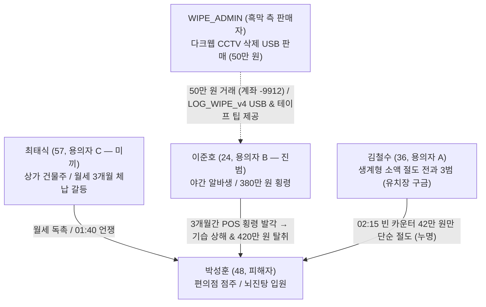

# 에피소드 1 (MVP) 완전 상세 설계서: 심야 편의점 금고 털이 사건

> **문서 목적**: EP 1(튜토리얼/MVP — 단순 강도 상해·절도 사건)의 사건 배경, 인물 관계도, 장소별 의미, 문서 원문, CCTV 6컷 연출, 자유 수사 액션 트리, 시간 밸런스, 정답 검증 로직을 논리적 빈틈 없이 정의합니다.

---

## 1. 사건 기본 설정 및 핵심 테마

* **사건 번호**: `CASE-2026-014` (심야 편의점 금고 털이 및 강도 상해 사건)
* **사건의 깊이 (정서적 테마)**: **"전과자에 대한 초동 수사팀의 편견을 데이터로 뒤집는 첫 수사"**
  * 초동 수사팀은 전과 3범 생계형 절도범 김철수(A)가 현장에 찍히자 *"전과자니까 당연히 네가 점주도 때렸겠지"*라고 단정 짓고 강도 상해(중범죄)로 송치하려 합니다.
  * 반면 실제 피해자(점주 박성훈)는 형편이 어려운 알바생 이준호(B)를 여러 번 봐주다 끝내 배신당한 인물입니다. 플레이어는 감정이 아닌 **CCTV·센서 로그·금융 내역**으로 누명을 벗기고 진짜 범인을 밝혀냅니다.
* **시간 규칙 (현실 형사 절차 고증 + 반복 플레이 없음)**:
  * **검찰 송치 마감 (16시간 = 960분)**: 초동 수사팀이 긴급 체포한 김철수(A)를 강도 상해범으로 검찰에 넘기기(송치) 직전까지 남은 시간입니다. 16시간 내에 반증을 제시하면 송치를 막고 전담팀 신뢰도가 상승(`+1`)합니다. 초과 시 송치 보류 사유서를 올려 **연장 수사**로 끝까지 해결할 수 있으나 신뢰도가 하락(`-1`)합니다.
  * **흑막 단서 휘발성 골든 타임 (12시간 = 720분)**: 이준호(B)에게 CCTV 삭제 USB(`LOG_WIPE_v4`)를 판매한 다크웹 판매자(`WIPE_ADMIN`)의 서버 계정이 12시간 뒤 자동 폭파됩니다. 12시간 내에 포렌식을 완료하면 **원본 접속 IP(`211.XX.104.88`)와 송금 계좌 끝자리(`-9912`)**를 온전히 확보합니다.

---

## 2. 등장인물 상세 프로필 및 인물 관계도

### 2.1. 인물 관계도

### 2.2. 인물별 상세 배경 및 `K-POL DB` 조회 정보
| 인물 | 역할 | 성격 및 사연 | `K-POL 시민·전과 DB` 조회 결과 (플레이어 확인 가능) |
| :--- | :--- | :--- | :--- |
| **박성훈 (48)** | 피해자 (점주) | 퇴직금으로 편의점을 차린 성실한 자영업자. 최근 장사가 안돼 월세가 3개월 밀림. 형편이 어려운 알바생 이준호(B)를 챙겨주었으나, 횡령액이 380만 원까지 불어나자 고심 끝에 경찰 신고를 결심. | 전과 없음. 신용대출 및 월세 연체 기록 일부 확인. |
| **김철수 (36)** | 용의자 A (누명) | 일용직을 전전하는 생계형 좀도둑. 폭력성은 전혀 없으며 사람이 없는 빈 가게만 노림. 경찰이 자신을 강도 상해범으로 몰아가자 억울해함. | **절도 전과 3범 (전부 야간 무인점포·빈집 소액 절도, 폭력/상해 전과 0건)**. *(중요 심리 단서)* |
| **이준호 (24)** | 용의자 B (진범) | 휴학생 겸 야간 알바생. 불법 스포츠 도박 빚에 빠져 3개월간 POS기 결제 취소 수법으로 380만 원을 빼돌림. 점주의 신고 예고에 궁지에 몰려 다크웹에서 `LOG_WIPE_v4` USB를 50만 원에 구매해 범행을 계획. | 전과 없음. 주소지: 편의점 인근 신림동 원룸. 최근 불법 도박 사이트 접속 경고 이력 없음(초범). |
| **최태식 (57)** | 용의자 C (미끼) | 상가 건물주. 성격이 다혈질이라 01:40에 술김에 찾아와 월세 문제로 크게 소리를 질렀으나, 실제로는 01:45 퇴장 후 곧바로 귀가해 잠듦. | 과거 단순 폭행 벌금형 1건(10년 전) — 플레이어가 의심하게 만드는 의도된 미끼. |

---

## 3. 사건의 진실 및 분 단위 전체 타임라인

* **사건 3개월 전 ~ 전날**: 이준호(B)가 야간 근무 중 현금 결제 건을 몰래 취소하는 방식으로 총 380만 원 횡령. 사건 전날 낮, 점주 박성훈이 정산 장부 대조 중 이를 적발하고 B에게 *"내일 아침 경찰에 정식 신고하겠다"*고 통보.
* **사건 전날 밤 21:00**: 이준호(B), 익명 암호화 메신저(다크챗) 판매자(`WIPE_ADMIN`)에게 **50만 원**을 송금(계좌 끝자리 `-9912`)하고 퀵서비스로 `LOG_WIPE_v4` USB 수령.
* **사건 당일 (2026.11.18 새벽)**:
  * `01:35 ~ 01:45`: 건물주 최태식(C)이 방문해 월세 문제로 점주와 언쟁 후 정문으로 퇴장.
  * `01:48`: 이준호(B)가 창고 정리 중 CCTV 사각지대인 **창고 뒷문 자석 센서에 투명 테이프**를 붙여 문이 열려도 경보/로그가 남지 않게 조작.
  * `01:50`: 이준호(B)가 정문으로 정상 퇴근(CCTV 촬영 + 출퇴근 단말기 태그 완료).
  * `01:52`: 골목을 돌아 창고 뒷문으로 재침입. 정산 중이던 점주가 인기척에 *"어, 준호야 뭐 놓고 갔어?"*라며 돌아보려는 순간 뒤통수를 소화기로 강타해 기절시킴.
  * `01:53 ~ 01:54`: 창고 비상금고에서 은행 띠지가 묶인 **현금 420만 원**을 탈취. 급히 챙기던 중 노란색 현금 띠지 1개와 점주의 피가 창고 문틈 아래로 소량 흘러나오고, B의 왼쪽 손목 실버 체인 팔찌가 끊어져 선반 아래로 떨어짐.
  * `01:55 ~ 02:05`: 카운터 아래 녹화기(NVR)에 `LOG_WIPE_v4` USB를 꽂아 10분 구간 영상을 삭제한 뒤 뒷문으로 도주.
  * `02:14 ~ 02:16`: 인근을 배회하던 김철수(A)가 불 켜진 빈 매장을 보고 침입, 카운터 현금 **42만 원**만 훔쳐 도주(창고에는 접근하지 않음).
  * `02:30`: 첫 손님이 창고 문틈 혈흔을 발견해 119/112 신고. 점주는 병원으로 이송(뇌진탕 입원).

---

## 4. 2D 지도 노드 5곳의 상세 의미 및 이동 시간 매트릭스

플레이어는 각 장소가 **사건에서 어떤 역할을 하며 무엇을 밝혀낼 수 있는지** 판단해 파트너(강민호 경사)의 동선을 설계합니다.

| 노드 ID | 장소명 | 사건 내 의미 및 역할 | 조사를 통해 밝혀낼 수 있는 것 |
| :--- | :--- | :--- | :--- |
| `NODE_STATION` | **경찰서 (시작 지점)** | 용의자 A(김철수)가 유치장에 구금된 장소. | 김철수 재심문(현장 접근 여부·냄새 등 보조 증언 확보). |
| `NODE_STORE` | **편의점 (사건 현장)** | 범행이 발생한 핵심 공간. 초동 감식은 끝났으나, 초동팀이 단순 강도로 치부해 놓친 사각지대 재조사가 필요. | **카운터 정밀 수색**: 잠긴 하단 서랍의 점주 횡령 메모 & 3개월 POS 취소 로그. **창고·뒷문 정밀 재감식**: 뒷문 자석 센서 틈새 투명 테이프 + 선반 아래 끊어진 팔찌 실물 수거. |
| `NODE_SECURITY` | **세이프가드 보안관제센터** | 편의점의 출입 센서 로그와 CCTV NVR 원격 백업을 관리하는 외부 기관. | 뒷문 개폐 기록 부재(테이프 조작 입증) + CCTV 삭제가 기기 오류가 아닌 `LOG_WIPE_v4` 수동 삭제임을 입증 + **[12h 휘발성] 원본 접속 IP 확보**. |
| `NODE_B_HOME` | **이준호(B) 신림동 원룸** | 야간 알바생의 거주지. 탈취한 금품과 USB 거래 흔적이 숨겨진 장소. | 침대 밑 가방에서 **동일 은행 띠지 현금 420만 원 전액** + 휴대폰 **익명 메신저(다크챗) 50만 원 송금 로그(전날 횡령 자금으로 구매, 계좌 `-9912`)** 확보. |
| `NODE_C_OFFICE` | **최태식(C) 부동산 사무실** | 다혈질 건물주의 사무실(의도된 소거용 미끼 장소). | 건물주 귀가 동선 및 자택 CCTV 확인 → **`[특이사항 없음]` 보고서 수신** → 증거판에서 C 관련 단서를 직접 기각/소거. |

### 노드 간 확정 이동 시간표 (단위: 분, 대칭)
| 출발 \ 도착 | 경찰서 | 편의점 | 보안관제센터 | B 원룸 | C 사무실 |
| :--- | :---: | :---: | :---: | :---: | :---: |
| **경찰서 (`STATION`)** | 0 | 25 | 20 | 35 | 30 |
| **편의점 (`STORE`)** | 25 | 0 | 15 | 15 | 20 |
| **보안관제센터 (`SECURITY`)** | 20 | 15 | 0 | 25 | 25 |
| **B 원룸 (`B_HOME`)** | 35 | 15 | 25 | 0 | 30 |
| **C 사무실 (`C_OFFICE`)** | 30 | 20 | 25 | 30 | 0 |

---

## 5. 초기 지급 자료 (초동 수사 확보분 — 게임 시작 시 OS 파일 탐색기에 기본 제공)

*(초동 수사팀이 현장에서 당연히 1차로 확보했을 보고서, 진술서, 기본 현장 사진, 당일 POS 영수증, CCTV는 모두 초기 자료로 지급됩니다. 플레이어는 이를 분석해 초동팀이 놓친 모순과 재수사 지점을 직접 찾아냅니다.)*

### ① `EV_DOC_INITIAL_REPORT` (초동 수사 보고서 및 의료 소견서)
> **[사건 개요]** 2026.11.18 02:30경 편의점 창고에서 점주 박성훈(48)이 후두부를 둔기(창고 소화기, 지문 닦임)에 맞아 쓰러진 채 발견됨. 창고 비상금고 현금 `420만 원` 및 카운터 현금 `42만 원` 도난.  
> **[피의자 특정]** `02:15` 매장 CCTV에 찍힌 절도 전과 3범 김철수(36)를 인근 PC방에서 긴급 체포(현금 42만 원 압수, 나머지 420만 원은 은닉 추정). `16시간` 뒤 강도 상해 혐의로 검찰 송치 예정.  
> **[특이사항]** 매장 CCTV 중 `01:55 ~ 02:05 구간이 기기 오류로 누락`됨. 출동 당시 창고 뒷문은 정상 잠금 상태였음.  
> **[의료 소견]** 피해자는 후두부 타격에 의한 뇌진탕 및 일시적 의식 혼미 상태로 `향후 48시간 진술 불가`. 구급차 이송 직전 **`"뒤에서 익숙한 목소리가 불러서 돌아보려는데..."`**라는 말만 남기고 의식을 잃음.

### ② 초동 현장 사진 2종 & 기본 출퇴근/매출 요약 (초동 감식반 촬영본)
* **`EV_PHOTO_INIT_STORAGE` (창고 발견 현장 전경 사진)**: 점주가 쓰러져 있던 바닥, 열린 비상금고, 쓰러진 소화기. *(※ `2.0x` 확대 시 선반 아래 어두운 구석에 **작은 은색 금속 조각**이 반짝이는 것이 어렴풋이 보임 → 창고 정밀 재감식 지시 유도!)*
* **`EV_PHOTO_INIT_COUNTER` (카운터 및 POS기 사진)**: 텅 빈 현금통, 바닥에 떨어진 지폐 몇 장, 열쇠로 잠겨 있는 카운터 하단 개인 서랍.
* **`EV_DOC_INIT_TIMECARD` (출퇴근 단말기 출력본)**: 이준호(B) `01:50:12` 정상 퇴근 태그 확인.

### ③ `EV_DOC_STATEMENT_A` (용의자 A 김철수 진술서)
> *"카운터에서 42만 원 훔친 건 맞습니다. 인정합니다. 근데 사장님을 때리지도 않았고 창고 문은 열어보지도 않았어요! 들어갔을 때 매장 안이 텅 비어 있었고, 계산대 쪽에서 살짝 피비린내 비슷한 게 나길래 겁나서 돈만 챙겨서 바로 뛰쳐나왔다고요. 420만 원? 본 적도 없습니다!"*

### ③ `EV_DOC_STATEMENT_B` (용의자 B 이준호 진술서)
> *"전 `01시 50분`에 정확히 퇴근 태그 찍고 정문으로 나왔습니다. CCTV에도 다 찍혔잖아요. 사장님이랑은 평소 사이도 좋았고, 창고 비상금고 비밀번호는 저도 몰라요. 퇴근하고 바로 원룸 가서 잤습니다."*

### ④ `EV_DOC_STATEMENT_C` (용의자 C 최태식 진술서)
> *"월세가 석 달이나 밀려서 `01시 35분`에 술 한잔하고 찾아가서 소리 좀 지른 건 맞아요. 근데 `01시 45분`에 나와서 바로 대리 불러서 집 가서 잤습니다. 내가 돈 몇 백 때문에 사람 머리를 치겠습니까?"*

---

## 6. CCTV 저프레임 스냅샷 6컷 상세 연출표 (나노바나나 제작 명세)

> **카메라 앵글**: 편의점 출입구 쪽 천장 모서리에서 카운터와 우측 안쪽 '창고 문'이 모두 보이도록 내려다보는 고정 광각 샷.

| 컷 번호 | 타임스탬프 | 화면 묘사 (이미지 편집 포인트) | 확대 캡처 대상 (`2.0x` 이상 필수) |
| :---: | :---: | :--- | :--- |
| **컷 1** | `01:40:12` | 카운터 앞에서 건물주(C)가 점주에게 손가락질하며 언쟁 중. 뒤편 창고 문 닫혀 있음. | 없음 (진술 C 일치 확인용) |
| **컷 2** | `01:45:03` | 건물주(C)가 화난 표정으로 정문을 열고 나감. 점주는 한숨 쉬며 창고 쪽으로 이동. | 없음 (진술 C 퇴장 확인) |
| **컷 3** | `01:50:18` | 알바생(B)이 가방을 메고 정문으로 걸어 나감. | **[줌인 포인트 1]** B의 왼쪽 손목에 **독특한 실버 체인 팔찌** 착용 + 우측 주머니에서 살짝 보이는 투명 테이프 (`EV_CAP_B_BRACELET`) |
| **컷 4** | `01:55 ~ 02:05` | **[SIGNAL LOST / NO DATA]** 검은 화면에 노이즈 및 오류 메시지 표시. | 누락 구간 확인 |
| **컷 5** | `02:14:30` | 텅 빈 매장. 정문 밖에 검은 후드(A)가 안을 기웃거리는 실루엣. | **[줌인 포인트 2]** 화면 우측 안쪽 **창고 문 아래 틈으로 혈흔과 노란색 은행 현금 띠지**가 이미 삐져나와 있음 (`EV_CAP_0214_BLOOD`) |
| **컷 6** | `02:16:05` | 검은 후드(A)가 카운터 금고에서 지폐만 챙기고 있음. 창고 쪽 접근 흔적 없음. | A가 창고에 가지 않았음을 확인 (`EV_CAP_A_THEFT`) |

---

## 7. 현장 지시 액션 트리 및 시간 밸런스 검증

모든 지시는 **초반부터 자유롭게 선택 가능(자유 수사)**하며, 보고서 전송 시간은 **15분 고정**입니다.

| 액션 ID | 위치 노드 | 지시 내용 | 작업 시간 | 획득 증거 및 주요 내용 |
| :--- | :--- | :--- | :---: | :--- |
| `ACT_REINTERROGATE_A` | 경찰서 | 김철수(A) 재심문 (창고 접근 여부 추궁) | 60분 | 진술 일관성 확인 + 폭력 전과 없음과 맞물려 누명 정황 강화 (선택/보조) |
| `ACT_INSPECT_COUNTER` | 편의점 | 잠긴 카운터 하단 서랍 개방 및 최근 3개월 POS 취소 로그 추출 | 90분 | **`EV_DOC_EMBEZZLE_MEMO`**: 잠긴 서랍 속 점주 자필 메모 (*"이준호 취소 영수증 3개월 합계 380만 원 확인. 더는 못 봐준다. 내일 오전 경찰 신고 예정"*) + 3개월 치 POS 취소 내역. |
| `ACT_INSPECT_STORAGE` | 편의점 | 창고 선반 아래 정밀 수색 및 뒷문 자석 센서 틈새 감식 | 90분 | **`EV_PHOTO_TAPE`**: 초동팀이 놓친 창고 뒷문 자석 센서 틈새의 투명 테이프 조각. **`EV_PHOTO_BRACELET`**: 선반 아래 깊숙이 굴러간 끊어진 실버 체인 팔찌 실물 수거. |
| `ACT_CHECK_SECURITY` | 보안관제센터 | 출입 센서 로그 및 CCTV NVR 삭제 로그 확보 | 60분 | **`EV_DOC_SENSOR_LOG`**: 01:50 이후 뒷문 개폐 기록 없음(테이프 조작 증명). **`EV_DOC_NVR_LOG`**: `01:55~02:05` 구간이 기기 오류가 아닌 외부 USB 툴 `LOG_WIPE_v4`로 수동 삭제됨 확인. **[12h 휘발성 보너스]**: 720분 이내 완료 시 **원본 접속 IP(`211.XX.104.88`)** 확보. |
| `ACT_CHECK_C_ALIBI` | C 사무실 | 건물주 C 귀가 동선 및 자택 CCTV 확인 *(소거용 미끼)* | 60분 | **`[특이사항 없음 보고서]`**: *"01:47 대리운전 탑승, 01:58 자택 엘리베이터 탑승 후 아침까지 외출 없음. 용의선상 배제해도 됩니다."* → 증거판에서 C 관련 단서 기각/소거. |
| `ACT_SEARCH_B_HOME` | B 원룸 | 이준호(B) 원룸 방문 조사 및 소지품 대조 | 90분 | **`EV_PHOTO_CASH_420`**: 침대 밑 가방에서 편의점 거래 은행 스탬프 띠지가 묶인 **현금 420만 원 전액** 발견. **`EV_DOC_DARKCHAT_LOG`**: 익명 암호화 메신저(다크챗, `WIPE_ADMIN`) 대화(전날 21:00 기존 횡령 자금으로 50만 원 송금): *"입금 50만 원 확인(계좌 끝자리 -9912). USB 꽂으면 최근 10분 날아감. 팁 하나 주면 뒷문 자석 센서는 투명 테이프로 눌러놔라. 내 계정은 12시간 뒤 자동 폭파된다."* **[12h 휘발성 보너스]**: 720분 이내 완료 시 계좌 끝자리 `-9912` 및 발신 메타데이터 온전 확보. |

### 수학적 시간 밸런스 검증 (휘발성 12시간 = 720분 / 송치 시한 16시간 = 960분)
* **최적 동선 (필수 4개 액션)**:
  1. `경찰서 → 편의점`(25) + 카운터 수색(90) + 보고(15) = **130분**
  2. `편의점 대기`(0) + 창고 정밀 감식(90) + 보고(15) = **105분** *(누적 235분)*
  3. `편의점 → 보안관제센터`(15) + 로그 확보(60) + 보고(15) = **90분** *(누적 325분 — 12h 내 원본 IP 확보)*
  4. `보안관제센터 → B 원룸`(25) + 원룸 조사(90) + 보고(15) = **130분** *(누적 455분 = **7시간 35분** — 12h 내 계좌 `-9912` 확보)*
* **비효율/미끼 포함 동선**: C 사무실 조사 및 A 재심문, 비효율적 왕복 포함 시 약 **780~900분 (13~15시간)** → 송치 시한(16시간) 내 진범 검거는 가능하되, 12시간 휘발성 골든 타임을 노리려면 동선 최적화가 요구됨.

---

## 8. 최종 보고서(기소 의견서) 정답 로직 및 플롯 홀 검증

| 보고서 항목 | 정답 값 / 숨겨진 증거 ID | 오답 시 파트너 피드백 |
| :--- | :--- | :--- |
| **1. 진범 지목** | **이준호 (용의자 B)** | (A 선택 시) *"김철수라면 02:14에 이미 번져 있던 혈흔과 띠지가 설명이 안 됩니다. CCTV 컷 5를 확대해 보시죠."* (C 선택 시) *"최태식은 01:45 퇴장 후 귀가 알리바이가 확실합니다."* |
| **2. 초동 가설(김철수 A) 반박** | **`EV_CAP_0214_BLOOD`** (02:14 창고 문틈 혈흔/띠지 캡처) | *"김철수가 창고 강도 상해범이 아니라는 시각적 증거가 필요합니다. 김철수가 들어오기 직전 CCTV를 확인해 보세요."* |
| **3. 알리바이 붕괴 (침입 트릭)** | **`EV_PHOTO_TAPE`** + **`EV_DOC_SENSOR_LOG`** | *"이준호는 01:50에 정문으로 퇴근했습니다. 경보도 안 울렸는데 어떻게 다시 들어왔는지 증명해야 합니다."* |
| **4. 진범 특정 물증 & 동기** | **`EV_PHOTO_BRACELET`** (또는 `EV_PHOTO_CASH_420`) + **`EV_DOC_EMBEZZLE_MEMO`** | *"침입 경로는 알겠는데, 창고에 들어간 사람이 이준호 본인이라는 물증과 범행 동기가 부족합니다."* |

### 사건 해결 연출: 시간대별 현장 체포 보고 메시지 (정산 화면 3단계 분기)
* **① 골든 타임 내 빠른 검거 (`≤ 12시간`)**:
  > `[현장 체포 보고]` `2026.11.18 {클리어 시각}경, 신림동 자택 원룸에서 탈취한 현금 420만 원을 숨긴 채 안심하고 잠을 자고 있던 피의자 이준호(24)를 강도상해 및 절도 혐의로 기습 체포함.`  
  > **강민호 경사**: *"경위님, 놈이 설마 이렇게 빨리 들킬 줄 몰랐는지 자다 깨서 멍하니 잡혔습니다. 판매자 계정도 폭파되기 전에 원본 로그까지 깔끔하게 건졌고요!"*
* **② 송치 마감 내 검거 (`12시간 초과 ~ 16시간 이내`)**:
  > `[현장 체포 보고]` `2026.11.18 {클리어 시각}경, 신림동 자택 원룸에서 현금 420만 원을 가방에 챙겨 타 지역으로 도주하려던 피의자 이준호(24)를 현관 앞에서 긴급 체포함.`  
  > **강민호 경사**: *"딱 짐 싸서 문 열고 나오려는 놈 덮쳤습니다. 가방에서 은행 띠지 묶인 420만 원 고스란히 나왔고, 김철수 씨 강도 상해 누명은 벗었습니다."*
* **③ 연장 수사 검거 (`16시간 초과`)**:
  > `[현장 체포 보고]` `2026.11.18 {클리어 시각}경, 이미 원룸을 빠져나와 고속버스터미널 대합실에서 지방행 버스에 탑승하려던 피의자 이준호(24)를 긴급 추적 끝에 검거함.`  
  > **강민호 경사**: *"하마터면 놓칠 뻔했습니다! 터미널에서 겨우 잡았네요. 송치 보류 건으로 위에서 좀 깨지겠지만, 그래도 억울한 사람 안 만든 게 다행입니다."*

### 플롯 홀 최종 점검표
* [x] **점주가 살아있는데 왜 바로 물어보지 않는가?** → 뇌진탕으로 48시간 진술 불가 + 뒤에서 기습당해 얼굴을 못 봄. 단 *"익숙한 목소리"* 한마디로 내부인 소행 암시.
* [x] **사라진 420만 원의 액수와 USB 구매 시점이 맞는가?** → USB 50만 원은 사건 전날 밤 기존 횡령 자금으로 송금했고, 당일 창고에서 훔친 **420만 원 전액**이 B 원룸에서 동일 은행 띠지 채로 발견됨.
* [x] **돈 없는 알바생이 어떻게 포렌식 삭제 툴을 구했는가?** → 거액 브로커 고용이 아니라, 다크웹에서 50만 원에 유통되는 `LOG_WIPE_v4` USB를 구매. (이 계좌 끝자리 `-9912`가 EP 2 대포통장과 직결됨)
