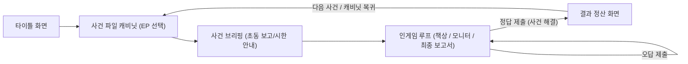

# 시스템·UX·플로우·사운드 상세 명세서 (03_SYSTEM_UX_SPEC)

> **문서 목적**: `01_MASTER_GDD.md`와 `02_EPISODE_01_SPEC.md`에서 정의한 핵심 기획을 실제 Unity 구현 시 모호함이 없도록 **단서 추출 UX, 튜토리얼/힌트, 신뢰도 수치표, 엔딩 분기, 화면 흐름, 저장 규칙, 사운드/연출**까지 상세화한 문서입니다.

---

## 1. 자유 단서 채택, 증거판(Evidence Board) 및 보고서 제출 UX 규칙

시스템이 정답 단서만 골라 알려주는 가이드형 방식을 배제하고, **플레이어가 직접 텍스트를 드래그하거나 영상을 확대 캡처해 증거판에 올리고, 선으로 연결·메모·기각(소거)하는 자유 수사 방식**을 채택합니다.

### 1.1. 2계층 단서 구조 및 숨겨진 판별 태그 (Hidden Tag)
1. **원본 자료 (Source Item)**: 책상 위의 종이 서류, 현장 폴라로이드 사진, 모니터 속 CCTV 시퀀스.
2. **사용자 단서 카드 (User Clue Card)**: 플레이어가 직접 드래그·캡처해 증거판에 추가한 카드.
   * **정답 비공개 원칙**: 플레이어가 무관한 문장이나 빈 벽을 채택하더라도 시스템은 오류를 띄우지 않고 동일하게 단서 카드를 생성해 줍니다.
   * **내부 판별 로직**: 생성된 단서 카드의 내부 데이터에는 조건 충족 시 숨겨진 `evidenceId`가 자동 매핑되고, 미충족 시 `NONE`으로 저장됩니다. 최종 보고서 제출 시 이 숨겨진 ID로 정답을 검증합니다.

### 1.2. 매체별 단서 채택 조작 및 정밀 판정 조건
* **종이 문서 / 디지털 로그 (텍스트 드래그 + 플로팅 툴바)**
  * 확대 보기(Inspect) 상태에서 실제 문서 뷰어처럼 **마우스로 원하는 텍스트 구간을 드래그 선택**하면 커서 옆에 플로팅 툴바(`[+ 증거판에 추가]`)가 팝업됩니다.
  * **통드래그 방지 & 태그 판정 (Unity TextMeshPro 인덱스 기반)**:
    * 한 번에 드래그 선택 가능한 최대 글자 수를 제한(예: **최대 100~120자**)하여 서류 전체를 통째로 복사하는 꼼수를 차단합니다.
    * 드래그된 문자 인덱스 구간(`[startIdx, endIdx]`)이 미리 정의된 핵심 단서 문장 구간과 **60% 이상 겹치면** 해당 `evidenceId`를 숨겨진 태그로 부여합니다.
* **CCTV 영상 클립 조작 & 영역 캡처 정밀 조건 (`Unity VideoPlayer`)**
  * **영상 조작 UX**: 타임라인 슬라이더 드래그(스크러빙), UI 버튼(`재생/일시정지`, `◀ 이전 프레임`, `▶ 다음 프레임`), 키보드 단축키(**`Space`**: 재생/일시정지, **`← / →`**: 0.2초/프레임 단위 미세 이동)를 모두 지원합니다.
  * 돋보기/줌인 상태에서 캡처 도구로 원하는 영역을 찍어 단서 카드로 등록할 수 있습니다.
  * **캡처 유효성 및 식별 조건 (2중 수학적 검증)**:
    1. **전체 화면 캡처 금지 (최대 범위 제한)**: 캡처 영역은 원본 이미지 전체 크기의 **가로·세로 각 40% 이하** (또는 **줌 배율 `2.0x` 이상**)로 확대된 상태여야만 캡처 가능합니다.
    2. **단서 온전 포함 + 최소 식별 크기**: 핵심 단서 Hitbox가 캡처 영역 안에 **85% 이상 포함**되어야 하며, 동시에 캡처된 이미지 내에서 해당 단서가 차지하는 면적/크기 비율이 **최소 15% 이상**이어야 인식됩니다.
    * **너무 작게 찍힌 경우의 피드백**: 조건 미달(너무 멀리서 작게 찍힘)인 캡처도 증거판에 올리는 것 자체는 허용하되, 해당 캡처를 파트너에게 분석/조사 첨부하거나 보고서에 제출할 때 **"너무 작아서(또는 범위가 넓어서) 정확히 뭘 보라는 건지 식별이 안 됩니다. 더 확대해서 찍어주세요"**라는 현실적인 피드백을 반환합니다.

* **경찰 통합 조회 DB & 특수 포렌식 툴 (능동적 단서 발굴 — EP 2~)**
  * **키워드 직접 검색 (`K-POL DB`)**: 단서를 자동으로 다 주지 않고, 플레이어가 서류·영상에서 발견한 **이름, 차량번호, 전화번호, 계좌번호**를 DB 검색창에 직접 입력해야 관련자(가족·법인·공범), 소유 차량, 전과 기록, 주소지가 출력됩니다. 조회된 결과 텍스트 역시 드래그해 증거판에 추가할 수 있으며, 새 주소지가 나오면 2D 지도에 신규 노드로 등록됩니다.
  * **포렌식 보정 툴**:
    * `명암/대비 슬라이더`: 어두운 야간 블랙박스/CCTV의 번호판이나 그림자를 보정해 글자를 해독한 뒤 캡처.
    * `오디오 파형 필터`: 저주파(빗소리/바람) 노이즈 컷 슬라이더를 조절해 숨겨진 기어음·충돌음·대화를 선명하게 분리하고 해당 시간 구간을 드래그해 오디오 단서 카드로 증거판에 등록.
    * `기밀 아카이브 권한`: 전담팀 신뢰도 또는 특정 영장 사유 충족 시 `기밀(CONFIDENTIAL)` 태그가 붙은 과거 사건 기록·내부 감사 로그 열람 가능.

### 1.3. 증거판 (Evidence Board) — 메모, 선 연결, 기각/소거
단순한 단서 목록(Tray) 대신, 독립된 **증거판(코르크 보드/화이트보드)** 화면을 제공합니다.
* **자유 배치 & 실(선) 연결**: 채택한 모든 단서 카드(텍스트 발췌, 사진/CCTV 캡처)를 보드 위에 자유롭게 배치하고, 카드 상단 핀을 드래그해 **다른 단서 카드와 선(빨간 실/실선)으로 연결**해 플레이어만의 추리 관계도를 구성할 수 있습니다.
* **사용자 메모(포스트잇)**: 모든 단서 카드 하단에 1~2줄짜리 자유 입력창(`TMP_InputField`)을 배치해, 예: `"02:14 이미 피가 있음 → A는 절도만 함"`처럼 플레이어가 직접 추리 메모를 적어둘 수 있게 구성하며, 보드 빈 공간에 독립 포스트잇을 붙일 수도 있습니다.
* **단서 기각(소거) 및 폐기함 복구**:
  * 현장직 조사 결과 `"특이사항 없음 / 알리바이 확인"` 보고를 받으면, 플레이어가 해당 단서 카드를 **`[기각(취소선 처리 후 접기)]`**하거나 **`[폐기함 이동]`**으로 직접 소거할 수 있습니다.
  * 실수로 핵심 단서를 버려 진행이 막히는 사고를 막기 위해, 영구 삭제 대신 **접힌 카드 재확장 및 폐기함에서 언제든 복구 가능**하게 설계합니다.

### 1.4. OS 바탕화면 창 정리 및 정보 과부하 방지 UX
* **다중 창 멀티태스킹 & Z-Order 포커스**: 서류 뷰어, CCTV 분석기, 메신저 등을 자유롭게 드래그해 **나란히 배치**할 수 있으며, 클릭한 창이 최상단으로 포커스됨.
* **창 최소화 및 좌우 분할 스냅**: 작업표시줄 아이콘 클릭으로 창 최소화/복원 지원. 창 상단 버튼으로 `[좌측 절반 배치]` / `[우측 절반 배치]` 원클릭 분할 제공(서류 ↔ CCTV 동시 비교 최적화).
* **사건 파일 탐색기 & 신규 자료 뱃지**: 좌측 폴더 트리(`[보고서/진술]`, `[현장 사진]`, `[보안/포렌식 로그]`)로 분류하며, 파트너가 새로 전송한 파일에는 `NEW` 뱃지 표시(1회 열람 시 제거).

---

## 2. 온보딩(튜토리얼) 및 막힘 방지(힌트) 시스템

### 2.1. EP 1 인게임 튜토리얼 흐름 (4단계)
별도의 긴 설명 팝업을 띄우지 않고, **파트너(강민호 경사)의 메신저 지시 + 대상 UI 외곽선 강조**로 자연스럽게 조작을 학습시킵니다.

1. **Step 1 (서류 텍스트 드래그 & 증거판 추가)**: 파트너 메시지 *"경위님, 초동 보고서부터 보시죠. 01시 55분 구간이 좀 찝찝합니다."* → 초동 수사 보고서 열기, 해당 문장 **마우스 드래그 → 플로팅 툴바 `[+ 증거판에 추가]`** 클릭 유도.
2. **Step 2 (CCTV 확대 캡처)**: *"모니터에서 매장 CCTV 열어보시겠습니까? 강도 놈이 들어오기 직전 화면을 창고 문 쪽으로 충분히 확대해서 찍어보시죠."* → 컷 5(`02:14`) 이동, `2.0x` 이상 줌인 후 캡처해 증거판에 등록 유도.
3. **Step 3 (지도 지시 & 시간 보내기)**: *"창고 쪽 다시 봐야겠네요. 지도에서 편의점 찍고 저한테 정밀 감식 지시 내려주세요."* → 2D 지도 열기, 예상 소요 시간 확인, `조사 완료까지 시간 보내기` 클릭 유도.
4. **Step 4 (증거판 정리 & 자유 수사 전환)**: 감식 결과 수신 후 *"수집한 단서들은 증거판에서 선으로 잇거나 메모해 두시고, 아닌 건 지워가며 정리하시면 됩니다. 송치 마감 16시간 남았습니다."* 메시지와 함께 자유 수사 시작.

### 2.2. 막힘 방지: 단계별 힌트 시스템 (`파트너에게 의견 묻기`)
추리 게임에서 특정 단서를 못 찾아 진행이 막히는(Soft-stuck) 상황을 방지하기 위해, 메신저 창에 **`[강민호 경사에게 의견 묻기]`** 버튼을 상시 제공합니다.

* **작동 원리**: 현재 플레이어가 아직 확보하지 못한 필수 단서(또는 미해결 보고서 슬롯) 중 가장 우선순위가 높은 1개를 자동 감지해 단계별 힌트 출력.
* **1단계 (방향 힌트 — 무료, 시간/페널티 없음)**:
  * 어느 매체나 장소를 봐야 하는지 방향만 제시.
  * *예시*: `"창고에서 끊어진 팔찌가 나왔는데... 퇴근하는 CCTV 영상에서 누가 차고 있던 것 같지 않습니까?"`
* **2단계 (구체적 지목 — 무료, 단 1단계 확인 후 30초 뒤 또는 재클릭 시 제공)**:
  * 정확한 컷 번호, 문서명, 또는 지시할 노드를 명시.
  * *예시*: `"매장 CCTV 01:50 컷에서 알바생 이준호의 왼쪽 손목을 확대해서 캡처해 보시죠."`
* *(설계 원칙)* 힌트 사용으로 시간을 차감하지 않아 플레이어의 심리적 부담을 없애되, 원한다면 결과 정산 화면의 '노힌트 클리어' 배지 여부로만 구분.

---

## 3. 전담팀 신뢰도 수치표 및 EP 5 엔딩 분기 조건

### 3.1. 전담팀 신뢰도 (Campaign Trust Level)
에피소드 1~5 전체를 관통하는 캠페인 누적 지표입니다.

* **범위**: `Lv 0 ~ Lv 5` (EP 1 시작 시 기본값: **`Lv 2`**)
* **변동 규칙** (에피소드 클리어 시 정산):
  * 마감 시한 내 해결 (연장 수사 미진입): **`+1`**
  * 마감 시한 초과 (연장 수사 진입 후 해결): **`-1`**
  * *(보너스)* 마감 시한 + 휘발성 골든 타임 모두 달성 시 추가 혜택은 '완전 흑막 단서'로 분리하여 신뢰도는 최대 ±1씩 안정적으로 변동.

| 신뢰도 단계 | 팀 상태 | 다음 에피소드 실질적 효과 | 연출 변화 |
| :---: | :--- | :--- | :--- |
| **Lv 0** | 해체 위기 | 외부 기관 작업 시간 **`+20분`** (협조 지연) | 국장 경고 메시지, 파트너 격려 |
| **Lv 1** | 주의 | 외부 기관 작업 시간 **`+10분`** | 상부 압박 메시지 |
| **Lv 2** | 보통 (시작) | 기본 작업 시간 적용 (변동 없음) | 기본 톤 |
| **Lv 3** | 신뢰 | 외부 기관 작업 시간 **`-15분`** (`우선 협조`) | 기관 담당자 우호적 반응 |
| **Lv 4** | 우수 | 외부 기관 **`-20분`** + 감식/포렌식 **`-15분`** (`긴급 영장 우선권`) | 신속 처리 보고 |
| **Lv 5** | 최고 권한 | 외부 기관 **`-25분`** + 감식 **`-20분`** + 보고 전송 **`-5분`** | 전폭 지원 연출 |

### 3.2. 휘발성 흑막 단서 & EP 7 최종 엔딩 분기 조건
EP 1~6 각 에피소드마다 1개씩 총 **6개의 핵심 흑막 단서**가 존재합니다. (골든 타임 내 확보 시 `완전 단서`, 초과 시 `손상 단서`)

| EP 1~6 확보한 `완전 흑막 단서` 수 | EP 7 최종장 진행 및 엔딩 분기 | 재도전 규칙 |
| :---: | :--- | :--- |
| **5 ~ 6개** | **진엔딩 (True Ending — 완벽 기소)**: EP 7에서 사건 설계자(서진우), 경찰 내부 내통자(박정태 총경), 자금 세탁망까지 모두 입증하여 완전 검거. | - |
| **2 ~ 4개** | **일반 엔딩 (Normal Ending — 부분 검거)**: 서진우 본인은 검거하지만, 증거 일부 손상으로 내부 내통자(박정태 총경)는 꼬리 자르기 성공. | 이전 에피소드 재플레이로 `완전 단서` 갱신 후 EP 7 재도전 가능 |
| **0 ~ 1개** | **미완 엔딩 (Bitter Ending — 도주 허용)**: 도주 경로 특정 실패로 대리인만 검거하고 서진우는 해외 도주. | 동일 (이전 에피소드 재플레이로 갱신 가능) |

---

## 4. 전체 화면 흐름(Screen Flow) 및 저장(Save/Load) 규칙

### 4.1. 전체 화면 전환 흐름

### 4.2. 결과 정산 화면 표시 항목
1. **현장 체포 보고 메시지 (경과 시간 구간별 3단계 동적 분기 연출)**:
   * 최종 보고서 정답 승인 직후, 인게임 현재 시각(`YYYY.MM.DD HH:MM`)과 **소요 시간 구간**에 따라 범인의 체포 장소·상황·파트너 멘트가 3단계로 달라져 출력된 뒤 `사건 종결` 도장이 찍힘.
     * `구간 1 (휘발성 골든 타임 내)`: 범인이 방심하고 자택/직장에 머물다 기습 체포 (디지털 흔적 온전 확보).
     * `구간 2 (골든 타임 초과 ~ 마감 시한 내)`: 범인이 짐을 싸서 도주를 시작하려는 찰나에 체포.
     * `구간 3 (마감 시한 초과 — 연장 수사)`: 범인이 이미 거처를 빠져나가 터미널·역·항구 등 도주 경로에서 긴급 추적 끝에 간신히 검거.
   * *포맷*: `[현장 체포 보고] YYYY.MM.DD HH:MM경, {체포 장소}에서 {시간대별 상황} 피의자 {이름(나이)}를 {죄명} 혐의로 긴급 체포함.`
2. **시간 성적**: 총 소요 시간 vs 송치 마감 시한 (달성 / 연장 수사 여부).
3. **휘발성 흑막 단서 상태**: `[완전 확보]` 또는 `[일부 손상]` 아이콘 및 단서명 표시.
4. **전담팀 신뢰도 변동**: `Lv 2 → Lv 3 (+1)` 및 다음 에피소드 해금 혜택 안내.
5. **버튼**: `[다음 에피소드 진행]` / `[사건 캐비닛으로 돌아가기]`.

### 4.3. 저장(Save/Load) 및 재플레이 규칙
* **자동 저장(Auto-Save) 3대 시점**:
  1. 새로운 `Clue Card` 추출 시
  2. 현장 지시 완료(`시간 보내기` 실행 직후) 시
  3. 에피소드 클리어 정산 완료 시
* **저장 포맷**: JSON 파일 (`Application.persistentDataPath/save_data.json`).
* **에피소드 재플레이(Replay)**: 클리어한 에피소드를 사건 파일 캐비닛에서 다시 플레이할 수 있으며, 더 좋은 기록(휘발성 `완전 단서` 확보 등)을 달성하면 최고 기록으로 갱신됩니다.

---

## 5. 사운드(BGM / SFX) 및 파트너 캐릭터 연출 명세

### 5.1. BGM 구성 (총 3트랙 — 소규모 제작 최적화)
1. **`BGM_DESK_AMBIENT`**: 차분하고 어두운 로우파이/느와르 앰비언트 + 미세한 사무실 형광등/빗소리. (평상시 분석 구간)
2. **`BGM_TENSION`**: 마감 시한 4시간 미만 남았을 때, 연장 수사 진입 시, 또는 최종 보고서 작성 화면에서 전환되는 낮은 베이스 중심 긴장감 트랙.
3. **`BGM_RESULT`**: 사건 해결 후 정산 화면용 차분한 해소 톤 트랙.

### 5.2. 필수 SFX 체크리스트 (12종)
| 카테고리 | 효과음(SFX) 항목 | 재생 시점 |
| :--- | :--- | :--- |
| **OS/문서** | `SFX_WINDOW_OPEN`, `SFX_MOUSE_CLICK`, `SFX_TEXT_DRAG_ADD` | 앱 창 열기/닫기, 버튼 클릭, 텍스트 드래그 단서 추가 시 |
| **모니터/CCTV** | `SFX_CCTV_STATIC`, `SFX_CCTV_TICK`, `SFX_ZOOM_IN`, `SFX_SHUTTER` | CCTV 켜기, 컷 이동, 돋보기 확대, 스냅샷 캡처 시 |
| **지도/시간** | `SFX_MAP_PIN`, `SFX_CLOCK_FASTFORWARD` | 지도 노드 선택, `시간 보내기` 스킵 연출 시 |
| **통신/보고서** | `SFX_MSG_NOTIFY`, `SFX_STAMP_APPROVED`, `SFX_PEN_SCRIBBLE_ERR` | 파트너 메시지 도착, 보고서 정답 승인, 오답 피드백 시 |

### 5.3. 파트너 형사(강민호 경사) 메신저 연출 규칙
* **캐릭터 톤**: 30대 후반 베테랑 현장 형사. 주인공(경위)을 신뢰하며 존댓말을 쓰지만, 현장의 피곤함과 직설적인 감각이 묻어나는 현실적인 구어체 사용.
* **상황별 필수 대사 슬롯**:
  * `지시 수락`: *"알겠습니다. 지금 바로 편의점으로 넘어갑니다. 차 좀 막히는데 25분쯤 걸리겠네요."*
  * `보고 완료`: *"도착해서 샅샅이 뒤졌습니다. 사진이랑 로그 파일 올려놨으니 책상 확인해 보시죠."*
  * `골든 타임(12시간) 경과 경고`: *"경위님, 시간이 꽤 지났습니다. 저쪽 서버 로그 덮어쓰기 되기 전에 서둘러야 할 것 같습니다."*
  * `송치 마감(16시간) 초과 (연장 수사 전환)`: *"마감 넘겨서 일단 송치 보류 사유서 올렸습니다. 위에서 좀 깨지겠지만... 여기서 멈출 순 없죠. 진범 잡을 때까지 계속 갑시다."*

---

## 6. Unity 구현 연계 체크리스트

* **해상도 및 UI 스케일**: `Canvas Scaler` → `Scale With Screen Size` (`1920 × 1080`, `Match = 0.5`).
* **텍스트 렌더링**: 모든 서류/로그/메신저/지도 라벨은 **TextMeshPro(TMP)** + 한글 폰트(예: `Pretendard`, `Noto Sans KR`, 타자기/보고서 느낌의 `MaruBuri` 또는 `NanumMyeongjo` 혼용) 사용.
* **데이터 분리**: `ClueCardData`, `MapNodeData`, `ActionData`, `EpisodeData`를 순수 C# 직렬화 클래스(JSON 로드)로 관리하여 EP 2~5 확장 시 코드 수정 0을 목표로 함.
