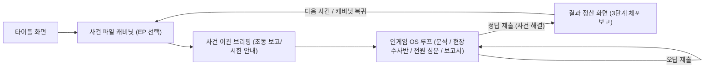

# 시스템·UX·플로우·사운드 상세 명세서 (03_SYSTEM_UX_SPEC)

> **문서 목적**: [01_MASTER_GDD.md](./01_MASTER_GDD.md), [02_EPISODE_01_SPEC.md](./02_EPISODE_01_SPEC.md), [13_EP01_LLM_INVESTIGATION_SPEC.md](./13_EP01_LLM_INVESTIGATION_SPEC.md)에서 정의한 핵심 기획을 Unity 구현 시 모호함이 없도록 **단서 추출 UX, 3버튼 플로팅 툴바, 현장수사반 LLM 지휘 UX, 사건 관련자 전원 심문 UX, 튜토리얼/힌트, 신뢰도 수치표, 엔딩 분기, 화면 흐름, 저장 규칙, 사운드/연출**까지 상세화한 문서입니다.

---

## 1. 자유 단서 채택, 현장수사반 지휘, 전원 심문 및 증거판 UX 규칙

시스템이 정답 단서만 골라 알려주는 가이드형 방식을 배제하고, **플레이어가 직접 문서·사진·CCTV·심문 녹취에서 단서를 채택해 증거판에 정리하고, 그 카드를 현장수사반 영장 근거와 용의자 심문 반박 무기로 직접 사용하는 능동 수사 방식**을 채택합니다.

### 1.1. 2계층 단서 구조 및 숨겨진 판별 태그 (Hidden Tag)
1. **원본 자료 (Source Item)**: 스캔 보고서·진술서·외부 로그, 현장 사진, CCTV 영상, `K-POL DB` 조회 결과, 조사실 심문 진술.
2. **사용자 단서 카드 (User Clue Card)**: 플레이어가 직접 드래그·캡처·발췌해 증거판에 올린 카드 (`TextExcerpt`, `CctvCapture`, `PhotoCapture`, `AudioClip`, `DbRecord`, `InterrogationStatement`).
   * **정답 비공개 원칙**: 무관한 문장이나 빈 벽을 채택해도 오류를 띄우지 않고 동일하게 단서 카드를 생성.
   * **내부 판별 로직**: 조건 충족 시 숨겨진 `hiddenEvidenceId`를 자동 매핑하고, 미충족 시 `NONE`으로 저장. 현장반 영장 검증, 심문 레이어 해금, 최종 보고서 제출 시 이 숨겨진 ID로 결정론적 검증 수행.

### 1.2. 매체별 단서 채택 조작 및 3버튼 플로팅 툴바
* **종이 문서 / 디지털 로그 (텍스트 드래그 + 3버튼 플로팅 툴바)**
  * 문서 본문에 미리 링크나 밑줄을 칠하지 않음(정답 스포일러 방지).
  * 플레이어가 원하는 텍스트 구간을 마우스 드래그 선택하면(통드래그 방지: **최대 120자 제한**) 커서 옆에 **`FloatingClueToolbar`** 3버튼이 팝업됨:
    1. **`[+ 증거판 등록]`**: 선택 구간이 핵심 태그(`HiddenTextTag`)와 **60% 이상** 겹치면 해당 `evidenceId`를 숨겨진 태그로 부여해 카드 생성.
    2. **`[K-POL DB 조회]`**: 드래그한 이름·장소·차량번호·계좌번호를 `PoliceDB` 검색창에 즉시 입력해 조회 실행.
    3. **`[현장반에 확인 지시]`**: 드래그한 문구·장소·인물명을 `[현장수사반]` 입력창에 자동 인용해 수색·알리바이 조회 지시로 바로 연결.
* **CCTV 영상 클립 & 정지 사진 정밀 캡처 (`Unity VideoPlayer` / `PhotoInspector`)**
  * **영상 조작 UX**: 타임라인 슬라이더, 재생/일시정지, `◀/▶` 미세 이동, 키보드 단축키(`Space`, `←/→`), 명암/대비 보정 슬라이더.
  * **2중 수학적 검증 (`CaptureRectValidator`)**:
    1. **전체 캡처 금지**: 줌 배율 **`2.0x` 이상** (원본 가로·세로 각 40% 이하)에서만 캡처 활성화.
    2. **단서 포함 + 최소 식별 크기**: 핵심 Hitbox가 캡처 영역에 **85% 이상 포함**되고, 캡처 이미지 내 면적 비율이 **15% 이상**이어야 정상 인식.
    * 포함은 되었으나 너무 작게 찍힌 경우 `isTooSmallCapture = true`로 저장되어 보고서 제출·심문 제시 시 *"너무 작아서 식별할 수 없습니다. 더 확대해 캡처해 주세요"* 피드백 반환.
* **경찰 통합 조회 DB (`K-POL DB`) 및 특수 포렌식 툴**
  * **법적 절차 분리**: 기본 `K-POL DB`는 신원·전과·주소지·근무지·차량 등 합법 즉시 조회 정보만 출력. 금융 계좌 추적·통신사실확인자료 등 영장이 필요한 민감 정보는 DB에 노출하지 않고 **현장수사반 영장 액션**으로 분리.
  * **후반 에피소드 포렌식 툴**: `오디오 파형 노이즈 필터`(EP 2·5·7), `메타데이터 뷰어`(EP 3·4·6).

### 1.3. 현장수사반 지휘 앱 (`FieldCommand` — LLM Tool Calling UX)
* **상대**: 휘하 현장수사반 (대표 보고 창구: **현장반장 강민호 경사**).
* **지시 흐름 (오인식·억울한 시간 소모 차단 2단계 확정)**:
  1. 플레이어가 자연어로 지시 입력 (예: *"뒷문 센서랑 수거 물품 다시 정밀 감식해봐"*, *"이준호 원룸 출입 기록 확인해"*), 필요 시 증거판 카드 첨부(예: 금융 영장 청구 근거).
  2. 백지 공포 방지를 위해 입력창 상단에 **동적 추천 칩(최대 3개)** 상시 표시(완료 액션 자동 제거).
  3. LLM이 허용된 미완료 `actionId`로 매핑해 강민호 경사 응답 출력 + 하단에 **`[지시 확정: 예상 소요 OO분]`** 확인 카드 표시(취소 가능).
  4. 확정 클릭 시 `TimeManager.AdvanceMinutes()` 실행 → 시계 경과 연출(1~2초) 후 신규 문서·사진·로그 해금(`NEW` 뱃지 + 토스트 알림) 및 현장 보고 수신.
* **0분 사전 필터링 및 가설 검증**:
  * 이미 완료한 지시, 근거 부족 영장 지시, 사건 무관 노이즈(지구대 민원 코인노래방 등) 지시는 강민호 경사가 **`0분`**으로 이유를 안내하며 거절/필터링.
  * *"지금까지 단서 정리해줘"*, *"김철수가 범인 아닐까?"* 같은 가설 검증 요청은 `0분`으로 현재 해금된 자료 범위 안에서만 논리적 빈틈을 피드백(미해금 사실·진범 스포일러 절대 금지).

### 1.4. 조사실 심문 앱 (`Interrogation` — 전원 심문 & Prompt Isolation UX)
* **전원 동일 노출 (메타 스포일러 0%)**: 사건 관련자 전원(EP 1 기준 **7인: 김철수·이준호·최태식·한소라·오민석·정대호·윤서진**)이 동일한 목록에 표시되며, 소환 비용도 **전원 동일 `45분 / 최대 8턴`**으로 통일. (의식불명 `박성훈` 등 불가 대상은 잠금 아이콘과 사유만 표기)
* **화면 구성**:
  * `[좌측]` 사건 관련자 목록(소환 횟수·붕괴된 거짓말 배지 표시) + `[소환 심문 시작 (-45분 / 8턴)]` 버튼.
  * `[상단]` 용의자 리소그래프 초상화(`emotion` 6종 연동 표정 변화) + **평정심 게이지(`0~100`)** + 남은 질문 턴(`8/8`).
  * `[중앙]` 대화 로그 + 새 진술/레이어 해금 말풍선 옆 **`[+ 심문 진술 증거판 등록]`** 버튼.
  * `[하단]` 자유 질문 입력창 + **증거판 카드 첨부 슬롯(최대 2장)**.
* **증거 제시 및 탈옥 방지 UX**:
  * 증거 없이 말로만 추궁할 때는 평정심이 소폭(`-10 ~ 0`)만 흔들리며 잠긴 비밀 레이어는 절대 열리지 않음(프롬프트 격리).
  * 모순을 찌르는 증거 카드를 첨부해 질문하면 즉시 레이어가 해금되며 **거짓말 붕괴 연출(`SFX_LIE_CRACK` + 평정심 급감 + 표정 전환)**과 함께 2차 변명·핵심 증언·자백으로 진행.
  * 엉뚱한 증거 카드를 첨부하면 평정심이 `+10` 회복되며 용의자가 여유 있게 반박.
* **응답 지연(Latency) UX**: LLM API 응답 대기 1~3초 동안 `"강민호 경사 무전 수신 중..."` 또는 `"{이름}이(가) 시선을 피하며 침묵하고 있습니다..."` 상태 인디케이터를 출력해 몰입감 유지.

### 1.5. 디지털 증거판 (`EvidenceBoard`) — 추리 정리 및 무기 보관함
* 채택한 모든 카드(텍스트 발췌, 사진/CCTV 캡처, DB 조회, 심문 진술)를 자유 배치, 핀-실 연결, 카드 하단 메모(`TMP_InputField`)·독립 포스트잇 작성, `[기각(취소선 후 접기)]`, `[폐기함 이동 및 복구]` 지원.
* 보드에 정리해 둔 카드는 **① 현장수사반 영장 청구 근거**, **② 심문 창 증거 제시 무기**, **③ 최종 송치 보고서 4슬롯 제출 답안**으로 직결됨.

### 1.6. OS 바탕화면 창 관리
* **6개 핵심 앱(`OSWindow`)**: `파일 탐색기`, `디지털 증거판`, `경찰 DB`, `현장수사반`, `용의자 심문`, `최종 보고서` (+ 독립 뷰어 창: `문서 뷰어`, `사진 분석기`, `CCTV 분석기`).
* 다중 창 드래그·Z-Order 포커스·최소화·`[좌/우 절반 스냅]` 지원. 신규 수신 파일에는 `NEW` 뱃지 표시(1회 열람 시 제거).

---

## 2. 온보딩(튜토리얼) 및 막힘 방지(힌트) 시스템

### 2.1. EP 1 인게임 튜토리얼 흐름 (4단계)
긴 설명 팝업 대신 **현장반장 강민호 경사의 브리핑 메시지 + 대상 UI 강조**로 핵심 루프를 자연스럽게 학습시킵니다.

1. **Step 1 (문서 드래그 & 3버튼 툴바)**: 강민호 메시지 *"팀장님, 일선서에서 이관된 초동 보고서부터 확인하시죠. 01시 55분 구간 누락이 찝찝합니다."* → 문서 열기 → 텍스트 드래그 → `[+ 증거판 등록]` (및 `[K-POL DB 조회]`/`[현장반 지시]` 안내).
2. **Step 2 (CCTV 확대 캡처)**: *"매장 정면 CCTV `02:14` 구간에서 김철수 진입 직전 창고 문 아래쪽을 `2.0x` 이상 확대해 찍어보시죠."* → 줌인 캡처 후 증거판 등록.
3. **Step 3 (현장수사반 자연어 지시 & 시간 경과)**: *"창고 뒷문이 잠겨 있었다는데 이상합니다. 현장수사반 창에서 저한테 뒷문 재감식이나 NVR 복구를 지시해 주십시오."* → 자연어 입력(또는 추천 칩) → `[지시 확정]` 클릭 및 시간 경과 확인.
4. **Step 4 (관련자 심문 & 자유 수사 전환)**: *"확보한 단서 카드를 들고 `[용의자 심문]` 창에서 관련자들을 소환해 보십시오. 송치 보완수사 시한 16시간, 휘발성 골든 타임 12시간입니다."* 메시지와 함께 자유 수사 시작.

### 2.2. 막힘 방지: 단계별 힌트 (`현장반장에게 의견 묻기`)
* `[현장수사반]` 창 상단에 **`[강민호 경사에게 의견 묻기]`** 버튼 제공 (**0분, 페널티 없음**).
* 현재 미확보 필수 단서 또는 미해결 보고서 슬롯 중 최우선 1개를 감지해 2단계 힌트 출력:
  * **1단계 (방향 힌트)**: 어느 인물·장소·매체를 교차 확인해야 하는지 방향만 제시.
  * **2단계 (구체 지목 — 30초 후 재클릭 시)**: 정확한 액션 대상, 심문 대상, 또는 첨부할 증거 유형을 구체적으로 안내.

---

## 3. 전담팀 신뢰도 수치표 및 EP 7 엔딩 분기 조건

### 3.1. 전담팀 신뢰도 (`Campaign Trust Level`)
에피소드 1~7 전체를 관통하는 누적 지표 (`Lv 0 ~ Lv 5`, EP 1 시작 기본값 **`Lv 2`**).
* 마감 시한 내 해결(연장 수사 미진입): **`+1`** / 마감 시한 초과(연장 수사 후 해결): **`-1`**

| 신뢰도 단계 | 팀 상태 | 다음 에피소드 실질적 효과 (`TimeManager.cs` 연동) | 연출 변화 |
| :---: | :--- | :--- | :--- |
| **Lv 0** | 해체 위기 | 외부 기관 작업 시간 **`+20분`** (협조 지연) | 국장 경고 메시지, 강민호 격려 |
| **Lv 1** | 주의 | 외부 기관 작업 시간 **`+10분`** | 상부 압박 메시지 |
| **Lv 2** | 보통 (시작) | 기본 작업 시간 적용 (변동 없음) | 기본 톤 |
| **Lv 3** | 신뢰 | 외부 기관 작업 시간 **`-15분`** (`우선 협조`) | 기관 담당자 우호적 반응 |
| **Lv 4** | 우수 | 외부 기관 **`-20분`** + 감식/포렌식 **`-15분`** | 신속 처리 보고 |
| **Lv 5** | 최고 권한 | 외부 기관 **`-25분`** + 감식 **`-20분`** + 보고 **`-5분`** | 전폭 지원 연출 |

### 3.2. 휘발성 흑막 단서 & EP 7 최종 엔딩 분기 조건
EP 1~6 각 에피소드마다 1개씩 총 **6개의 핵심 흑막 단서** 존재 (휘발성 골든 타임 내 확보 시 `완전 단서`, 초과 시 `손상 단서`).

| EP 1~6 `완전 흑막 단서` 수 | EP 7 최종장 엔딩 분기 | 재도전 규칙 |
| :---: | :--- | :--- |
| **5 ~ 6개** | **진엔딩 (True Ending — 완벽 기소)**: 서진우, 박정태 총경, 자금 세탁망 완전 검거. | — |
| **2 ~ 4개** | **일반 엔딩 (Normal Ending — 부분 검거)**: 서진우는 검거하나 박정태 총경 꼬리 자르기 성공. | 이전 에피소드 재플레이로 갱신 후 재도전 가능 |
| **0 ~ 1개** | **미완 엔딩 (Bitter Ending — 도주 허용)**: 대리인만 검거, 서진우 해외 도주. | 동일 |

---

## 4. 전체 화면 흐름(Screen Flow) 및 저장(Save/Load) 규칙

### 4.1. 전체 화면 전환 흐름

### 4.2. 결과 정산 화면 표시 항목
1. **현장 체포 보고 메시지 (소요 시간 구간별 3단계 동적 분기)**:
   * `구간 1 (휘발성 골든 타임 12h 이내)`: 범인이 방심하고 거처에 머물다 기습 체포(디지털 흔적·피해금 온전 확보).
   * `구간 2 (12h 초과 ~ 16h 마감 시한 내)`: 도주 준비 중 체포.
   * `구간 3 (16h 마감 초과 — 연장 수사)`: 터미널·역 등 도주 경로에서 긴급 추적 끝에 간신히 검거.
2. **시간 성적**, **휘발성 흑막 단서 확보 상태**, **전담팀 신뢰도 변동**, **다음 사건/캐비닛 버튼**.

### 4.3. 저장(Save/Load) 규칙
* **자동 저장(Auto-Save) 4대 시점**:
  1. 새로운 `UserClueCard` 추출 시
  2. 현장수사반 지시 액션 완료 시
  3. **용의자 심문 레이어 해금 또는 심문 세션 종료 시**
  4. 에피소드 클리어 정산 완료 시
* **저장 포맷**: JSON 파일 (`Application.persistentDataPath/save_data.json`).

---

## 5. 사운드(BGM / SFX) 및 현장반장 연출 명세

### 5.1. BGM 구성 (총 4트랙)
1. **`BGM_DESK_AMBIENT`**: 차분하고 어두운 느와르 앰비언트 + 미세한 형광등/빗소리 (평상시 OS 분석).
2. **`BGM_INTERROGATION`**: 조사실 심문 창 활성화 시 페이드인되는 저음 펄스 중심의 심리전 트랙.
3. **`BGM_TENSION`**: 마감 시한 4시간 미만, 연장 수사 진입, 또는 최종 보고서 작성 시 긴장감 트랙.
4. **`BGM_RESULT`**: 사건 해결 후 정산 화면용 해소 톤 트랙.

### 5.2. 필수 SFX 체크리스트 (15종)
| 카테고리 | 효과음(SFX) 항목 | 재생 시점 |
| :--- | :--- | :--- |
| **OS/문서** | `SFX_WINDOW_OPEN`, `SFX_MOUSE_CLICK`, `SFX_TEXT_DRAG_ADD`, `SFX_CLUE_PIN` | 창 열기/닫기, 클릭, 드래그 단서 추가, 증거판 핀 연결 시 |
| **포렌식** | `SFX_CCTV_STATIC`, `SFX_CCTV_TICK`, `SFX_ZOOM_IN`, `SFX_SHUTTER` | CCTV 켜기, 프레임 이동, 돋보기 확대, 캡처 시 |
| **현장반/시간** | `SFX_RADIO_TX`, `SFX_CLOCK_FASTFORWARD`, `SFX_MSG_NOTIFY` | 현장반 지시 전송, 시간 경과 연출, 보고 수신 시 |
| **심문/보고서** | `SFX_COMPOSURE_DROP`, `SFX_LIE_CRACK`, `SFX_STAMP_APPROVED`, `SFX_PEN_SCRIBBLE_ERR` | 평정심 하락, 거짓말 레이어 붕괴, 보고서 승인, 오답 시 |

### 5.3. 현장반장(강민호 경사) 대사 톤 규칙
* **캐릭터 톤**: 39세 베테랑 현장 형사. 전담팀장(플레이어)에게 **`"팀장님"`** 호칭과 격식을 갖추되, 현장의 피로감과 직설적 감각이 살아있는 현실 구어체 사용.
* **필수 대사 슬롯**:
  * `지시 확정`: *"알겠습니다, 팀장님. 현장반 바로 움직여서 확인해 올리겠습니다."*
  * `영장 근거 부족 거절`: *"팀장님, 참고인 금융 계좌 추적은 영장 사유가 필요합니다. 횡령이나 금전 갈등을 입증할 POS 감사 로그나 점주 메모부터 확보해 첨부해 주십시오."*
  * `노이즈 사전 필터링`: *"팀장님, 그 민원 건은 지구대 종결 사항이라 사건 시각·동선과 무관합니다. 인력 낭비이니 본 사건 핵심부터 짚으시죠."*
  * `골든 타임 경과 경고`: *"팀장님, 휘발성 골든 타임이 지났습니다. 디지털 로그 일부가 덮어쓰기됐을 가능성이 높습니다."*
  * `연장 수사 전환`: *"마감을 넘겨 송치 보류·연장 수사 사유서를 올렸습니다. 위에서 좀 깨지겠지만, 진범 잡을 때까지 끝까지 갑시다."*

---

## 6. Unity 구현 연계 체크리스트

* **해상도 및 UI 스케일**: `Canvas Scaler` → `Scale With Screen Size` (`1920 × 1080`, `Match = 0.5`).
* **텍스트 렌더링**: 모든 서류·로그·현장반·심문 대화는 **TextMeshPro(TMP)** + 한글 폰트 사용.
* **LLM 추상화 & 보안**: `ILlmProvider` 인터페이스로 프로바이더 교체 가능하게 분리하고, API 키 미설정 환경에서도 전체 루프를 검증할 수 있는 `MockLlmProvider` 기본 탑재. 상용 빌드에서는 클라이언트에 API 키 미포함(프록시 서버 또는 BYOK).
