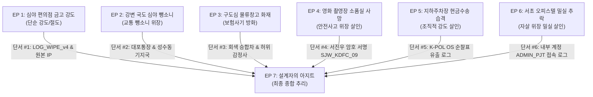

# 메인 스토리 및 전체 7개 에피소드 마스터 플랜 (04_MAIN_STORY_AND_EPISODES)

> **문서 목적**: 단순 절도/강도에서 시작해 뺑소니, 방화, 촬영장 살인, 현금수송 강도살인, 밀실 살인을 거쳐 최종전으로 수렴하는 **7개 에피소드의 계단식 구성**과, 개별 사건 속에 자연스럽게 숨겨진 **단서 연결망(Cross-Episode Clues)**을 빈틈없이 정의합니다.

---

## 1. 서사 설계 원칙

1. **사건의 독립성 + 단서의 연결성**: EP 1~6은 각기 다른 범인과 동기를 가진 **독립된 범죄 사건**입니다. 억지로 모든 피해자를 한 사건에 엮지 않고, 현장의 디지털 로그·계좌·차량·서명 등 **일부 부수 단서들만 공통 배후(지하 증거 세탁 네트워크)로 자연스럽게 이어지도록** 설계합니다.
2. **범죄 수위 및 추리 난이도의 계단식 상승**:
   * 초반(EP 1~2): 단순 강도/절도, 뺑소니 (시스템 학습 및 단일 매체 교차 검증)
   * 중반(EP 3~4): 보험사기 방화, 촬영장 위장 살인 (복합 매체 + 시간/NG 컷 분석)
   * 후반(EP 5~6): 조직적 강도살인, 밀실 살인 (다중 CCTV + IoT/내부망 로그 분석)
   * 최종(EP 7): EP 1~6 전체 아카이브 종합 추리

---

## 2. 주요 캐릭터 시트

* **주인공 — 한도현 경감 (34세, 서울청 보완·재수사 전담팀장)**: 과거 강력계 현장 부상 이후 내근 분석·지휘 보직으로 전향해 `K-POL OS`로 일선서 초동 사건을 이관받아 전면 재검토하고 현장수사반 지휘 및 용의자 심문을 총괄. 5년 전 파면된 전직 사수 서진우의 코딩/포렌식 습관을 누구보다 잘 알고 있음.
* **현장수사반 반장 — 강민호 경사 (39세, 휘하 현장수사반 대표 보고 창구)**: 전담팀 현장수사반을 이끄는 베테랑 형사. 팀장의 자연어 지시에 따라 현장 감식·주변 탐문·외부 로그 조회·영장 집행을 수행하고 결과 파일을 `K-POL OS`로 전송.
* **최종 흑막 — 서진우 (45세, 코드네임 '설계자')**: 전직 경찰청 디지털포렌식센터 수석이자 `K-POL OS` 원개발자. 5년 전 **`2021년 남부항만 비자금 수사 증거 조작 사건`** 당시 상부의 조작 압력을 거부하다 누명을 쓰고 파면된 뒤, **소액 범죄자에게는 자체 개발한 삭제 툴(`LOG_WIPE`)을 다크웹에 유통해 자금을 모으고, 거액 의뢰인에게는 맞춤형 알리바이·사고 위장 트릭을 컨설팅**하는 지하 증거 세탁 네트워크를 구축.
* **경찰 내부 내통자 — 박정태 총경 (52세)**: 현직 서울청 수사국 간부. 5년 전 서진우 파면에 가담했으나 현재는 약점과 이권으로 얽혀, 경찰 순찰 일정과 신변보호 해제 정보 등을 서진우 측에 유출.

---

## 3. 전체 7개 에피소드 로드맵 및 단서 연결망

---

## 4. 에피소드별 상세 기획 (EP 1 ~ EP 7)

### EP 1 (튜토리얼 — 강도 상해/절도): `CASE-2026-014: 심야 편의점 금고 털이 사건`
* **범죄 유형**: 강도 상해·절도 (인명 사망 없음, 점주 박성훈은 창고에서 소화기에 맞아 급성 뇌진탕·48시간 진술 불가 — 입문 난이도)
* **시한 규칙**: 영장 청구·송치 보완수사 마감 **16시간** / 휘발성 골든 타임 **12시간** (김철수 긴급체포 48시간 시한 승계)
* **핵심 매체**: 매장 정면 CCTV + 건물 평면도(블루프린트)·이동 시간표 + 현장수사반 지시(감식·로그·영장) + 사건 관련자 7인 전원 심문(`김철수·이준호·최태식·한소라·오민석·정대호·윤서진`)
* **초동 가설**: `02:15` 침입한 외부 절도범(김철수)이 점주를 기절시키고 금고 420만 원을 턴 강도 사건.
* **진실 및 트릭**: 야간 알바생(이준호)이 도박 빚에 몰려 3개월간 POS 현금 취소로 380만 원을 횡령하다 점주에게 적발(18일 09시 신고 예고)되자, 창고 뒷문 자석 센서에 자석과 투명 테이프를 고정해 경보를 무력화하고 정문 퇴근 후 뒷골목으로 재침입. `"사장님"` 부른 뒤 3.3kg 빨간 분말 소화기로 점주를 기절시키고 420만 원을 탈취한 뒤, **성수동 익명 발송인(`W.A.`)에게 50만 원에 구매한 CCTV 삭제 USB(`LOG_WIPE_v4`)**로 10분 구간을 지우고 도주.
* **EP 7 연결 단서 (#1 — 12h 내 확보)**: `LOG_WIPE_v4` NVR 포렌식 원본 접속 IP (`211.XX.104.88`) 및 금융 영장으로 확보한 구매 송금 계좌 끝자리(`-9912`)·성수동 공단 발송지(`W.A.`).

---

### EP 2 (초중급 — 뺑소니 위장): `CASE-02: 강변 국도 심야 뺑소니 사건`
* **범죄 유형**: 특가법상 도주치사(뺑소니)로 위장된 고의 충돌 사건
* **시한 규칙**: 영장 청구 시한 **18시간** / 휘발성 골든 타임 **13시간**
* **핵심 매체**: 차량 블랙박스 스냅샷 + **사고 직전 오디오 파형(녹취)** + 차량 GPS 로그
* **초동 가설**: 만취 화물차 기사(A)가 심야 국도에서 보행자를 치고 도주한 단순 뺑소니.
* **진실 및 트릭**: 특허 분쟁 중인 공동대표(B)가 처남 차(`34너 8821`)와 라운지 부재로 강력한 미끼로 작용하나, 호텔 604호 카드키 로그로 B의 알리바이가 입증되고 공업사 대차 장부를 통해 원천 기술을 빼앗길 위기였던 **수석 엔지니어 강태민(D)**의 고의 살인이 드러남. 블랙박스 명암 보정(`34너 8821`) + 오디오 파형(후진 기어음) + GPS 35분 강제 재부팅 공백 입증.
* **EP 7 연결 단서 (#2 — 13h 내 확보)**: 강태민(D)이 GPS 조작 툴 대금을 송금한 **대포통장 전문(`302-XXXX-9912` — EP 1 계좌와 일치!)** 및 접선 선불폰의 **성수동 구 공단 기지국 위치**.

---

### EP 3 (중급 — 방화/보험사기): `CASE-03: 구도심 물류창고 심야 화재 사건`
* **범죄 유형**: 현주건조물 방화 및 보험사기 (야간 경비원 1명 연기 흡입 중상)
* **시한 규칙**: 보험금 지급·종결 마감 **18시간** / 휘발성 골든 타임 **13시간**
* **핵심 매체**: 골목 방범 CCTV + 소방 감식 보고서 + 전기 안전 점검 로그 + 화물 입출고 장부
* **초동 가설**: 노후 배전반 누전으로 발생한 단순 실화.
* **진실 및 트릭**: 부도 위기인 창고 대표(A)가 보험금 24억 수익자로 강력한 미끼이나, 약관상 위탁 화물 면책으로 오히려 파산하는 입장. 진범은 6개월간 위탁 부품 15억을 빼돌리고 폐지·벽돌로 바꿔치기한 화주사 물류팀장 **조현우(B)**와 허위 누전 감정서를 화재 3시간 전에 미리 작성한 공범 감정사 **나기철(C)**. 발화 11분 뒤 차단된 전력 로그(`02:19`) + PDF 메타데이터 조작 + 뒷골목 대포차(`58모 4192`) 교차 검증으로 입증.
* **EP 7 연결 단서 (#3 — 13h 내 확보)**: 화재 전날 밤 창고 골목 CCTV에 찍힌 **회색 승합차(`58모 4192`)** 확대 캡처 + 이 사건의 전기 감식서를 '단순 누전'으로 허위 작성한 민간 감정사가 5년 전 서진우 파면 사건의 감식 조작 인물과 동일인임을 확인.

---

### EP 4 (중상급 — 안전사고 위장 살인): `CASE-04: 독립영화 촬영장 소품실 사망 사건`
* **범죄 유형**: 소품 오작동 안전사고로 위장된 계획 살인
* **시한 규칙**: 현장 보존 해제 시한 **20시간** / 휘발성 골든 타임 **14시간**
* **핵심 매체**: **촬영 카메라 메모리칩 (본 촬영 컷 + NG 컷)** + 수정 대본 + 소품 출납부
* **초동 가설**: 소품 팀장(A)의 관리 부주의로 촬영용 소품이 진품과 섞여 주연 배우가 사망한 과실치사.
* **진실 및 트릭**: 수정 대본을 배포한 영화 감독(C)이 강력한 미끼이나, 실제로는 투자 철회 협박에 못 이겨 대본을 전달한 것. 진범은 제작비 22억 횡령 폭로를 막으려 한 제작 투자자 **한승우(D)**. 본 촬영 컷은 사고처럼 보이나, **NG 컷 3번(`15:52:10`) 거울 반사**를 `2.5x` 확대 캡처해 한승우의 커프스링크와 소품 바꿔치기를 포착 + 단검 나사 틈 향수 성분 및 수정 대본 메타데이터(`Original_Author: HSW_Lumen`)로 입증.
* **EP 7 연결 단서 (#4 — 14h 내 확보)**: 한승우(D)에게 동선 변경과 사고 위장 시나리오를 보낸 익명 메일의 원본 서버 헤더에서 **`LOG_WIPE` 개발자 서명(`SJW_KDFC_09`)** 발견 → 주인공 한도현이 전직 사수 **서진우**의 개입을 확정.

---

### EP 5 (상급 — 조직적 강도 살인): `CASE-05: 지하주차장 현금수송차 습격 살인 사건`
* **범죄 유형**: 특수강도살인 (보안요원 1명 사망, 현금 8억 강탈)
* **시한 규칙**: 구속 시한 **22시간** / 휘발성 골든 타임 **15시간**
* **핵심 매체**: **지하주차장 다중 CCTV (카메라 A/B 2대 교차 타임라인)** + 무전 녹취록 + 차량 차단기 로그
* **초동 가설**: 무장한 외부 전문 강도단 3인의 우발적 습격.
* **진실 및 트릭**: 도박 빚이 있고 습격 직전 하차한 후임 요원 오세훈(B)이 강력한 미끼이나, 실제로는 6억 채무에 몰린 **관제·배차 팀장 최진혁(C)**이 내부 주범. 하역장 카메라 B 벽면 LED 시계(`03:11:00`)와 CCTV 타임스탬프(`03:09:30`)의 **90초 조작 시차**, 원격 차단기 오류 로그, 무전 오디오 파형(비상 신고 방해) 교차 검증으로 입증.
* **EP 7 연결 단서 (#5 — 15h 내 확보)**: 실행범 아지트에서 압수한 **'강남권 심야 경찰 순찰 시간표'**가 사건 6시간 전 **서울청 내부망(`K-POL OS`) 수사국 간부실**에서 직접 출력된 감사 로그 확보 (내부 내통자 존재 확정). 또한 도주 차량(`58모 4195`)이 EP 3의 **회색 승합차(`58모 4192`)**와 동일 대포차망으로 연결됨.

---

### EP 6 (최상급 — 밀실 살인): `CASE-06: 서초동 오피스텔 밀실 추락 사건`
* **범죄 유형**: 투신 자살로 위장된 계획 밀실 살인
* **시한 규칙**: 단순 자살 종결 마감 **22시간** / 휘발성 골든 타임 **15시간**
* **핵심 매체**: **단지 보안 드론 순찰 스냅샷** + **스마트홈 IoT(도어락/전력/에어컨) 로그** + 경찰 내부망 감사 로그
* **초동 가설**: 현관문이 안에서 이중 잠금된 고층 오피스텔에서 내부 고발자(피해자)가 스스로 투신.
* **진실 및 트릭**: 드론 순찰 컷 중 1장이 5분 전 컷과 배경 구름·차량 위치가 완전히 동일한 **루프 합성 영상**임을 확대 캡처로 간파 + 스마트홈 전력 로그의 `21:40` 실외기 전력 급등 및 원격 도어락 펌웨어 강제 재부팅 흔적을 조합해, 기업 법무팀장(진범)의 인접 호실 침입 살인 입증.
* **EP 7 연결 단서 (#6 — 15h 내 확보)**: 피해자의 신변보호 해제 일정을 사건 2시간 전 무단 조회한 **경찰청 내부 계정(`ADMIN_PJT` — 박정태 총경)** 접속 로그 확보.

---

### EP 7 (최종장 — 종합 추리): `CASE-07: 코드네임 '설계자' 검거 작전`
* **범죄 유형**: 연쇄 증거 조작 교사, 공무상 비밀 누설, 범죄단체 조직
* **시한 규칙**: 해외 도주 전 긴급 체포 시한 **24시간**
* **핵심 매체**: **EP 1~6 아카이브 전체** + 서울청 내부 복도 CCTV + 성수동 은신처(구 데이터센터) 서버 덤프
* **최종 추리 목표 (2가지 동시 입증)**:
  1. **서진우의 실제 도주 경로 특정**: EP 1(원본 IP) + EP 2(성수동 기지국/계좌) + EP 3/5(회색 승합차 대포차 `58모 4192→4195→4198`) + 서버 덤프를 교차 분석해, 위장 출국(수도권 국제공항)이 아닌 실제 **서해 제3부두(4번 선석) 23:30 밀항 루트**를 찾아 강민호 경사를 급파.
  2. **내부 내통자(박정태 총경) 기소 증거 완성**: EP 4(서진우 서명) + EP 5(순찰표 유출) + EP 6(`ADMIN_PJT` 접속 로그) + 청사 내부 CCTV를 연결해 박정태 총경의 공모 사실 입증.
* **최종 엔딩 분기 (EP 1~6 `완전 휘발성 단서` 6개 기준)**:
  * **진엔딩 (`5~6개 확보`)**: 서진우 밀항 직전 검거 + 박정태 총경 구속 기소 + 지하 증거 세탁망 완전 와해.
  * **일반 엔딩 (`2~4개 확보`)**: 서진우 본인은 검거하나, 박정태 총경 또는 자금줄 증거가 일부 손상되어 내부 내통자는 꼬리 자르기 성공.
  * **미완 엔딩 (`0~1개 확보`)**: 서진우의 도주 경로 특정에 실패해 대리인만 검거, 서진우 해외 도주. *(이전 에피소드 재플레이로 휘발성 단서를 보완한 뒤 EP 7 재도전 가능)*
