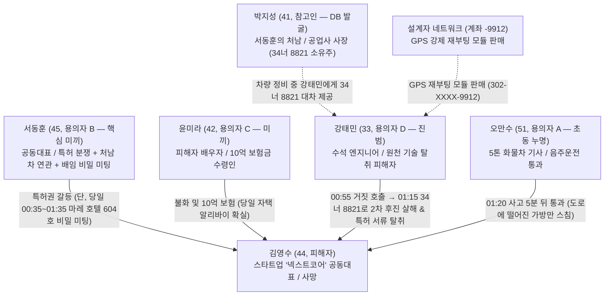

# 에피소드 2 완전 상세 설계서: 강변 국도 심야 뺑소니 사건

> **문서 목적**: EP 1(튜토리얼) 이후 추리 난이도가 본격적으로 상승하는 EP 2의 사건 배경, **2중 오인 유도(레드헤링) 트릭**, 인물 관계도, 장소별 의미, 실제 게임 문서 원문, 포렌식 툴킷(명암 보정·오디오 파형)·`K-POL DB` 검색 체인, 시간 밸런스, 정답 로직을 논리적 모순 없이 정의합니다. *(모든 기업·호텔·메신저 명칭은 가상 명칭 사용)*

---

## 1. 사건 기본 설정 및 핵심 테마

* **사건 번호**: `CASE-2026-021` (강변 국도 심야 도주치사 — 뺑소니 위장 고의 살인)
* **사건의 깊이 (추리 난이도 상승 포인트)**: **"완벽해 보이는 1차 용의자(공동대표)의 함정을 넘어 진짜 범인을 찾아내는 2단 추리"**
  * 초동 가설(화물차 기사 A)을 깨고 나면, 모든 정황(특허 분쟁 동기 + 호텔 라운지 부재 + **처남 명의 범행 차량**)이 공동대표 서동훈(B)을 가리킵니다.
  * 하지만 끝까지 파고들어 **호텔 604호 객실 카드키 로그(경쟁사와의 비밀 배임 미팅 알리바이)**와 **공업사 대차 출고 장부**를 확인해야만, 서동훈에게 누명을 씌우려 했던 진짜 범인 **수석 엔지니어 강태민(D)**을 특정할 수 있습니다.
* **시간 규칙 (연장 수사 허용)**:
  * **휘발성 골든 타임**: **13시간 (780분)** — 경과 전 강태민(D) 대상 금융/통신 영장 집행 완료 시 EP 1 계좌 끝자리(`-9912`)와 정확히 일치하는 **대포통장 전문(`302-XXXX-9912`) 및 성수동 구 공단 기지국 위치** 확보.
  * **영장 청구 시한 (신뢰도 기준)**: **18시간 (1,080분)** — 시한 내 해결 시 전담팀 신뢰도 +1, 초과 시 연장 수사 전환 및 신뢰도 -1.

---

## 2. 등장인물 상세 프로필 및 인물 관계도

### 2.1. 인물 관계도

### 2.2. 인물별 상세 배경 및 `K-POL DB` 조회 정보
| 인물 | 역할 | 성격 및 사연 | `K-POL 시민·차량·전과 DB` 조회 결과 |
| :--- | :--- | :--- | :--- |
| **김영수 (44)** | 피해자 | 스타트업 '넥스트코어' 공동대표. 실무 개발자 강태민(D)이 3년간 밤새워 만든 AI 원천 알고리즘을 계약서 독소 조항으로 가로채 단독 출원하려 함. | 전과 없음. 넥스트코어 지분 51% 보유. |
| **오만수 (51)** | 용의자 A (누명) | 5톤 화물차 기사. 음주 상태로 국도를 지나다 강태민이 도로에 던지고 간 피해자 가방만 스치고 지나감. | 단순 음주운전 벌금형 1회(5년 전, 인명피해 없음). |
| **서동훈 (45)** | 용의자 B (핵심 미끼) | 공동대표(지분 49%). 피해자와 특허권으로 심하게 다퉜고, 당일 호텔 라운지에서 1시간 자리를 비워 가장 유력한 용의자로 보임. 실제로는 그 1시간 동안 마레 호텔 604호에서 경쟁사('브이코어 AI') 이사와 **비밀 지분 매각 협상** 중이었음(배임 소지가 있어 경찰에 숨김). | 3년 전 경쟁사 기술 유출 혐의(불기소). **가족관계 조회 시 처남이 '박지성(34너 8821 소유주)'으로 확인됨!** |
| **윤미라 (42)** | 용의자 C (미끼) | 피해자의 배우자. 별거 직전이고 10억 원 생명보험 수령인이라 의심받으나, 보험은 2년 전 피해자 본인이 직접 가입함. | 전과 없음. 강남 아파트 거주. |
| **강태민 (33)** | 용의자 D (진범) | 넥스트코어 수석 엔지니어. 초기에는 평범한 참고인으로 등장. 자신의 코드 기여도 98.4% 핵심 특허에서 발명자 이름이 빠지고 소송 협박까지 받자, 회사 지정 정비소(하필 서동훈 처남 소유)의 대차 SUV(`34너 8821`)와 GPS 재부팅 모듈을 이용해 살인 및 서동훈 누명 유도를 계획. | 전과 없음. **특허청 분쟁 조정 신청 이력(사건 5일 전 기각됨)** 확인. |
| **박지성 (41)** | 참고인 (DB 발굴) | 서동훈(B)의 처남이자 외곽 공업사 사장. 차량번호 **`34너 8821`**의 실제 명의자. | 차량 `34너 8821` 소유주. 주소지 검색 시 **지도에 `박지성 공업사` 노드 신규 해금**. |

---

## 3. 사건의 진실 및 분 단위 전체 타임라인 (모순 0% 검증)

* **사건 5일 전**: 강태민(D)이 특허청에 공동 발명자 권리 분쟁 조정을 신청했으나 독소 조항으로 기각됨. 김영수가 고압적인 사내 메일로 단독 출원 강행 및 퇴사 압박.
* **사건 2일 전**: 강태민(D), 익명 암호화 메신저(다크챗, 계좌 `302-XXXX-9912` — EP 1과 동일 계좌)에서 **차량 GPS 강제 재부팅 모듈**을 구매하고 성수동 구 공단 인근에서 선불폰으로 수령. 자신의 차를 박지성 공업사에 정비 맡기고 대차로 회색 SUV(`34너 8821`)를 빌림.
* **사건 당일 (2026.11.24 새벽)**:
  * `23:30`: 1차 회식 종료. 강태민(D)이 피해자를 배웅한 뒤 헤어진 것처럼 행동(피해자는 인근 카페/자택 방향으로 이동).
  * `00:30`: 서동훈(B), 강남 **마레 호텔** 지하주차장에 본인 대형 세단 입차 후 `00:35` 호텔 604호(브이코어 AI 이사 투숙)로 이동해 비밀 매각 미팅.
  * `00:50 ~ 01:25`: 강태민(D), 대차 SUV(`34너 8821`)에 GPS 재부팅 모듈을 작동시켜 35분간 위치 기록 공백 생성.
  * `00:55`: 강태민(D), 선불폰 문자로 **공동대표 서동훈(B)을 사칭**해 피해자에게 **"김 대표, 서동훈이야. 폰 배터리 나가서 다른 폰으로 보낸다. 특허 합의서 최종안 가져왔으니 강변 국도 휴게소 갓길에서 잠깐 보자"**라고 불러냄 *(피해자가 새벽에 나간 개연성 확보 + 플레이어가 B를 더욱 의심하게 만드는 미끼 강화!)*.
  * `01:15`: 갓길에 도착해 기다리던 피해자 김영수를 SUV로 1차 고의 충돌 → **후진 기어를 넣어 2차 확인 사살**. *(이때 피해자 휴대폰의 112 긴급통화가 오작동 연결되어 15초간 녹음됨)*
  * `01:16 ~ 01:18`: 강태민(D), 차에서 내려 사망 확인 후 **피해자 가방에서 '단독 특허 출원 원본 서류/USB'를 꺼내느라 2분 지체**. 멀리서 화물차 전조등 불빛이 보이자 가방을 도로에 던지고 `01:18:40` 반대편 차선으로 급가속 도주 *(6분 지체 모순 해소 + 가방이 도로에 떨어진 이유 설명)*.
  * `01:18:40`: 마주 오던 화물차(A) 블랙박스에 도주하는 회색 SUV(`34너 8821`) 뒷모습 포착.
  * `01:20`: 만취 상태의 화물차 기사 오만수(A)가 쓰러진 피해자 옆을 스쳐 지나감(도로에 떨어진 가방 끈만 트럭 하단에 걸려 찢어짐).
  * `01:35`: 서동훈(B), 604호 미팅 종료 후 라운지로 내려와 `01:38` 결제 영수증을 남기고 출차.

---

## 4. 2D 지도 노드 6곳의 상세 의미 및 이동 시간 매트릭스

초기에는 5개 노드만 표시되며, **`K-POL 차량 DB`에서 `34너 8821`을 직접 검색해 박지성 공업사 주소를 확인하면 6번째 노드(`NODE_SUV_GARAGE`)가 지도에 해금**됩니다.

| 노드 ID | 장소명 | 사건 내 의미 및 역할 | 조사를 통해 밝혀낼 수 있는 것 |
| :--- | :--- | :--- | :--- |
| `NODE_STATION` | **경찰서 (시작 지점)** | 화물차 기사 A 구금 및 **용의자 지목 금융/통신 영장 집행** 거점. | 플레이어가 **서동훈(B)/윤미라(C)/강태민(D) 중 1명을 직접 선택**해 영장 집행. *(서동훈 선택 시 호텔 604호 투숙비 결제만 확인 — 미끼 소거 / 강태민 선택 시 13h 골든 타임 내 `302-XXXX-9912` 확보)* |
| `NODE_HIGHWAY` | **강변 국도 사고 현장** | 충돌이 일어난 2차선 갓길. | 타이어 자국 폭 정밀 측정(SUV 규격) + 피해자 휴대폰 수거(**`00:55` 호출 문자 + `01:15` 112 오디오 녹음 15초**). |
| `NODE_HOTEL` | **강남 마레 호텔** | 서동훈(B)의 알리바이 무대(핵심 미끼 검증 장소). | 라운지 CCTV(`00:35~01:35` 부재 확인 — 의심 증폭) + **604호 객실 카드키 출입 로그 & 룸서비스 영수증**(브이코어 AI 이사와 비밀 미팅 중이라 건물 밖으로 나간 적 없음 입증 → **B 소거 핵심**). |
| `NODE_OFFICE` | **넥스트코어 사무실** | 피해자·서동훈(B)·강태민(D)이 함께 일하는 IT 회사. | 사내 코드 저장소(**강태민 기여도 98.4%**) + 피해자가 강태민에게 보낸 **고압적 소송 협박 메일** 확보(진범 동기). |
| `NODE_WIFE_HOME` | **윤미라(C) 자택** | 배우자 거주지(소거용 미끼 장소). | 아파트 출입 기록 및 보험 가입 경위 확인 → **`[특이사항 없음]` 보고서 수신** → 증거판에서 C 기각/소거. |
| `NODE_SUV_GARAGE` | **박지성 공업사** *(DB 검색 해금)* | 범행 차량 `34너 8821`의 실제 보관 장소(반전의 핵심). | SUV 하부 범퍼 혈흔 검출 + GPS 35분 강제 재부팅 로그 + **공업사 대차 출고 장부(사건 당일 대여자가 서동훈이 아닌 `강태민(D)`임을 결정적 입증!)**. |

### 노드 간 확정 이동 시간표 (단위: 분, 대칭)
| 출발 \ 도착 | 경찰서 | 사고 현장 | 마레 호텔 | 사무실 | 배우자 자택 | 박지성 공업사 |
| :--- | :---: | :---: | :---: | :---: | :---: | :---: |
| **경찰서** | 0 | 30 | 20 | 25 | 25 | 35 |
| **사고 현장** | 30 | 0 | 35 | 40 | 30 | 20 |
| **마레 호텔** | 20 | 35 | 0 | 15 | 20 | 40 |
| **사무실** | 25 | 40 | 15 | 0 | 15 | 45 |
| **배우자 자택** | 25 | 30 | 20 | 15 | 0 | 40 |
| **박지성 공업사** | 35 | 20 | 40 | 45 | 40 | 0 |

---

## 5. 초기 지급 자료 (초동 수사 확보분 — 게임 시작 시 OS 파일 탐색기에 기본 제공)

*(초동 수사팀이 당연히 1차로 확보했을 보고서, 진술서 4종, 화물차 블랙박스 5컷, 사고 현장 전경 사진, 서동훈이 자진 제출한 호텔 결제 영수증은 초기 자료로 지급됩니다.)*

### ① `EV_EP2_INITIAL_REPORT` (초동 교통사고 수사 보고서)
> **[사건 개요]** 2026.11.24 `01:20`경 강변 국도 2차선 갓길에서 보행자 김영수(44, 넥스트코어 공동대표)가 차량에 치여 사망.  
> **[피의자 특정]** 당시 혈중알코올농도 0.11% 상태로 해당 구간을 통과한 5톤 화물차 기사 오만수(51)를 긴급 체포. 트럭 우측 하단에서 피해자 가방 파편 검출. `18시간` 뒤 구속영장 청구 예정.  
> **[특이사항]** 빗속 어두운 현장에서 피해자의 휴대폰은 발견되지 않음(충격 시 도로 밖으로 튕겨 나간 것으로 추정).  
> **[참고 사항]** 피해자는 공동대표 서동훈(45)과 최근 핵심 특허권 문제로 심한 갈등이 있었으며, 배우자 윤미라(42)가 10억 원 생명보험 수령인으로 등재됨. 회사 수석 엔지니어 강태민(33)이 사건 당일 회식 후 피해자를 배웅했다고 참고인 진술함.

### ② 초동 현장 사진 및 제출 서류 (초동 확보분)
* **`EV_EP2_PHOTO_INIT_ROAD` (사고 현장 갓길 전경 사진)**: 비 젖은 2차선 도로, 찢어진 가방 파편, 갓길 배수구 철망.
* **`EV_EP2_DOC_INIT_RECEIPT` (서동훈 자진 제출 영수증)**: 마레 호텔 라운지 `01:38` 결제 영수증 스캔본(입차 `00:30` 기재).

### ③ `EV_EP2_STATEMENT_A` (오만수 진술서)
> *"술 먹고 운전대 잡은 건 백 번 잘못했습니다. 근데 사람은 진짜 안 쳤어요! 어두워서 잘 안 보였는데 길가에 가방 같은 게 퍽 걸려서 지나갔을 뿐입니다. 저 지나가기 전에 반대편으로 회색 SUV 한 대가 미친 듯이 밟고 지나가더라고요!"*

### ③ `EV_EP2_STATEMENT_B` (서동훈 진술서)
> *"김영수랑 특허 때문에 다툰 건 맞습니다. 그래도 죽일 이유가 있나요? 전 `00시 30분`에 마레 호텔 지하주차장에 제 차 세워두고 `01시 40분`까지 계속 호텔 안에 있었습니다. `01시 38분` 라운지 결제 영수증도 제출했잖아요. 00시 35분부터 1시간 동안 뭐 했냐고요? ...그건 개인적인 사업 미팅이라 말씀드리기 곤란합니다."*

### ④ `EV_EP2_STATEMENT_C` (윤미라 진술서)
> *"남편이랑 별거 직전이었던 건 사실이지만 그날 밤엔 집에서 한 발짝도 안 나갔습니다. 10억 보험도 2년 전에 남편이 직접 든 거예요. 제 아파트 엘리베이터 CCTV 확인해 보세요."*

### ⑤ `EV_EP2_STATEMENT_D` (강태민 참고인 진술서)
> *"전날 밤 `23시 30분`쯤 1차 회식이 끝나고 대표님을 배웅해 드렸습니다. 그 뒤엔 제 차가 고장 나서 공업사에 맡겨둔 상태라, **택시를 타고** 바로 귀가했습니다. 대표님이랑 서동훈 대표님이 특허 때문에 크게 싸우시긴 했어요."*

---

## 6. 포렌식 툴킷(블랙박스 보정 + 오디오 파형) 상세 명세

### 6.1. 화물차 A 블랙박스 5컷 (명암/대비 보정 필수)
| 컷 번호 | 타임스탬프 | 화면 묘사 | 포렌식 가공 및 숨겨진 단서 |
| :---: | :---: | :--- | :--- |
| **컷 1** | `01:18:40` | 비 내리는 어두운 국도. 반대편 차선으로 급가속해 빠져나가는 회색 SUV 뒷모습. | **[명암/대비 보정 + 2.5x 확대 캡처]** 어둠에 묻힌 번호판 **`34너 8821`** 해독! (`EV_EP2_CAP_PLATE`) → `K-POL 차량 DB` 검색 유도 |
| **컷 2** | `01:19:50` | 화물차 전조등이 갓길을 비춤. 이미 쓰러져 있는 피해자 실루엣, 도로에 던져진 가방, 이중 타이어 자국. | **[2.0x 확대 캡처]** 화물차 도착 전에 이미 쓰러져 있었으며, 승용차 폭의 **전진+후진 타이어 자국** 확인 (`EV_EP2_CAP_SKIDMARK`) |
| **컷 3~5** | `01:20:05~15` | 화물차가 도로에 떨어진 가방만 스치고 통과. | 오만수(A) 누명 정황 확인 |

### 6.2. 오디오 파형 분석기 (피해자 휴대폰 `01:15` 112 오작동 녹음 15초)
* 현장 감식(`ACT_EP2_HIGHWAY`)으로 획득.
* 기본 상태에서는 강한 빗소리(저주파 노이즈)에 묻혀 식별 불가 → **저주파 노이즈 컷 슬라이더 조절** 시:
  * `00:02`: 브레이크 마찰음 없는 1차 강한 충격음
  * `00:06`: **차량 후진 기어 경고음(`띠-띠-띠`) + 엔진 가속음 + 2차 충격음**
  * `00:12`: **차 문 열리는 소리 + 빗속 발소리 + 가방 지퍼 여는 소리** (`EV_EP2_AUDIO_REVERSE`) → 단순 뺑소니가 아닌 계획 살인 및 서류 탈취 확정.

---

## 7. 현장 지시 액션 트리 및 수학적 시간 밸런스 검증

| 액션 ID | 위치 노드 | 지시 내용 | 작업 시간 | 획득 증거 및 결과 |
| :--- | :--- | :--- | :---: | :--- |
| `ACT_EP2_HIGHWAY` | 사고 현장 | 갓길 타이어 자국 폭 정밀 측정 및 배수구 수색(피해자 휴대폰 복구) | 90분 | **`EV_EP2_DOC_TIRE`** (SUV 규격 타이어 폭), **`EV_EP2_AUDIO_PHONE`** (배수구에서 수거한 휴대폰의 `01:15` 112 녹음 15초), **`EV_EP2_DOC_CALL_TEXT`** (`00:55` 서동훈 사칭 선불폰 문자: *"김 대표, 서동훈이야. 폰 배터리 나가서 다른 폰으로 보낸다. 특허 합의서 최종안 가져왔으니 강변 국도 갓길에서 잠깐 보자"*) |
| `ACT_EP2_HOTEL` | 마레 호텔 | 라운지 CCTV 및 **604호 객실 카드키 로그·룸서비스 영수증** 확보 | 60분 | **`EV_EP2_DOC_HOTEL_CARD`**: `00:35~01:35` 사이 서동훈(B)은 라운지에 없었으나 **604호(브이코어 AI 이사 투숙)에서 비밀 지분 매각 미팅 중이었으며 건물 밖으로 나간 적 없음** 확인 → **핵심 미끼 B 소거!** |
| `ACT_EP2_OFFICE` | 사무실 | 특허 분쟁 서류 및 사내 코드 저장소·메일 압수 | 90분 | **`EV_EP2_DOC_PATENT_DEV`**: 코드 기여도 **강태민(D) 98.4%** 기록 + 김영수가 강태민에게 보낸 고압적 메일(*"연봉 받고 만든 코드는 회사 소유야. 발명자 이름 빼는 데 불만 있으면 계약 위반 소송 걸겠다"*) 확보. |
| `ACT_EP2_WIFE` | 배우자 자택 | 윤미라(C) 아파트 CCTV 및 보험 경위 조사 *(미끼)* | 60분 | **`[특이사항 없음 보고서]`** → 증거판에서 C 기각/소거. |
| `ACT_EP2_GARAGE` | 박지성 공업사 *(DB 해금)* | SUV(`34너 8821`) 범퍼 혈흔 감식, GPS 모듈 압수, **대차 출고 장부** 확인 | 90분 | **`EV_EP2_PHOTO_BUMPER`** (범퍼 하부 피해자 혈흔), **`EV_EP2_DOC_GPS_LOG`** (`00:50~01:25` 35분 강제 재부팅), **`EV_EP2_DOC_RENTAL_LEDGER`** (사건 당일 대차 수령인: 서동훈이 아닌 **`강태민`** 서명 — "택시 타고 귀가했다"는 진술 완전 붕괴!). |
| `ACT_EP2_FINANCE` | 경찰서 *(대상 선택 영장)* | **플레이어가 용의자(B/C/D) 중 1명 선택** → 최근 7일 금융 거래 및 통신 기지국 조회 | 90분 | • **서동훈(B) 선택 시**: *"특이 자금 없음. 마레 호텔 604호 투숙비 결제만 확인"* (미끼 소거) • **강태민(D) 선택 시**: GPS 모듈 구매 송금 내역 확인 + **[13h 휘발성 보너스]** 780분 이내 완료 시 EP 1과 동일한 **대포통장 전문(`302-XXXX-9912`) 및 성수동 구 공단 기지국 위치(`EV_META_EP02_ACCOUNT`)** 확보. |

### 수학적 시간 밸런스 검증 (휘발성 13시간 = 780분 / 영장 시한 18시간 = 1,080분)
* **최적 동선 (필수 5개 액션)**:
  1. `경찰서 → 사고 현장`(30) + 감식/휴대폰(90) + 보고(15) = **135분**
  2. `사고 현장 → 박지성 공업사`(20) + 차량/대차 장부(90) + 보고(15) = **125분** *(누적 260분)*
  3. `공업사 → 사무실`(45) + 특허/메일/코드(90) + 보고(15) = **150분** *(누적 410분)*
  4. `사무실 → 마레 호텔`(15) + 604호 카드키 로그(60) + 보고(15) = **90분** *(누적 500분)*
  5. `호텔 → 경찰서`(20) + 강태민 금융/통신 영장(90) + 보고(15) = **125분** *(누적 625분 = **10시간 25분**)*
* **비효율/미끼 포함 동선**: 배우자 자택 조사 및 서동훈 영장 오지정 시 약 **850~1,020분 (14~17시간)** → 영장 시한(18시간) 내 해결 가능, 13시간 골든 타임 달성에는 전략적 동선과 정확한 대상 선택 필수.

---

## 8. 최종 보고서(기소 의견서) 정답 로직 및 플롯 홀 점검

| 보고서 항목 | 정답 값 / 숨겨진 증거 ID | 오답 시 파트너 피드백 |
| :--- | :--- | :--- |
| **1. 진범 지목** | **강태민 (용의자 D)** | (A 선택 시) *"화물차 도착 전에 이미 쓰러져 있었습니다."* (B 선택 시) *"저도 서동훈인 줄 알았는데, 마레 호텔 604호 출입 기록을 보면 그 시간에 건물 밖으로 나간 적이 없습니다. `34너 8821`을 진짜 누가 몰았는지 공업사 장부를 확인해 보시죠!"* (C 선택 시) *"윤미라는 밤새 자택 알리바이가 확실합니다."* |
| **2. 초동 가설 반박 & 고의 살인 입증** | **`EV_EP2_CAP_SKIDMARK`** + **`EV_EP2_AUDIO_REVERSE`** | *"화물차가 친 게 아니라 고의적인 2차 후진 충돌 및 서류 탈취였다는 현장 캡처와 오디오 증거가 필요합니다."* |
| **3. 실제 범행 차량 및 운전자 특정** | **`EV_EP2_PHOTO_BUMPER`** + **`EV_EP2_DOC_RENTAL_LEDGER`** | *"범행 차량(`34너 8821`)의 혈흔과, '택시를 탔다'던 진술과 달리 그날 밤 차를 빌려 간 사람이 누구인지 증명하는 장부가 필요합니다."* |
| **4. 범행 동기 입증** | **`EV_EP2_DOC_PATENT_DEV`** | *"강태민이 대표를 죽여야 했던 결정적 동기(코드 기여도 및 협박 메일)를 첨부해 주십시오."* |

### 사건 해결 연출: 시간대별 현장 체포 보고 메시지 (정산 화면 3단계 분기)
* **① 골든 타임 내 빠른 검거 (`≤ 13시간`)**:
  > `[현장 체포 보고]` `2026.11.24 {클리어 시각}경, 넥스트코어 사무실 개인 자리에서 탈취한 단독 특허 원본 USB를 자신의 노트북으로 옮기고 있던 피의자 강태민(33)을 살인 혐의로 기습 체포함.`  
  > **강민호 경사**: *"경위님, 서동훈 대표한테 시선이 쏠렸을 줄 알고 태연하게 회사에 출근해 있더군요. 대포통장 `-9912` 추적 기록도 폐쇄 전에 온전히 확보했습니다."*
* **② 영장 시한 내 검거 (`13시간 초과 ~ 18시간 이내`)**:
  > `[현장 체포 보고]` `2026.11.24 {클리어 시각}경, 자택 주차장에서 특허 원본 서류와 여권을 챙겨 도주하려던 피의자 강태민(33)을 살인 혐의로 긴급 체포함.`  
  > **강민호 경사**: *"공업사 쪽 수사 들어간 눈치를 챘는지 막 차 빼려던 놈을 잡았습니다. 오만수 기사님은 음주운전 혐의만 남고 살인 누명은 벗었습니다."*
* **③ 연장 수사 검거 (`18시간 초과`)**:
  > `[현장 체포 보고]` `2026.11.24 {클리어 시각}경, 이미 자택을 빠져나와 고속철도역 대합실에서 타 지역으로 도피하려던 피의자 강태민(33)을 긴급 추적 끝에 검거함.`  
  > **강민호 경사**: *"시간 넘겨서 간신히 기차역에서 붙잡았습니다. 대포통장 쪽 기록이 일부 날아간 건 아쉽지만, 진짜 범인은 놓치지 않았습니다."*

### 플롯 홀 최종 점검표
* [x] **피해자가 왜 새벽 01:15에 강변 국도 갓길에 있었는가?** → `00:55` 강태민이 선불폰 문자로 *"특허 합의서 초안 검토"*를 핑계로 불러냄.
* [x] **왜 사고(`01:15`) 후 3분 40초 뒤(`01:18:40`)에야 현장을 빠져나갔는가?** → 2차 후진 충돌 후 차에서 내려 피해자 가방에서 단독 특허 출원 원본 서류/USB를 챙기느라 지체했고, 화물차 불빛을 보고 가방을 도로에 던지고 급가속 도주함(오디오 파형과 가방 파편 모두 설명됨).
* [x] **실존 상표명/기업명이 완전히 배제되었는가?** → `마레 호텔`, `넥스트코어`, `브이코어 AI`, `다크챗` 등 100% 가상 명칭으로 통일.
* [x] **EP 1과의 연결고리가 정확한가?** → EP 1 다크챗 송금 계좌 끝자리 `-9912`가 EP 2 강태민의 GPS 모듈 구매 계좌 **`302-XXXX-9912`**로 정확히 이어지며, 성수동 기지국이 EP 7 은신처의 첫 공간적 복선이 됨.
