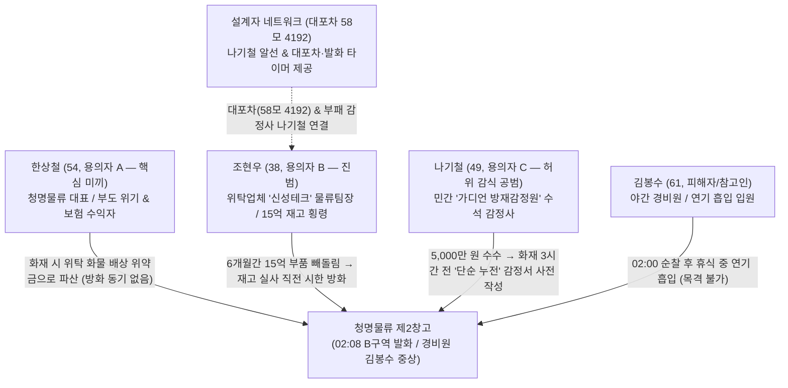

# 에피소드 3 완전 상세 설계서: 구도심 물류창고 심야 화재 사건

> **문서 목적**: **메타데이터 뷰어(문서 조작 간파)**와 **전기/소방 로그 교차 검증**이 처음 본격 도입되는 EP 3의 사건 배경, 2중 오인 유도(창고 대표 미끼 → 위탁업체 팀장 & 허위 감정사 반전), 인물 관계도, 장소별 의미, 실제 게임 문서 원문, 시간 밸런스, 정답 로직을 논리적 모순 없이 정의합니다. *(모든 기업·기관 명칭은 가상 명칭 사용)*

---

## 1. 사건 기본 설정 및 핵심 테마

* **사건 번호**: `CASE-2026-033` (구도심 '청명물류 제2창고' 심야 방화 및 보험사기 사건 — 야간 경비원 1명 연기 흡입 중상 입원, 사망자 없음)
* **사건의 깊이 (추리 난이도 포인트)**: **"보험금 24억 원의 수익자(창고 대표)가 범인이라는 고정관념을 깨는 역발상 추리"**
  * 겉보기에는 부도 직전인 창고 대표 한상철(A)이 보험금 24억 원을 노리고 불을 지른 전형적인 보험사기처럼 보입니다.
  * 하지만 **보험 약관(위탁 화물 면책 조항)**과 **잔해물 감식(금속 부품 없음, 빈 박스와 벽돌만 검출)**을 교차 검증하면, 진짜 목적은 보험금이 아니라 **'6개월간 빼돌린 15억 원어치 위탁 재고의 횡령 흔적을 불로 지우는 것'**이었음이 드러납니다.
* **시간 규칙 (연장 수사 허용)**:
  * **휘발성 골든 타임**: **13시간 (780분)** — 경과 전 감정사 나기철(C) 및 대포차(`58모 4192`) 조회 완료 시 **5년 전 서진우 파면 사건 당시 감식 조작 이력(기밀 아카이브)**과 **회색 대형 승합차(`58모 4192`) 원본 차대번호 추적 로그** 확보.
  * **보험금 지급·사건 종결 마감 (신뢰도 기준)**: **18시간 (1,080분)** — 시한 내 해결 시 전담팀 신뢰도 +1, 초과 시 연장 수사 전환 및 신뢰도 -1.

---

## 2. 등장인물 상세 프로필 및 인물 관계도

### 2.1. 인물 관계도

### 2.2. 인물별 상세 배경 및 `K-POL DB` 조회 정보
| 인물 | 역할 | 성격 및 사연 | `K-POL 시민·차량·기밀 DB` 조회 결과 |
| :--- | :--- | :--- | :--- |
| **한상철 (54)** | 용의자 A (핵심 미끼) | 청명물류 대표. 자금난으로 부도 위기이며 창고 건물 화재보험(24억 원) 수익자라 가장 먼저 의심받음. 하지만 화재 전날 밤까지 창고에 거래처 위탁 화물을 챙겨두었고, **위탁 화물 소실 시 보험 면책 + 배상 위약금**으로 완전히 망하는 입장. | 전과 없음. 국세 체납 1건(자금난 확인 — 미끼 요소). |
| **조현우 (38)** | 용의자 B (진범) | 위탁 화주사 '신성테크' 물류팀장. 6개월간 B구역에 맡겨둔 고가 전자부품 15억 원어치를 빼돌려 암시장에 팔고, 박스 안에 폐지와 벽돌을 채워둠. 다음 주 정기 재고 실사가 잡히자 창고 전체를 태워 증거를 인멸하려 함. | 전과 없음. **최근 6개월간 해외 카지노 출입 및 고액 현금 입금 의심 보고(FIU 참고 기록)** 확인. |
| **나기철 (49)** | 용의자 C (공범) | 민간 '가디언 방재감정원' 소속 감정사. 설계자 네트워크의 소개로 조현우에게 5,000만 원을 받고 "노후 배전반 누전" 허위 감정서를 제출. | **[기밀 아카이브 조회 — 13h 휘발성]**: 5년 전 경찰청 디지털포렌식센터 **서진우 파면 사건 당시 증거 조작에 동원된 외부 감정 보고서 작성자와 동일인!** |
| **김봉수 (61)** | 피해자 (경비원) | 청명물류 야간 경비원. 02:00 정기 순찰 때는 이상이 없었으나, 경비실 복귀 후 밀려든 유독가스에 의식을 잃어 입원(48시간 진술 불가). | 전과 없음. |

---

## 3. 사건의 진실 및 분 단위 전체 타임라인 (모순 0% 검증)

* **사건 6개월 전 ~ 전날**: 조현우(B), 화주사 전용 밀봉·독립 전자키 구역인 B구역의 고가 반도체/부품 15억 원어치를 정상 출고 물량에 끼워 수십 차례 빼돌림. 창고 대표(A)와 경비원이 개봉 권한이 없다는 점을 악용해, 빈 박스에 동일 무게의 폐지·벽돌을 채우고 수축 랩으로 재밀봉해 둠.
* **사건 전날 (2026.12.01)**:
  * `21:00`: 한상철(A), 창고에 들러 내일 아침 출고할 A구역 화물 상태를 점검하고 `21:25` 퇴근(CCTV 기록 존재).
  * `23:10`: 공범 감정사 **나기철(C)**, 자신의 사무실 PC에서 **"청명물류 제2창고 배전반 누전 소견서" 워드 초안(`Created_At: 12.01 23:10:14`)**을 미리 작성해 둠. *(화재 다음 날 `12.02 10:15` 현장 사진만 끼워 넣어 최종 PDF로 저장했으나, 원본 생성 시각 메타데이터를 지우지 못함!)*
  * `23:35`: 조현우(B), 설계자 네트워크에서 조달한 **회색 대형 승합차(`58모 4192`, 말소 대포차)**를 타고 창고 뒷골목에 진입. 화주사 출입 카드로 B구역에 들어가 마지막 남은 진짜 부품 3박스를 싣고, B구역 구석 박스 더미 아래에 **시한 발화 타이머(02:08 작동 설정)**를 설치한 뒤 `23:52` 이탈.
* **사건 당일 (2026.12.02 새벽)**:
  * `02:00`: 경비원 김봉수, 창고 외곽 순찰(이상 없음) 후 경비실 복귀.
  * `02:08`: B구역 시한 발화 장치 작동 → 최초 열감지기/연기감지기 경보 발생(소방서 자동 신고).
  * `02:19`: 불길이 B구역에서 벽면 배전반까지 번지면서 **11분 뒤에야 건물 누전차단기 트립(전력 차단)** 발생 *(누전이 원인이 아님을 입증하는 결정적 물리 모순!)*.
  * `02:22`: 소방차 도착, 경비원 김봉수 구조. B구역 전소.

---

## 4. 2D 지도 노드 6곳의 상세 의미 및 이동 시간 매트릭스

초기에는 5개 노드만 열려 있으며, **감정서 메타데이터 조작을 확인하거나 `K-POL DB`에서 나기철을 조회하면 6번째 노드(`NODE_FORENSIC_LAB`) 조사의 핵심 명분이 명확해집니다** (단, 자유 수사 원칙에 따라 모든 노드는 초반부터 접근 가능).

| 노드 ID | 장소명 | 사건 내 의미 및 역할 | 조사를 통해 밝혀낼 수 있는 것 |
| :--- | :--- | :--- | :--- |
| `NODE_STATION` | **경찰서 (시작 지점)** | 사건 접수 및 **대상 선택 금융 영장 집행** 거점. | 플레이어가 **한상철(A)/조현우(B)/나기철(C) 중 1명을 직접 선택**해 계좌 추적 영장 집행(조현우 선택 시 장물 처분 및 5,000만 원 뇌물 송금 확보). |
| `NODE_WAREHOUSE` | **청명물류 제2창고 (화재 현장)** | 화재가 발생한 핵심 공간(A/B구역 및 뒷골목). | **스마트 전력 계량기 로그(`02:19` 차단 — 발화 11분 뒤!)** + **B구역 잔해물 정밀 감식(전자부품 금속 잔해 없음, 벽돌·폐지만 대량 검출)** + 뒷골목 CCTV 확보. |
| `NODE_INSURANCE` | **동방화재보험 본사** | 24억 원 화재보험 계약 및 지급 심사 기관. | **보험 약관 전문 확보**(타사 위탁 화물은 면책 대상이며, 창고 화재 시 한상철 A는 위약금으로 파산함을 확인 → **A의 동기 반박**). |
| `NODE_CEO_OFFICE` | **한상철(A) 대표 사무실** | 부도 위기 창고 대표의 개인 사무실 *(소거용 미끼 장소)*. | 자금 장부 및 개인 통장 확인 → **`[특이사항 없음 보고서]`** *"자금난은 맞지만 화재 직전까지 은행 대출 연장 합의서를 작성 중이었으며, 불이 나면 오히려 18억 배상 책임이 생깁니다."* → 증거판에서 A 기각/소거. |
| `NODE_SHINSUNG` | **신성테크 물류센터** | 위탁 화주사 및 조현우(B)의 근무지. | 다음 주 **정기 재고 실사 공문** + B구역 출입 카드 사용 로그(`12.01 23:36` 조현우 카드 태그 흔적 — 본인은 퇴근했다고 거짓 진술!). |
| `NODE_FORENSIC_LAB` | **가디언 방재감정원** | 허위 누전 감정서를 작성한 나기철(C)의 사무실. | 나기철 PC 압수 및 계좌 확인 → 조현우로부터 **5,000만 원 수수 내역** + **[13h 휘발성 보너스]** 나기철의 과거 서진우 파면 사건 연루 기밀 기록 & 대포차(`58모 4192`) 연계 확인. |

### 노드 간 확정 이동 시간표 (단위: 분, 대칭)
| 출발 \ 도착 | 경찰서 | 물류창고 | 보험 본사 | 한상철 사무실 | 신성테크 | 방재감정원 |
| :--- | :---: | :---: | :---: | :---: | :---: | :---: |
| **경찰서** | 0 | 25 | 20 | 20 | 35 | 25 |
| **물류창고** | 25 | 0 | 30 | 25 | 15 | 30 |
| **보험 본사** | 20 | 30 | 0 | 10 | 40 | 15 |
| **한상철 사무실** | 20 | 25 | 10 | 0 | 35 | 20 |
| **신성테크** | 35 | 15 | 40 | 35 | 0 | 35 |
| **방재감정원** | 25 | 30 | 15 | 20 | 35 | 0 |

---

## 5. 초기 지급 자료 (초동 수사 확보분 — 게임 시작 시 OS 파일 탐색기에 기본 제공)

*(초동 수사팀과 소방대가 당연히 1차로 확보했을 화재 보고서, 나기철 감정사의 누전 소견서 PDF, 진술서 2종, 화재 현장 전경 사진, 소방 열감지기 작동 기록은 초기 자료로 지급됩니다.)*

### ① `EV_EP3_INITIAL_REPORT` (초동 화재 조사 보고서)
> **[사건 개요]** 2026.12.02 `02:08`경 구도심 청명물류 제2창고 B구역에서 화재 발생(열감지기 02:08 최초 작동). 야간 경비원 김봉수(61)는 연기 흡입으로 입원(48시간 진술 불가). 이송 직전 **`"02시에 순찰 돌 땐 배전반 쪽에 아무 이상 없었는데... B구역 안쪽에서 이상한 시계 초침 같은 소리가 났다"`**고 진술.  
> **[초동 결론]** 민간 '가디언 방재감정원' 나기철 감정사의 소견에 따라 노후 배전반 합선(누전)에 의한 단순 실화로 내사 종결 예정. `18시간` 뒤 동방화재보험에 종결 확인서 송부 예정(보험금 24억 원 청구됨).  
> **[참고 사항]** 창고 대표 한상철(54)은 최근 자금난으로 부도 위기였으며, 화재 전날 밤 21시경 창고에 방문한 기록이 있음.

### ② 초동 현장 사진 및 기본 소방 기록 (초동 확보분)
* **`EV_EP3_PHOTO_INIT_BZONE` (B구역 화재 잔해 전경 사진)**: 검게 그을린 배전반과 무너진 B구역 팔레트 잿더미. *(※ `2.0x` 확대 시 불탄 박스 잿더미 사이에 전자부품 대신 **깨진 벽돌 조각**이 어렴풋이 보임 → 현장 정밀 잔해 감식 유도!)*
* **`EV_EP3_DOC_INIT_FIRELOG` (소방서 열감지기 기록)**: `2026.12.02 02:08:11` B구역 3번 열감지기 최초 경보 발신, `02:22` 소방대 도착.

### ③ `EV_EP3_DOC_EXPERT_PDF` (나기철 감정사의 누전 소견서 — **메타데이터 뷰어 분석 대상!**)
> **[감정 소견]** 현장 B구역 벽면 메인 배전반의 피복 노후화로 인한 단락(누전)이 최초 발화 원인으로 판단됨. 방화 흔적 및 인화물질 미검출.  
> *(※ 플레이어가 `메타데이터 뷰어`로 이 PDF를 열면, 최종 수정 시각 `Modified_At: 2026-12-02 10:15:02` 아래 숨겨진 **`Created_At: 2026-12-01 23:10:14`** 및 **`Source_Doc: B구역_배전반_누전_초안.docx`**가 노출됨! — 화재 3시간 전에 이미 작성 시작된 조작 문서 `EV_EP3_META_PDF_TIME`)*

### ③ `EV_EP3_STATEMENT_A` (한상철 대표 진술서)
> *"제가 돈이 급한 건 맞지만, 제 창고에 불을 지르다니 말도 안 됩니다! B구역엔 신성테크의 고가 반도체 부품이 15억 원어치나 들어 있었어요. 보험 약관 좀 보세요, 전 이번에 완전히 망했다고요! 21시에 들른 건 내일 출고할 A구역 물량 체크하러 간 겁니다."*

### ④ `EV_EP3_STATEMENT_B` (조현우 물류팀장 참고인 진술서)
> *"우리 회사 부품 15억 원어치가 한순간에 다 타버렸습니다. 전날 저녁 18시에 정상 퇴근해서 집에서 쉬고 있었는데 새벽에 연락받고 뛰어나왔어요. 한상철 대표가 요즘 자금난이 심하다더니 설마..."*

---

## 6. 포렌식 툴킷(골목 CCTV + 메타데이터 뷰어) 상세 명세

### 6.1. 창고 뒷골목 방범 CCTV 4컷 (`ACT_EP3_WAREHOUSE`로 확보)
| 컷 번호 | 타임스탬프 | 화면 묘사 | 포렌식 가공 및 숨겨진 단서 |
| :---: | :---: | :--- | :--- |
| **컷 1** | `12.01 21:24` | 한상철(A)이 정문 쪽으로 걸어 나와 본인 승용차로 퇴근. | A 진술 일치 확인 |
| **컷 2** | `12.01 23:35` | 어두운 창고 뒷골목으로 **회색 대형 승합차**가 후진 진입. | **[명암 보정 + 2.5x 확대 캡처]** 번호판 **`58모 4192`** 해독! (`EV_EP3_CAP_VAN_PLATE`) → `K-POL 차량 DB` 검색 시 **말소된 대포차** 확인(EP 5/7 연결!) |
| **컷 3** | `12.01 23:44` | 모자를 쓴 남성이 B구역 뒷문에서 박스 3개를 승합차에 싣고 있음. | **[2.0x 확대 캡처]** 점퍼 등판에 선명한 **`신성테크(SHINSUNG)` 물류팀 로고** 포착 (`EV_EP3_CAP_LOGO`) |
| **컷 4** | `12.02 02:08` | B구역 환기구에서 검은 연기가 치솟기 시작함. | 최초 발화 시각(`02:08`) 교차 확인 |

---

## 7. 현장 지시 액션 트리 및 수학적 시간 밸런스 검증

| 액션 ID | 위치 노드 | 지시 내용 | 작업 시간 | 획득 증거 및 결과 |
| :--- | :--- | :--- | :---: | :--- |
| `ACT_EP3_WAREHOUSE` | 물류창고 | B구역 잔해물 성분 감식, 스마트 전력 로그 및 뒷골목 CCTV 확보 | 90분 | **`EV_EP3_DOC_POWER_LOG`**: 누전차단기 트립 시각 **`02:19`** (최초 발화 `02:08`보다 **11분 뒤** → 누전 거짓 입증!). **`EV_EP3_DOC_DEBRIS`**: B구역 잔해에서 전자부품 금속 성분 거의 없음, **폐지·벽돌 조각만 대량 검출**. **`EV_EP3_CCTV_ALLEY`**: 뒷골목 CCTV 4컷. |
| `ACT_EP3_INSURANCE` | 보험 본사 | 청명물류 화재보험 약관 원본 및 청구 내역 확인 | 60분 | **`EV_EP3_DOC_POLICY`**: 제14조(위탁 화물 면책) 확인 — 한상철(A)은 화재 시 오히려 18억 배상 위약금 발생. |
| `ACT_EP3_CEO` | 한상철 사무실 | 한상철(A) 자금 장부 및 통장 내역 조사 *(미끼)* | 60분 | **`[특이사항 없음 보고서]`** → 증거판에서 A 기각/소거. |
| `ACT_EP3_SHINSUNG` | 신성테크 | B구역 출입 카드 로그 및 재고 감사 일정 공문 확보 | 60분 | **`EV_EP3_DOC_CARD_LOG`**: `12.01 23:36` **조현우(B) 사원증**으로 B구역 출입 기록 확인("18시 퇴근" 거짓 진술 붕괴!) + 다음 주 **정기 재고 실사 공문** 확보(범행 동기). |
| `ACT_EP3_LAB` | 방재감정원 | 나기철(C) PC 원본 파일 압수 및 다크챗 통신 흔적 확보 | 90분 | **`EV_EP3_DOC_DRAFT`**: `B구역_배전반_누전_초안.docx` 원본 파일 및 다크챗 알선 흔적 확인. **[13h 휘발성 보너스]**: 780분 이내 완료 시 **나기철이 5년 전 서진우 파면 사건 당시 감식 조작에 가담했던 기밀 기록(`EV_META_EP03_EXPERT`)** 및 **`58모 4192` 대포차 공급선 로그** 확보. |
| `ACT_EP3_FINANCE` | 경찰서 *(대상 선택 영장)* | **플레이어가 용의자(A/B/C) 중 1명 선택** → 최근 6개월 금융 계좌 추적 영장 집행 | 90분 | • **한상철(A) 선택 시**: *"연체 대출 연장 서류만 확인, 특이 자금 없음"* (미끼 소거) • **조현우(B) 선택 시**: **`EV_EP3_DOC_BRIBE`** — 암시장 장물 처분 현금 분산 입금 + 나기철(C) 측으로의 **5,000만 원 차명 송금 내역** 확보! |

### 수학적 시간 밸런스 검증 (휘발성 13시간 = 780분 / 종결 시한 18시간 = 1,080분)
* **최적 동선 (필수 5개 액션 — A 사무실 미끼 생략 시)**:
  1. `경찰서 → 물류창고`(25) + 현장 감식/전력/CCTV(90) + 보고(15) = **130분**
  2. `물류창고 → 신성테크`(15) + 출입/실사 공문(60) + 보고(15) = **90분** *(누적 220분)*
  3. `신성테크 → 방재감정원`(35) + PC/기밀 압수(90) + 보고(15) = **140분** *(누적 360분)*
  4. `방재감정원 → 보험 본사`(15) + 보험 약관 확인(60) + 보고(15) = **90분** *(누적 450분)*
  5. `보험 본사 → 경찰서`(20) + 조현우 금융 영장(90) + 보고(15) = **125분** *(누적 575분 = **9시간 35분**)*
* **일반/미끼 포함 동선 (한상철 사무실 조사 + 오지정 영장 포함 시)**: 약 **780~900분 (13~15시간)** → 종결 시한(18시간) 내 안정적 해결 가능, 13시간 휘발성 골든 타임 달성에는 전략적 동선과 정확한 대상 선택 필수.

---

## 8. 최종 보고서(기소 의견서) 정답 로직 및 플롯 홀 점검

| 보고서 항목 | 정답 값 / 숨겨진 증거 ID | 오답 시 파트너 피드백 |
| :--- | :--- | :--- |
| **1. 진범 지목** | **조현우 (용의자 B)** *(공범: 나기철 C)* | (A 선택 시) *"동방화재 약관을 보면 한상철 대표는 불이 나면 오히려 18억을 물어줘야 합니다. 불을 지를 이유가 전혀 없습니다."* |
| **2. 초동 가설(단순 누전) 반박** | **`EV_EP3_DOC_POWER_LOG`** + **`EV_EP3_META_PDF_TIME`** | *"누전이 아니라는 물리적 전력 로그와, 감정서가 조작되었다는 증거(PDF 메타데이터)를 함께 제시해야 합니다."* |
| **3. 현장 침입 및 방화 물증** | **`EV_EP3_DOC_CARD_LOG`** + **`EV_EP3_CAP_LOGO`** (또는 `EV_EP3_CAP_VAN_PLATE`) | *"조현우가 18시에 퇴근했다던 말이 거짓이며, 그날 밤 창고에 들어갔다는 출입 기록과 영상 증거가 필요합니다."* |
| **4. 범행 동기 입증 (재고 횡령 은폐)** | **`EV_EP3_DOC_DEBRIS`** (폐지·벽돌 잔해) | *"조현우가 왜 자사 부품이 든 창고를 태웠는지 증명해야 합니다. B구역 잔해물 감식 결과를 확인해 보시죠."* |

### 사건 해결 연출: 시간대별 현장 체포 보고 메시지 (정산 화면 3단계 분기)
* **① 골든 타임 내 빠른 검거 (`≤ 13시간`)**:
  > `[현장 체포 보고]` `2026.12.02 {클리어 시각}경, 신성테크 물류센터 사무실에서 재고 실사 대조표를 허위로 꾸미고 있던 피의자 조현우(38)와 방재감정원 사무실에 있던 공범 나기철(49)을 현주건조물방화 및 업무상횡령 혐의로 동시 기습 체포함.`  
  > **강민호 경사**: *"경위님, 둘 다 단순 누전으로 종결될 줄 알고 태연하게 출근해 있었습니다. 나기철 PC에서 5년 전 서진우 파면 조작 기록까지 삭제 전에 온전히 건졌습니다!"*
* **② 종결 시한 내 검거 (`13시간 초과 ~ 18시간 이내`)**:
  > `[현장 체포 보고]` `2026.12.02 {클리어 시각}경, 공항 리무진 승강장에서 장물 처분 자금을 챙겨 해외 출국을 시도하던 피의자 조현우(38)와 PC 하드를 파기하려던 공범 나기철(49)을 긴급 체포함.`  
  > **강민호 경사**: *"한 발 늦었으면 비행기 탈 뻔했습니다. 동방화재보험 쪽 종결 통보도 제시간에 막았습니다."*
* **③ 연장 수사 검거 (`18시간 초과`)**:
  > `[현장 체포 보고]` `2026.12.02 {클리어 시각}경, 보험금 지급 보류 직후 잠적해 지방 항구 인근 모텔에 은신 중이던 피의자 조현우(38)와 공범 나기철(49)을 긴급 추적 끝에 검거함.`  
  > **강민호 경사**: *"간신히 지방 모텔에서 덮쳤습니다. 나기철 쪽 기밀 기록이 일부 날아간 건 아쉽지만 방화범 둘 다 확실히 넣었습니다."*

### 플롯 홀 최종 점검표
* [x] **왜 한상철(A)이 보험금 수익자인데 방화 동기가 없는가?** → 건물 보험금 24억 원은 은행 담보 대출 상환으로 묶여 있고, 타사 위탁 화물(15억+위약금)은 보험 면책 대상이라 화재 시 즉시 파산하는 현실적 구조.
* [x] **왜 조현우(B)는 CCTV에 찍히면서도 본인 사원증을 썼는가?** → B구역 출입문은 전자키가 없으면 열리지 않았고, 조현우는 어차피 **창고 전체가 불타고 '단순 누전'으로 종결되면 출입 로그나 뒷골목 CCTV를 경찰이 조회하지 않을 것**이라 확신했음(나기철 감정사 매수).
* [x] **EP 5/7과의 연결고리가 정확한가?** → 회색 대형 승합차(`58모 4192`, 말소 대포차)가 EP 5 현금수송 습격 사건의 도주 대포차 네트워크와 이어지며, 나기철 감정사의 과거 기록이 **5년 전 서진우 파면 사건**의 실마리를 처음으로 플레이어에게 암시함.
