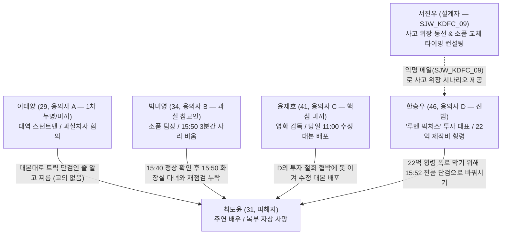

# 에피소드 4 완전 상세 설계서: 독립영화 촬영장 소품실 사망 사건

> **문서 목적**: **촬영 카메라 메모리칩(본 촬영 + NG 컷) 분석**과 **이메일 원본 헤더 메타데이터 추적**이 핵심이며, 주인공이 **전직 사수 서진우의 암호 서명(`SJW_KDFC_09`)**을 처음 발견하는 서사적 전환점인 EP 4의 완전 상세 명세서입니다. *(사전 모순 검증 완료 / 실존 상표명 0%)*

---

## 1. 사건 기본 설정 및 핵심 테마

* **사건 번호**: `CASE-2026-047` (파주 '청람 스튜디오' 독립영화 `<블라인드 컷>` 촬영장 소품 오작동 사망 사건)
* **사건의 깊이 (추리 난이도 & 메인 스토리 전환점)**: **"안전사고의 외피, 감독을 향한 의심, 그리고 NG 컷 구석에 찍힌 진짜 흑막의 그림자"**
  * 초동 수사팀은 소품 팀장(B)과 대역 스턴트맨(A)의 과실치사(안전사고)로 결론지으려 합니다.
  * 한 꺼풀 벗기면 당일 갑자기 수정 대본을 배포한 **영화 감독 윤재호(C)**가 유력 용의자로 떠오르지만, 이메일 메타데이터와 이중 회계 장부, 그리고 **NG 컷 3번 구석의 확대 캡처**를 교차 검증해야 진짜 범인인 **제작 투자자 한승우(D)**를 특정할 수 있습니다.
  * 이 사건에서 처음으로 설계자 측 익명 메일 헤더에 **전직 사수 서진우의 고유 서명(`SJW_KDFC_09`)**이 노출되며, 주인공 한도현의 개인적 추적이 본격화됩니다.
* **시간 규칙 (연장 수사 허용)**:
  * **휘발성 골든 타임**: **14시간 (840분)** — 경과 전 한승우(D) 메일 서버 영장 집행 완료 시 해외 VPN 우회 전 **원본 서버 헤더 및 서진우 개발자 서명(`SJW_KDFC_09`)** 온전 확보.
  * **현장 보존 해제 마감 (신뢰도 기준)**: **20시간 (1,200분)** — 시한 내 해결 시 전담팀 신뢰도 +1, 초과 시 연장 수사 전환 및 신뢰도 -1.

---

## 2. 등장인물 상세 프로필 및 인물 관계도

### 2.1. 인물 관계도

### 2.2. 인물별 상세 배경 및 `K-POL DB` 조회 정보
| 인물 | 역할 | 성격 및 사연 | `K-POL 시민·전과·법인 DB` 조회 결과 |
| :--- | :--- | :--- | :--- |
| **최도윤 (31)** | 피해자 (주연 배우) | 정의감이 강한 연기파 배우. 친척인 회계 담당자를 통해 제작비 30억 중 22억이 페이퍼컴퍼니로 빠진 이중 장부를 우연히 입수, 촬영 마지막 날 기자회견 폭로를 예고함. | 전과 없음. |
| **이태양 (29)** | 용의자 A (1차 미끼) | 무술팀 대역 스턴트맨. 과거 최도윤과 술자리에서 연기 합 문제로 말다툼한 적이 있어 의심받으나, 당일 소품 테이블에 접근한 적이 없음. | 과거 폭행 기소유예 1건(7년 전) — 소거용 미끼 요소. |
| **박미영 (34)** | 용의자 B (과실) | 소품 팀장. `15:40` 리허설 전 트릭 단검의 스프링 작동을 확인했으나, `15:50` 화장실에 다녀온 직후 감독의 급한 큐 사인에 재점검 없이 소품을 건넴. | 전과 없음. |
| **윤재호 (41)** | 용의자 C (핵심 미끼) | 독립영화 `<블라인드 컷>` 감독. 최도윤과 작품 해석으로 자주 다퉜고, 사건 당일 오전 `11:00` 갑자기 동선을 바꾸는 수정 대본을 배포해 가장 유력한 용의자로 의심받음. 실제로는 투자자 한승우(D)의 투자 철회 협박에 못 이겨 D가 보낸 대본을 그대로 뿌린 것. | 전과 없음. 제작비 부족으로 개인 채무 다수. |
| **한승우 (46)** | 용의자 D (진범) | 제작 투자사 '루멘 픽처스' 대표. 제작비 30억 중 22억을 허위 용역사로 빼돌림. 최도윤의 폭로를 막기 위해 설계자(서진우)의 컨설팅을 받아 진품 단검 바꿔치기를 직접 실행. | 법인 DB 조회 시 **최근 2년간 설립된 무실적 유령 법인 3곳의 실소유주**로 확인됨. |

---

## 3. 사건의 진실 및 분 단위 전체 타임라인 (모순 0% 검증)

* **사건 3일 전**: 주연 배우 최도윤이 이중 장부를 입수하고 한승우(D)에게 *"촬영 끝나는 날 전부 공개하겠다"*고 최후통첩. 한승우(D), 설계자(서진우)에게 거액을 지불하고 **'촬영 중 안전사고 위장 시나리오'**를 익명 메일로 수령.
* **사건 전날**: 한승우(D), 소품 제작사 공방에서 영화용 트릭 단검(무게 280g, 흑색 무광 금속 손잡이)과 **외형·무게(295g)가 거의 동일한 진품 단검**을 타인 명의로 별도 구매 *(대역 배우가 손에 쥐었을 때 무게 차이를 못 느낀 물리적 이유!)*.
* **사건 당일 (2026.12.10)**:
  * `09:30`: 한승우(D), 윤재호 감독(C)에게 *"투자 끊기기 싫으면 오늘 마지막 씬을 원테이크 클로즈업으로 바꾸고, 15시 55분에 휴식 없이 바로 들어가라"*며 수정 대본 파일 강제 전달.
  * `11:00`: 윤재호 감독(C), 수정 대본을 전 스태프에게 배포.
  * `15:40`: 소품 팀장 박미영(B), 트릭 단검 정상 작동(칼날 수납) 확인 후 대기실 구석 소품 테이블에 배치.
  * `15:50 ~ 15:53`: 박미영(B)이 화장실로 자리를 비운 3분 사이, 한승우(D)가 라텍스 장갑을 끼고 소품 테이블의 트릭 단검을 진품 단검으로 바꿔치기함. **이때 조명 테스트 중이던 B팀 카메라(`CAM_B`)의 NG 컷 3번(`15:52:10`) 배경 거울에 한승우의 은색 커프스링크와 손목이 찍힘!**
  * `15:55`: 재점검 시간 없이 곧바로 본 촬영 돌입. 대역 스턴트맨 이태양(A)이 대본대로 찌르는 연기를 하다가 진품 단검이 그대로 복부에 박혀 `16:40` 최도윤 사망.

---

## 4. 2D 지도 노드 6곳의 상세 의미 및 이동 시간 매트릭스

| 노드 ID | 장소명 | 사건 내 의미 및 역할 | 조사를 통해 밝혀낼 수 있는 것 |
| :--- | :--- | :--- | :--- |
| `NODE_STATION` | **경찰서 (시작 지점)** | 사건 접수 및 **대상 선택 메일 서버/금융 영장 집행** 거점. | 플레이어가 **윤재호(C)/한승우(D) 중 선택**해 메일 헤더·계좌 영장 집행. *(한승우 선택 + 14h 골든 타임 시 **`SJW_KDFC_09` 서명** 확보!)* |
| `NODE_STUDIO` | **파주 청람 스튜디오 (현장)** | 사망 사건이 발생한 촬영 세트장 및 소품실. | **B팀 카메라 메모리칩(본 촬영 + NG 컷 6종)** + 진품 단검 나사 틈 정밀 감식(라텍스 장갑 파우더 및 고급 향수 성분 — 스태프/스턴트맨과 불일치). |
| `NODE_DIRECTOR_LAB` | **윤재호(C) 감독 작업실** | 수정 대본을 배포한 핵심 미끼 감독의 작업실. | 윤재호 PC 이메일 압수 → 오전 `09:30` **한승우(D)가 투자 철회로 협박하며 수정 대본 원본을 보낸 메일** 확보 → **핵심 미끼 C 소거!** |
| `NODE_LUMEN` | **루멘 픽처스 사무실** | 투자자 한승우(D)의 본사 사무실. | **이중 회계 장부(22억 원 횡령 내역)** + 최도윤이 보낸 **기자회견 폭로 예고 문자 출력본**(확실한 살해 동기!) + 한승우 책상의 동일 고급 향수 확인. |
| `NODE_STUNT_GYM` | **이태양(A) 액션스쿨** | 대역 스턴트맨의 소속 훈련장 *(소거용 미끼 장소)*. | 동료 스태프 증언 및 동선 확인 → **`[특이사항 없음 보고서]`** *"다툰 건 한 달 전 연기 합 문제로 당일 화해했고, 사건 당일 대기실 소품 테이블 근처에 간 적이 없습니다."* → 증거판에서 A 기각/소거. |
| `NODE_PROP_SHOP` | **특수소품 공방** | 영화용 트릭 단검을 납품한 공방. | **소품 규격서**(트릭 단검 280g vs 진품 295g으로 무게 차이 거의 없음 — A의 무죄 입증) + 사건 전날 동일 외형 진품 단검을 현금 구매해 간 **한승우 측 대리인 CCTV/영수증** 확보. |

### 노드 간 확정 이동 시간표 (단위: 분, 대칭)
| 출발 \ 도착 | 경찰서 | 청람 스튜디오 | 감독 작업실 | 루멘 픽처스 | 액션스쿨 | 특수소품 공방 |
| :--- | :---: | :---: | :---: | :---: | :---: | :---: |
| **경찰서** | 0 | 35 | 25 | 20 | 30 | 25 |
| **청람 스튜디오** | 35 | 0 | 25 | 40 | 20 | 35 |
| **감독 작업실** | 25 | 25 | 0 | 20 | 25 | 20 |
| **루멘 픽처스** | 20 | 40 | 20 | 0 | 35 | 30 |
| **액션스쿨** | 30 | 20 | 25 | 35 | 0 | 25 |
| **특수소품 공방** | 25 | 35 | 20 | 30 | 25 | 0 |

---

## 5. 초기 지급 자료 (초동 수사 확보분 — 게임 시작 시 OS 파일 탐색기에 기본 제공)

*(초동 수사팀이 당연히 1차로 확보했을 변사 보고서, 수정 대본 PDF, 진술서 3종, 촬영장 및 단검 현장 사진은 초기 자료로 지급됩니다.)*

### ① `EV_EP4_INITIAL_REPORT` (초동 변사 사건 수사 보고서)
> **[사건 개요]** 2026.12.10 `15:55`경 파주 청람 스튜디오 촬영 중, 대역 배우 이태양(29)이 휘두른 단검에 주연 배우 최도윤(31)이 복부를 찔려 `16:40` 사망. 현장에서 수거된 단검은 칼날이 들어가지 않는 **진품 금속 단검**으로 확인됨.  
> **[초동 결론]** 소품 팀장 박미영(34)의 관리 소홀 및 이태양(29)의 확인 부주의에 의한 업무상 과실치사(안전사고)로 송치 예정. `20시간` 뒤 스튜디오 현장 보존 해제 예정.  
> **[특이사항]** 감독 윤재호(41)가 사건 당일 `11:00` 갑자기 해당 씬의 동선을 바꾸는 수정 대본을 배포함.

### ② 초동 현장 사진 2종 (초동 감식반 촬영본)
* **`EV_EP4_PHOTO_INIT_SET` (세트장 및 대기실 소품 테이블 전경 사진)**: 촬영 세트와 뒤편 대기실 통로의 소품 테이블, 그리고 테이블 뒤 벽면에 걸린 대형 분장 거울 배치 확인 *(NG 컷 거울 반사 추리의 공간적 단서)*.
* **`EV_EP4_PHOTO_INIT_KNIFE` (현장 수거 진품 단검 사진)**: 흑색 무광 금속 손잡이 단검(외형상 트릭 단검과 육안 구분 불가).

### ③ `EV_EP4_DOC_SCRIPT_PDF` (수정 대본 파일 — **메타데이터 뷰어 분석 대상!**)
> **[씬 #42 수정 지시]** 15:55 휴식 없이 원테이크 클로즈업 돌입. 소품 점검 생략하고 직전 리허설 소품 그대로 사용. 카메라 A는 피해자 등 뒤 45도 사각지대 배치.  
> *(※ `메타데이터 뷰어` 확인 시: 배포자는 윤재호지만 **`Original_Author: HSW_Lumen`**(한승우 루멘)으로 기록되어 있음! `EV_EP4_META_SCRIPT`)*

### ③ `EV_EP4_STATEMENT_A` (이태양 대역 배우 진술서)
> *"제가 미쳤다고 촬영장에서 사람을 찌릅니까! 손에 쥐었을 때 평소 쓰던 트릭 단검이랑 무게랑 색깔이 똑같았어요. 최도윤 형이랑 한 달 전에 합 때문에 좀 다툰 건 맞지만 그날 바로 풀었다고요!"*

### ④ `EV_EP4_STATEMENT_C` (윤재호 감독 진술서)
> *"대본을 당일 오전에 바꾼 건... 연출적인 판단이었습니다. 최도윤 씨랑 최근 작품 방향 때문에 언쟁이 좀 있긴 했지만, 사고를 낼 이유가 전혀 없어요."*

### ⑤ `EV_EP4_STATEMENT_D` (한승우 투자 대표 참고인 진술서)
> *"안타까운 사고입니다. 전 촬영장 뒷편 VIP 대기실에서 커피만 마시고 있었어요. 소품실이나 세트장 안쪽엔 발도 안 들였습니다."*

---

## 6. 포렌식 툴킷(촬영 메모리칩: 본 촬영 + NG 컷 6종) 상세 명세

> **특징**: `ACT_EP4_STUDIO`로 획득. 본 촬영 컷(1~2)만 보면 완벽한 안전사고처럼 보이지만, **NG 컷 3번(`15:52:10`)**을 정밀 분석해야 진범의 물리적 실수가 드러납니다.

| 컷 번호 | 구분 / 시각 | 화면 묘사 | 포렌식 가공 및 숨겨진 단서 |
| :---: | :---: | :--- | :--- |
| **컷 1~2** | 본 촬영 (`15:55`) | 클로즈업 앵글. 이태양(A)이 대본대로 찌르고, 최도윤이 쓰러지자 A가 경악하며 칼을 떨어뜨림. | A의 표정·동작상 명백한 당황(고의성 낮음) |
| **컷 3** | NG 컷 1 (`15:38`) | 리허설 중 대사 실수. 소품 팀장 박미영(B)이 단검 칼날이 손잡이로 쏙 들어가는 걸 테스트하는 모습. | `15:40` 이전까지는 정상 트릭 단검이었음을 입증! (`EV_EP4_CAP_FAKE_OK`) |
| **컷 4** | **NG 컷 3 (`15:52:10`)** | B팀 카메라 조명 테스트 중 실수로 녹화된 컷. 어두운 세트장 뒤편 대기실 통로 거울이 살짝 비침. | **[명암 보정 + 2.5x 확대 캡처]** 거울 반사 속에 **VIP 정장 소매의 은색 커프스링크(한승우 착용품)를 찬 손이 소품 테이블의 단검을 바꿔치기하는 장면** 포착! (`EV_EP4_CAP_NG_SWAP` — "소품실에 발도 안 들였다"는 D 진술 완전 붕괴!) |
| **컷 5~6** | NG 컷 4~5 (`15:53`) | 박미영(B)이 화장실에서 뛰어와 시간 촉박에 단검을 그대로 A에게 건네는 모습. | B의 단순 과실 확인 |

---

## 7. 현장 지시 액션 트리 및 수학적 시간 밸런스 검증

| 액션 ID | 위치 노드 | 지시 내용 | 작업 시간 | 획득 증거 및 결과 |
| :--- | :--- | :--- | :---: | :--- |
| `ACT_EP4_STUDIO` | 청람 스튜디오 | B팀 메모리칩(NG 컷 포함) 확보 및 진품 단검 정밀 감식 | 90분 | **`EV_EP4_CAM_MEMORY`** (본 촬영 + NG 컷 6종), **`EV_EP4_DOC_KNIFE_LAB`** (손잡이 나사 틈에서 라텍스 장갑 파우더 + 고급 우드 향수 성분 검출). |
| `ACT_EP4_DIRECTOR` | 감독 작업실 | 윤재호(C) PC 압수 및 수정 대본 수신 이메일 확인 | 60분 | **`EV_EP4_DOC_COERCION_MAIL`**: `09:30` 한승우(D)가 투자 철회를 협박하며 수정 대본 원본을 보낸 메일 확보 → **핵심 미끼 C 소거!** |
| `ACT_EP4_LUMEN` | 루멘 픽처스 | 회계 장부 압수, 한승우(D) 사무실 수색 및 통화 기록 확보 | 90분 | **`EV_EP4_DOC_FRAUD_LEDGER`** (제작비 22억 원 유령 법인 횡령 이중 장부 + 최도윤의 폭로 예고 문자), **`EV_EP4_PHOTO_PERFUME`** (책상 위 동일 고급 우드 향수 및 은색 커프스링크 확인). |
| `ACT_EP4_STUNT` | 액션스쿨 | 이태양(A) 동료 탐문 및 동선 검증 *(미끼)* | 60분 | **`[특이사항 없음 보고서]`** → 증거판에서 A 기각/소거. |
| `ACT_EP4_PROP` | 특수소품 공방 | 트릭 단검 무게 규격서 및 진품 단검 판매 기록 확인 | 60분 | **`EV_EP4_DOC_PROP_SPEC`** (트릭 280g vs 진품 295g — 무게 차이 거의 없음 입증) + 전날 한승우 측 대리인의 진품 구매 영수증. |
| `ACT_EP4_MAIL_WARRANT` | 경찰서 *(대상 선택 영장)* | **윤재호(C)/한승우(D) 중 선택** → 삭제된 익명 메일 서버 헤더 및 계좌 추적 | 90분 | • **윤재호(C) 선택 시**: *"특이 외부 연락 없음"* (소거) • **한승우(D) 선택 시**: 설계자 측으로부터 사고 위장 동선 지시 메일 수신 확인. **[14h 휘발성 보너스]**: 840분 이내 완료 시 해외 VPN 우회 전 원본 헤더에서 **`LOG_WIPE` 개발자이자 주인공의 전직 사수 서진우의 고유 서명(`SJW_KDFC_09`)** 확보! (`EV_META_EP04_SIGNATURE`) |

### 수학적 시간 밸런스 검증 (휘발성 14시간 = 840분 / 마감 시한 20시간 = 1,200분)
* **최적 동선 (필수 5개 액션)**:
  1. `경찰서 → 청람 스튜디오`(35) + 메모리칩/단검 감식(90) + 보고(15) = **140분**
  2. `스튜디오 → 감독 작업실`(25) + 협박 메일 압수(60) + 보고(15) = **100분** *(누적 240분)*
  3. `작업실 → 루멘 픽처스`(20) + 이중 장부/향수(90) + 보고(15) = **125분** *(누적 365분)*
  4. `루멘 픽처스 → 특수소품 공방`(30) + 규격서/구매 기록(60) + 보고(15) = **105분** *(누적 470분)*
  5. `공방 → 경찰서`(25) + 한승우 메일 헤더 영장(90) + 보고(15) = **130분** *(누적 600분 = **10시간 00분**)*
* **비효율/미끼 포함 동선**: 액션스쿨 조사 + 윤재호 영장 오지정 포함 시 약 **850~1,020분 (14시간 10분 ~ 17시간)** → 20시간 내 해결 가능, 14시간 휘발성 골든 타임 달성에는 전략적 동선 필수.

---

## 8. 최종 보고서(기소 의견서) 정답 로직 및 플롯 홀 점검

| 보고서 항목 | 정답 값 / 숨겨진 증거 ID | 오답 시 파트너 피드백 |
| :--- | :--- | :--- |
| **1. 진범 지목** | **한승우 (용의자 D)** | (A/B 선택 시) *"트릭 단검과 진품 무게가 거의 같고, 15:40까지는 정상 소품이었습니다. 누군가 그 사이에 바꿔치기했습니다."* (C 선택 시) *"윤재호 감독은 협박에 못 이겨 대본을 뿌린 겁니다. 수정 대본 메타데이터와 이메일 원본을 확인해 보시죠."* |
| **2. 안전사고(과실) 반박** | **`EV_EP4_CAP_FAKE_OK`** + **`EV_EP4_DOC_PROP_SPEC`** | *"15:40에는 정상 트릭 소품이었으며, 대역 배우가 무게 차이를 눈치채지 못했다는 객관적 근거가 필요합니다."* |
| **3. 진범의 소품 교체 물증** | **`EV_EP4_CAP_NG_SWAP`** + **`EV_EP4_DOC_KNIFE_LAB`** (또는 `EV_EP4_PHOTO_PERFUME`) | *"한승우는 소품실에 간 적이 없다고 주장합니다. NG 컷과 단검 정밀 감식에서 결정적 물증을 연결해 보시죠."* |
| **4. 범행 동기 및 대본 조작 입증** | **`EV_EP4_DOC_FRAUD_LEDGER`** + **`EV_EP4_DOC_COERCION_MAIL`** | *"한승우가 왜 주연 배우를 죽이고 대본을 강제로 바꿨는지, 횡령 장부와 협박 메일을 첨부해 주십시오."* |

### 사건 해결 연출: 시간대별 현장 체포 보고 메시지 (정산 화면 3단계 분기)
* **① 골든 타임 내 빠른 검거 (`≤ 14시간`)**:
  > `[현장 체포 보고]` `2026.12.10 {클리어 시각}경, 루멘 픽처스 대표실에서 유령 법인 이중 회계 장부를 파쇄하려던 피의자 한승우(46)를 살인 및 특정경제범죄가중처벌법 위반(횡령) 혐의로 기습 체포함.`  
  > **강민호 경사**: *"경위님, 안전사고로 끝날 줄 알고 서류만 정리하다가 그대로 잡혔습니다. 그리고 익명 메일 원본 헤더에서 `SJW_KDFC_09` 서명까지 삭제 전에 확보했습니다... 설마 서진우 선배님 맞습니까?"*
* **② 현장 보존 마감 내 검거 (`14시간 초과 ~ 20시간 이내`)**:
  > `[현장 체포 보고]` `2026.12.10 {클리어 시각}경, 파주 청람 스튜디오 철수 현장에서 소품 폐기를 지시하며 도주하려던 피의자 한승우(46)를 긴급 체포함.`  
  > **강민호 경사**: *"스튜디오 정리하는 척 증거 인멸하려던 놈을 현장에서 덮쳤습니다. 대역 배우 이태양 씨와 소품 팀장님도 살인 혐의는 완전히 벗었습니다."*
* **③ 연장 수사 검거 (`20시간 초과`)**:
  > `[현장 체포 보고]` `2026.12.10 {클리어 시각}경, 지방 개인 별장으로 잠적해 횡령 자금의 해외 송금을 시도하던 피의자 한승우(46)를 긴급 추적 끝에 검거함.`  
  > **강민호 경사**: *"별장까지 쫓아가서 겨우 잡았습니다. 익명 메일 서버 헤더가 일부 파기된 게 아쉽지만 진범은 확실히 넣었습니다."*

### 플롯 홀 최종 점검표 (자체 검수 완료)
* [x] **대역 배우가 칼을 쥐었을 때 무게 차이를 몰랐는가?** → 트릭 단검 280g vs 진품 단검 295g(금속 손잡이·스프링 무게추 적용)으로 15g 차이에 불과해 긴장된 원테이크 촬영 직전 구분 불가.
* [x] **왜 하필 NG 컷에 찍혔는가?** → 본 촬영 카메라(`CAM_A`)는 꺼져 있었으나, B팀 카메라(`CAM_B`)가 조명 화이트밸런스 테스트를 위해 1분간 녹화 버튼을 눌러둔 상태였고 거울 반사에 우연히 잡힘(현실적 촬영장 변수).
* [x] **메인 스토리 연결이 자연스러운가?** → 이 에피소드의 휘발성 단서(`SJW_KDFC_09`)를 통해 주인공 한도현이 처음으로 **"지금까지의 사건들 배후에 5년 전 파면된 전직 사수 서진우가 있다"**는 사실을 확신하게 됨.
