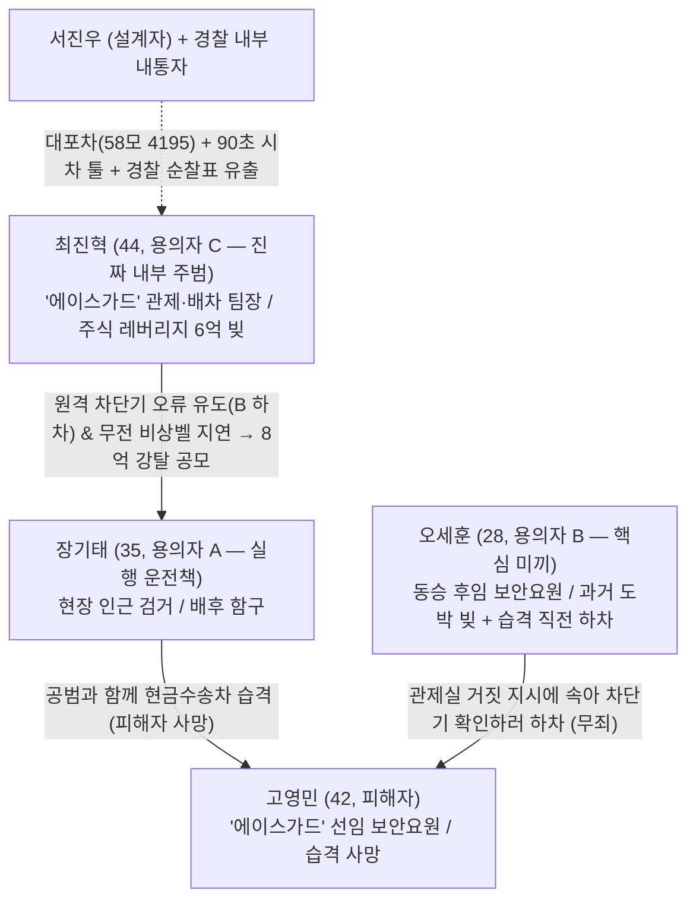

# 에피소드 5 완전 상세 설계서: 지하주차장 현금수송차 습격 살인 사건

> **문서 목적**: **다중 CCTV 2대(카메라 A/B)의 90초 타임스탬프 조작 교차 검증**, **무전 오디오 파형 분석**, **EP 3 대포차(`58모 4192`) 연결**, 그리고 **경찰청 내부망(`K-POL OS`) 순찰표 유출**로 내부 내통자의 존재를 처음 확정하는 상급 에피소드 EP 5의 완전 상세 명세서입니다. *(사전 모순 검증 완료 / 실존 상표명 0%)*

---

## 1. 사건 기본 설정 및 핵심 테마

* **사건 번호**: `CASE-2026-059` (강남 '센트럴타워' 지하 2층 주차장 현금수송차 습격 및 특수강도살인 사건 — 보안요원 1명 사망, 1명 경상, 현금 8억 원 강탈)
* **사건의 깊이 (상급 난이도 & 내부 내통자 충격)**: **"현장에 있던 후임 보안요원의 의심을 뒤집고, 관제실의 90초 시차 조작과 경찰 내부 유출을 밝혀내는 복합 수사"**
  * 초동 수사팀은 검거된 운전책 장기태(A) 외에, 도박 빚이 있고 습격 직전 차에서 내린 후임 보안요원 **오세훈(B)**을 내부 공범으로 의심합니다.
  * 하지만 **카메라 B 벽면 LED 시계와 CCTV 타임스탬프의 90초 시차 조작**, **차단기 원격 오류 로그**, **관제 무전 녹취**를 교차 검증하면, 오세훈을 차 밖으로 유인하고 비상벨을 막은 진짜 내부 주범이 **관제·배차 팀장 최진혁(C)**임이 드러납니다.
  * 또한 실행범 은신처에서 나온 **관할 경찰 순찰 시간표**가 사건 6시간 전 서울청 내부망(`K-POL OS`)에서 출력된 것임이 밝혀지며, 경찰 내부에 설계자(서진우)와 손잡은 내통자가 존재함이 확정됩니다.
* **시간 규칙 (연장 수사 허용)**:
  * **휘발성 골든 타임**: **15시간 (900분)** — 경과 전 청사 내부망 출력 감사 로그 조회 완료 시 삭제 직전의 **출력 부서 코드(`서울청 수사국 간부실`) 및 출력 단말 MAC 주소** 확보 (EP 6 박정태 총경 특정의 결정적 전제).
  * **구속 시한 (신뢰도 기준)**: **22시간 (1,320분)** — 시한 내 해결 시 전담팀 신뢰도 +1, 초과 시 연장 수사 전환 및 신뢰도 -1.

---

## 2. 등장인물 상세 프로필 및 인물 관계도

### 2.1. 인물 관계도

### 2.2. 인물별 상세 배경 및 `K-POL DB` 조회 정보
| 인물 | 역할 | 성격 및 사연 | `K-POL 시민·차량·전과 DB` 조회 결과 |
| :--- | :--- | :--- | :--- |
| **고영민 (42)** | 피해자 (선임 요원) | 15년 경력의 베테랑 현금수송 보안요원. 습격 당시 현금 가방을 지키려다 흉기에 찔려 사망. | 전과 없음. |
| **장기태 (35)** | 용의자 A (실행 운전책) | 습격 직후 도주 차량을 몰다 추격 끝에 검거(공범 1명과 현금 8억은 도주 중). *"우발적 범행이며 내부 조력자는 없다"*고 버팀. | 특수절도 전과 2범. 거주지(은신처) 주소 확인 가능. |
| **오세훈 (28)** | 용의자 B (핵심 미끼) | 동승 후임 요원. 2년 전 도박 빚이 있었고 습격 직전 차단기를 확인하겠다며 차에서 내려 혼자 경상만 입어 내부 공범으로 몰림. 실제로는 빚을 갚기 위해 야간 대리운전까지 뛰며 성실히 살고 있었고, 관제 팀장의 원격 조작에 속은 피해자. | 과거 불법 도박 벌금형 1건(2년 전 — 미끼 요소). |
| **최진혁 (44)** | 용의자 C (진범/내부 주범) | 에이스가드 관제·배차 팀장. 겉으로는 모범 직원이나, 최근 1년간 무리한 주식 레버리지 투자로 **사채 포함 6억 원대 채무**에 몰려 파산 직전. 설계자 측과 손잡고 8억 원 강탈 작전을 설계. | 전과 없음. **최근 3개월간 급여 압류 예고 및 사채업자 고소 이력** 확인. |

---

## 3. 사건의 진실 및 분 단위 전체 타임라인 (모순 0% 검증)

* **사건 6시간 전 (`12.17 21:00`)**: 경찰 내부 내통자가 서울청 `K-POL OS`에서 **강남권 심야 순찰 경로 및 교대 시간표**(센트럴타워 인근 7분 공백 포함)를 출력해 서진우 측에 전달.
* **사건 당일 (2026.12.18 새벽)**:
  * `03:09:00` *(실제 시각)*: 장기태(A)와 실행 공범이 **회색 대형 승합차(`58모 4195`, EP 3 `58모 4192`와 동일 대포차 공급선)**를 타고 센트럴타워 지하주차장 진입.
  * `03:10:00` *(실제 시각)*: 현금수송차가 지하 2층 하역장 도착. **관제 팀장 최진혁(C)**이 원격으로 주차장 입구 차단기 오류 신호를 강제 발생시켜 후임 오세훈(B)이 확인하러 차에서 내리게 유도.
  * `03:10:30` *(실제 시각)*: 최진혁(C), 사전에 심어둔 `LOG_WIPE` 변종 스크립트로 **카메라 B(하역장) 타임스탬프를 실제보다 90초 느리게(`03:09:00`으로) 조작**하여 자신의 원격 제어 시각과 어긋나게 위장.
  * `03:11:00` *(실제 시각)*: 실행범들이 수송차를 습격해 고영민을 살해하고 8억 원 강탈. 오세훈(B)이 비상 무전을 눌렀으나 최진혁(C)이 **"통신 점검 중이니 2분 대기하라"**고 거짓 통제해 112 신고를 90초 지연시킴.
  * `03:13:00` *(실제 시각)*: 순찰 공백 7분 틈을 타 도주. 장기태(A)만 추격에 검거됨.

---

## 4. 2D 지도 노드 6곳의 상세 의미 및 이동 시간 매트릭스

초기에는 5개 노드만 표시되며, **카메라 A에서 해독한 도주 승합차 번호판 `58모 4195`를 `K-POL 차량 DB`에 검색해 말소 대포차 유통지(폐차장)를 찾으면 6번째 노드(`NODE_VAN_LOT`)가 해금**됩니다.

| 노드 ID | 장소명 | 사건 내 의미 및 역할 | 조사를 통해 밝혀낼 수 있는 것 |
| :--- | :--- | :--- | :--- |
| `NODE_STATION` | **경찰서 (시작 지점)** | 장기태(A) 구금 및 **대상 선택 금융 영장 + 청사 내부망 감사 로그 조회** 거점. | **최진혁(C) 선택 시** 6억 채무 및 착수금 정황 확보 + **[15h 휘발성 보너스]** 순찰표 출력 부서(`서울청 수사국 간부실`) 감사 로그 확보! |
| `NODE_TOWER` | **센트럴타워 지하주차장 (현장)** | 습격이 일어난 지하 2층 하역장 및 입구 차단기. | **다중 CCTV(카메라 A/B 6컷)** + **주차장 차단기 원격 제어 로그**(`03:10:00` 에이스가드 관제실 IP에서 강제 오류 명령 전송 확인!). |
| `NODE_ACE_HQ` | **에이스가드 관제본부** | 현금수송 배차 및 비상 무전을 통제하는 관제실. | **비상 무전 녹취 오디오**(`03:11` 최진혁이 오세훈의 비상 신고를 "점검 중"이라며 막은 음성!) + 최진혁 PC의 타임스탬프 조작 툴 흔적. |
| `NODE_HIDEOUT` | **장기태(A) 은신처** | 검거된 운전책의 원룸. | 코팅된 **'강남권 심야 경찰 순찰 시간표' 출력물**(하단 미세 워터마크 메타데이터 → `K-POL OS` 내부 출력물 확인!) + 대포차 보조키. |
| `NODE_B_HOME` | **오세훈(B) 자택** | 과거 도박 빚이 있던 후임 요원의 거주지 *(소거용 미끼)*. | 계좌 및 생활 패턴 확인 → **`[특이사항 없음 보고서]`** *"2년 전 빚은 야간 대리운전으로 거의 다 갚았고, 장기태나 외부 세력과 통화·금전 거래가 전혀 없습니다."* → 증거판에서 B 기각/소거. |
| `NODE_VAN_LOT` | **외곽 폐차장 (대포차 거점)** *(DB 검색 해금)* | 도주 차량 `58모 4195`의 유통 거점. | `58모 4195` 차량 감식 및 **EP 3 화재 현장 대포차(`58모 4192`)와 동일한 차대번호 위조 수법 및 성수동 거래선** 확인! |

### 노드 간 확정 이동 시간표 (단위: 분, 대칭)
| 출발 \ 도착 | 경찰서 | 센트럴타워 | 관제본부 | A 은신처 | B 자택 | 대포차 폐차장 |
| :--- | :---: | :---: | :---: | :---: | :---: | :---: |
| **경찰서** | 0 | 25 | 20 | 30 | 25 | 35 |
| **센트럴타워** | 25 | 0 | 20 | 25 | 20 | 40 |
| **관제본부** | 20 | 20 | 0 | 30 | 25 | 35 |
| **A 은신처** | 30 | 25 | 30 | 0 | 15 | 35 |
| **B 자택** | 25 | 20 | 25 | 15 | 0 | 40 |
| **대포차 폐차장** | 35 | 40 | 35 | 35 | 40 | 0 |

---

## 5. 초기 지급 자료 (초동 수사 확보분 — 게임 시작 시 OS 파일 탐색기에 기본 제공)

*(초동 수사팀이 당연히 1차로 확보했을 보고서, 진술서 3종, 하역장 현장 전경 사진, 에이스가드 당일 배차표는 초기 자료로 지급됩니다.)*

### ① `EV_EP5_INITIAL_REPORT` (초동 특수강도살인 보고서)
> **[사건 개요]** 2026.12.18 새벽 `03:11`경 강남 센트럴타워 지하 2층 하역장에서 에이스가드 현금수송차가 무장 강도 2인의 습격을 받아 선임 요원 고영민(42) 사망, 현금 8억 원 강탈.  
> **[수사 현황]** 도주 운전책 장기태(35) 검거. 동승 후임 요원 오세훈(28)이 과거 도박 전력이 있고 습격 직전 차단기 확인을 이유로 차에서 내려 내부 공범으로 유력 의심됨. `22시간` 내 구속영장 청구 및 공범 특정 시한.

### ② 초동 현장 사진 및 배차 기록 (초동 확보분)
* **`EV_EP5_PHOTO_INIT_BAY` (지하 2층 하역장 전경 사진)**: 습격당한 현금수송차와 벽면의 독립 전파 디지털 LED 시계 위치 확인 *(카메라 B 90초 시차 검증의 기준점)*.
* **`EV_EP5_DOC_INIT_DISPATCH` (에이스가드 당일 배차표)**: 수송차량 출동 시간(`03:10` 하역장 도착 예정) 및 배차 책임자 **최진혁 팀장** 결재 서명 기재.

### ③ `EV_EP5_STATEMENT_A` (장기태 진술서)
> *"다 내 단독 기획이야! 현금수송차 시간대 며칠 지켜보다가 턴 거라고. 에이스가드 직원 중에 아는 놈 하나도 없어. 순찰차? 그냥 운 좋게 안 마주친 거지!"*

### ③ `EV_EP5_STATEMENT_B` (오세훈 후임 요원 진술서)
> *"억울합니다! `03시 10분`에 차단기가 갑자기 오류 뜨면서 안 열리길래 확인하러 내린 거예요. 습격당하자마자 비상 무전 눌렀는데 관제실 최진혁 팀장님이 '지금 통신 점검 중이니 2분 대기하라'고 하셔서 신고가 늦어진 겁니다!"*

### ④ `EV_EP5_STATEMENT_C` (최진혁 관제 팀장 참고인 진술서)
> *"오세훈이 거짓말하는 겁니다! CCTV 타임스탬프 보세요. 습격은 `03시 09분 30초`에 이미 끝났고, 전 그 뒤에 정상적으로 비상 신고 접수했습니다. 통신 점검 지시 같은 건 한 적이 없어요!"*

---

## 6. 포렌식 툴킷(다중 CCTV 2대 시차 교차 + 무전 오디오) 상세 명세

### 6.1. 다중 CCTV A/B 교차 6컷 (`ACT_EP5_TOWER`로 확보)
| 컷 번호 | 카메라 / CCTV 표시 시각 | 화면 묘사 | 포렌식 가공 및 숨겨진 단서 |
| :---: | :---: | :--- | :--- |
| **컷 1** | `CAM_A (입구)` `03:09:00` | 회색 대형 승합차가 입구 차단기를 통과해 지하 2층으로 진입. | **[명암 보정 + 2.5x 확대 캡처]** 번호판 **`58모 4195`** 해독! (`EV_EP5_CAP_VAN_58`) → `K-POL 차량 DB` 검색 시 EP 3(`58모 4192`)과 동일 대포차망 확인 + 폐차장 노드 해금 |
| **컷 2** | `CAM_A (입구)` `03:10:00` | 입구 차단기 표시등이 갑자기 적색(오류)으로 점멸. 오세훈(B)이 수송차에서 내려 걸어감. | 차단기 원격 오류 로그(`03:10:00`)와 시각 일치 |
| **컷 3** | `CAM_B (하역장)` `03:09:30` | 강도들이 수송차를 습격하는 장면. | **[2.5x 확대 캡처 — 핵심 트릭!]** 하역장 벽면에 걸린 **건물 자체 디지털 LED 시계는 `03:11:00`**을 가리키고 있으나, CCTV 타임스탬프는 `03:09:30`으로 **정확히 90초 느리게 조작**됨! (`EV_EP5_CAP_TIME_SHIFT` → 최진혁 C의 "03:09:30에 끝났다"는 거짓말 완전 붕괴!) |
| **컷 4** | `CAM_B (하역장)` `03:10:15` *(실제 `03:11:45`)* | 강도들이 현금 가방을 들고 도주. | 실제 시각 `03:11:45` 도주 확인 |

### 6.2. 관제실 비상 무전 오디오 파형 (`ACT_EP5_ACE_HQ`로 확보)
* 기본 상태에서는 지하주차장 고주파 무전 잡음(치직거림)이 심함 → **고주파 노이즈 컷 필터 조절** 시:
  * `03:11:10`: 오세훈(B)의 다급한 목소리 *"팀장님! 강도입니다! 112 바로—"*
  * `03:11:14`: **최진혁(C)의 목소리 *"센트럴타워 지하 2층 통신 점검 중이니 2분 대기해, 비상벨 누르지 마."*** (`EV_EP5_AUDIO_RADIO` — 최진혁의 고의 방해 결정적 증거!)

---

## 7. 현장 지시 액션 트리 및 수학적 시간 밸런스 검증

| 액션 ID | 위치 노드 | 지시 내용 | 작업 시간 | 획득 증거 및 결과 |
| :--- | :--- | :--- | :---: | :--- |
| `ACT_EP5_TOWER` | 센트럴타워 | 다중 CCTV(A/B) 확보 및 입구 차단기 원격 제어 로그 압수 | 90분 | **`EV_EP5_CCTV_DUAL`** (A/B 교차 컷), **`EV_EP5_DOC_GATE_LOG`** (`03:10:00` 에이스가드 관제실 최진혁 계정으로 차단기 강제 오류 명령 전송 기록!). |
| `ACT_EP5_ACE_HQ` | 관제본부 | 비상 무전 백업 오디오 및 최진혁(C) PC 로그 압수 | 90분 | **`EV_EP5_AUDIO_RADIO`** (무전 녹취 파일), **`EV_EP5_DOC_SHIFT_TOOL`** (최진혁 PC에서 `LOG_WIPE` 변종 90초 시차 툴 실행 흔적 확인). |
| `ACT_EP5_HIDEOUT` | A 은신처 | 장기태(A) 원룸 수색 및 소지품 압수 | 90분 | **`EV_EP5_DOC_PATROL_MAP`**: 코팅된 **강남권 심야 경찰 순찰 시간표** 출력물 — 메타데이터/워터마크 확인 시 **사건 6시간 전 서울청 `K-POL OS` 내부망에서 직접 출력된 기밀 문서!** |
| `ACT_EP5_B_HOME` | B 자택 | 오세훈(B) 계좌 및 통화 내역 조사 *(미끼)* | 60분 | **`[특이사항 없음 보고서]`** → 증거판에서 B 기각/소거. |
| `ACT_EP5_VAN_LOT` | 대포차 폐차장 *(DB 해금)* | `58모 4195` 차량 감식 및 대포차 유통선 추적 | 60분 | **`EV_EP5_DOC_VAN_LINK`**: EP 3 화재 현장 대포차(`58모 4192`)와 동일한 차대번호 위조 수법 및 성수동 거래선 연결 확인. |
| `ACT_EP5_AUDIT` | 경찰서 *(영장 & 내부 감사)* | **대상 선택 금융 영장(B/C)** + **청사 내부망 순찰표 출력 감사 로그 조회** | 90분 | • **최진혁(C) 선택 시**: **`EV_EP5_DOC_DEBT_C`** (6억 원 사채 채무 및 대포폰 착수금 정황). • **[15h 휘발성 보너스]**: 900분 이내 감사 로그 조회 완료 시 삭제 직전의 **출력 부서 코드(`서울청 수사국 간부실`) 및 단말 MAC 주소(`EV_META_EP05_LEAK`)** 확보! |

### 수학적 시간 밸런스 검증 (휘발성 15시간 = 900분 / 구속 시한 22시간 = 1,320분)
* **최적 동선 (필수 5개 액션)**:
  1. `경찰서 → 센트럴타워`(25) + CCTV/차단기(90) + 보고(15) = **130분**
  2. `센트럴타워 → 관제본부`(20) + 무전/PC(90) + 보고(15) = **125분** *(누적 255분)*
  3. `관제본부 → A 은신처`(30) + 순찰표 압수(90) + 보고(15) = **135분** *(누적 390분)*
  4. `A 은신처 → 대포차 폐차장`(35) + 대포차 감식(60) + 보고(15) = **110분** *(누적 500분)*
  5. `폐차장 → 경찰서`(35) + C 금융 영장 & 내부 감사 로그(90) + 보고(15) = **140분** *(누적 640분 = **10시간 40분**)*
* **비효율/미끼 포함 동선**: 오세훈 자택 조사 + 오지정 영장 포함 시 약 **900~1,100분 (15~18시간 20분)** → 22시간 내 해결 가능, 15시간 휘발성 골든 타임(내부망 출력 부서 확보) 달성에는 전략적 동선 필수.

---

## 8. 최종 보고서(기소 의견서) 정답 로직 및 플롯 홀 점검

| 보고서 항목 | 정답 값 / 숨겨진 증거 ID | 오답 시 파트너 피드백 |
| :--- | :--- | :--- |
| **1. 내부 주범 지목** | **최진혁 (관제 팀장 C)** | (B 선택 시) *"오세훈은 차단기 오류 때문에 내렸고, 무전으로 신고하려다 제지당했습니다. 카메라 B의 시계를 다시 보시죠."* |
| **2. 타임스탬프 조작 입증** | **`EV_EP5_CAP_TIME_SHIFT`** (벽면 LED 시계 vs CCTV 90초 시차) | *"최진혁은 03:09:30에 사건이 끝났다고 주장합니다. 카메라 B 영상 자체가 조작되었다는 시각적 증거가 필요합니다."* |
| **3. 고의적 유인 및 신고 방해 물증** | **`EV_EP5_DOC_GATE_LOG`** + **`EV_EP5_AUDIO_RADIO`** | *"최진혁이 일부러 차단기 오류를 내고 비상 신고를 막았다는 원격 로그와 무전 증거를 연결해 주십시오."* |
| **4. 범행 동기 및 배후 연계** | **`EV_EP5_DOC_DEBT_C`** + **`EV_EP5_DOC_PATROL_MAP`** | *"최진혁의 6억 채무 동기와, 실행범들이 경찰 순찰 공백을 미리 알고 있었다는 결정적 문서를 첨부해 주십시오."* |

### 사건 해결 연출: 시간대별 현장 체포 보고 메시지 (정산 화면 3단계 분기)
* **① 골든 타임 내 빠른 검거 (`≤ 15시간`)**:
  > `[현장 체포 보고]` `2026.12.18 {클리어 시각}경, 에이스가드 관제본부 당직실에서 90초 시차 조작 툴 로그를 삭제하던 피의자 최진혁(44)을 특수강도살인 공모 혐의로 기습 체포함.`  
  > **강민호 경사**: *"경위님, 오세훈 요원한테 누명 씌워놓고 당직실에서 로그 지우다 딱 걸렸습니다. 근데... 청사 내부 감사 로그에서 순찰표 출력한 곳이 '서울청 수사국 간부실'로 떴습니다. 우리 안에도 놈들 편이 있습니다."*
* **② 구속 시한 내 검거 (`15시간 초과 ~ 22시간 이내`)**:
  > `[현장 체포 보고]` `2026.12.18 {클리어 시각}경, 외곽 창고에서 도주 실행범과 강탈 현금 8억 원을 분배하려던 피의자 최진혁(44)을 현장 급습 체포함.`  
  > **강민호 경사**: *"현금 8억 원 전액 회수했고 공범까지 같이 묶었습니다. 오세훈 요원도 억울한 누명 벗었습니다."*
* **③ 연장 수사 검거 (`22시간 초과`)**:
  > `[현장 체포 보고]` `2026.12.18 {클리어 시각}경, 강탈 현금 일부를 챙겨 고속도로 휴게소를 거쳐 지방으로 도주하던 피의자 최진혁(44)을 긴급 추적 끝에 검거함.`  
  > **강민호 경사**: *"휴게소에서 간신히 붙잡았습니다. 청사 내부망 출력 부서 기록이 일부 덮어쓰기 된 게 뼈아프지만, 주범은 확실히 잡았습니다."*

### 플롯 홀 최종 점검표 (자체 검수 완료)
* [x] **왜 최진혁(C)은 카메라 B의 타임스탬프만 90초 조작했는가?** → 카메라 A(건물 관리사무소 소유)에는 접근 권한이 없었고, 에이스가드 자체 설치 하역장 카메라 B에만 원격 접근이 가능했기 때문에 90초 시차 모순이 발생함.
* [x] **실제 건물 LED 시계까지 조작하지 못한 이유는?** → 주차장 벽면 LED 시계는 네트워크에 연결되지 않은 독립 전파 시계라 원격 조작이 불가능했음.
* [x] **EP 3·EP 6과의 연결이 정확한가?** → 도주 차량 `58모 4195`가 EP 3 `58모 4192`와 동일 대포차망으로 이어지며, 순찰표 출력 부서(`서울청 수사국 간부실`)가 EP 6의 `ADMIN_PJT(박정태 총경)` 계정으로 직접 연결됨.
