# 에피소드 6 완전 상세 설계서: 서초동 오피스텔 밀실 추락 사건

> **문서 목적**: **보안 드론 5분 루프 합성 영상 간파**, **스마트홈 IoT(전력·허브 재부팅) 로그 교차 검증**, **유서 파일 2초 작성 메타데이터 적발**, 그리고 경찰 내부 내통자 **`ADMIN_PJT`(박정태 총경)**의 정체가 마침내 드러나는 최상급 밀실 추리 에피소드 EP 6의 완전 상세 명세서입니다. *(사전 모순 검증 완료 / 실존 상표명 0%)*

---

## 1. 사건 기본 설정 및 핵심 테마

* **사건 번호**: `CASE-2026-068` (서초동 '루체르나 오피스텔' 1804호 밀실 추락 사망 사건 — 내부 고발자 자살 위장 계획 살인)
* **사건의 깊이 (최상급 밀실 추리 & 내부 내통자 특정)**: **"완벽한 밀실과 5분짜리 가짜 하늘, 그리고 피해자의 방패를 직접 거둬간 경찰 상부"**
  * 현관문이 안에서 안전고리까지 잠긴 완벽한 밀실, PC에 남은 유서, 이상 없는 드론 순찰 영상 때문에 단순 자살로 종결되기 직전입니다.
  * 드론 영상의 **5분 루프 합성**을 간파하면 해킹 전과가 있는 오피스텔 보안 실장(B)이 유력 용의자로 떠오르지만, 외부 해킹 패킷과 **인접 호실 1805호(유령 법인 단기 임대)**의 연결고리를 `K-POL DB`로 파헤쳐야 진짜 범인 **한성바이오 법무팀장 강현석(A)**의 베란다 침입 밀실 트릭을 깰 수 있습니다.
  * 결정적으로, 사건 2시간 전 피해자의 경찰 신변보호를 직권 해제한 계정이 **`ADMIN_PJT` (박정태 총경)**임이 드러나며 최종장 EP 7로 직결됩니다.
* **시간 규칙 (연장 수사 허용)**:
  * **휘발성 골든 타임**: **15시간 (900분)** — 경과 전 `K-POL OS` 내부 신변보호 해제 감사 로그 조회 완료 시 덮어쓰기 직전의 **계정 ID(`ADMIN_PJT` — 박정태 총경) 및 해제 결재 원본 로그** 확보.
  * **단순 자살 종결 마감 (신뢰도 기준)**: **22시간 (1,320분)** — 시한 내 해결 시 전담팀 신뢰도 +1, 초과 시 연장 수사 전환 및 신뢰도 -1.

---

## 2. 등장인물 상세 프로필 및 인물 관계도

### 2.1. 인물 관계도

```mermaid
flowchart TD
    V["정민재 (36, 피해자)<br/>'한성바이오' 회계팀 과장 / 내부 고발자 (추락 사망)"]
    A["강현석 (48, 용의자 A — 진범)<br/>'한성바이오' 법무팀장 / 400억 임상 조작 은폐"]
    B["남궁현 (39, 용의자 B — 핵심 미끼)<br/>오피스텔 보안 실장 / 과거 해킹 전과 + 마스터키 보유"]
    C["이수진 (33, 용의자 C — 미끼)<br/>피해자 직장 동료 / 20:05 마지막 방문자"]
    P["박정태 총경 (ADMIN_PJT — 내부 내통자)<br/>사건 2시간 전 피해자 신변보호 직권 해제"]
    X["서진우 (설계자)<br/>드론 5분 루프 합성 & 스마트허브 재부팅 패킷 제공"]

    P -.->|"19:30 신변보호 직권 해제 & 1804호 주소 유출"| X
    X -.->|"드론 루프 합성(21:35~21:40) & 허브 재부팅 툴 제공"| A
    A -->|"유령 법인 명의로 1805호 임대 → 실외기실 경유 1804호 침입 살해 & 유서 조작"| V
    B -->|"외부 해킹에 당한 무고한 관리자 (지하 경비실 CCTV 알리바이)"| V
    C -->|"20:05 퇴장 후 귀가 (알리바이 확실)"| V
```

### 2.2. 인물별 상세 배경 및 `K-POL DB` 조회 정보
| 인물 | 역할 | 성격 및 사연 | `K-POL 시민·법인·전과 DB` 조회 결과 |
| :--- | :--- | :--- | :--- |
| **정민재 (36)** | 피해자 (내부 고발자) | 한성바이오 회계팀 과장. 회사의 400억 원대 임상시험 데이터 조작 및 비자금 문건을 확보해 검찰 제보를 앞두고 경찰 신변보호를 받고 있었으나, 사건 당일 `19:30` 갑자기 보호가 해제됨. | 전과 없음. 신변보호 신청 이력(당일 `19:30` 해제). |
| **강현석 (48)** | 용의자 A (진범) | 한성바이오 법무팀장. 사주 일가의 지시로 내부 고발 문건을 회수하고 자살로 위장 살해. 일주일 전 유령 법인('델타홀딩스') 명의로 옆집 **1805호**를 단기 임대해 밀실 트릭을 실행. | 전과 없음. **법인 DB 조회 시 `1805호` 임차 법인 '델타홀딩스'의 등기 감사로 강현석 이름 확인!** *(지도에 `1805호` 노드 해금)* |
| **남궁현 (39)** | 용의자 B (핵심 미끼) | 루체르나 오피스텔 보안 실장. 과거 해킹 전과가 있고 드론 관제 권한과 18층 마스터키를 갖고 있어 유력 용의자로 의심받으나, 사건 시각 지하 1층 경비실에서 택배 분류 중이었음. | 정보통신망법 위반 집행유예 1회(8년 전 — 강력한 미끼). |
| **이수진 (33)** | 용의자 C (미끼) | 피해자의 회계팀 후배. 사건 당일 `19:20~20:05` 피해자 집을 방문한 마지막 인물이라 의심받으나, 단순 위로 방문 후 즉시 귀가함. | 전과 없음. |

---

## 3. 사건의 진실 및 분 단위 전체 타임라인 (모순 0% 검증)

* **사건 7일 전**: 강현석(A), 유령 법인 '델타홀딩스' 명의로 루체르나 오피스텔 **1805호(1804호 바로 옆 빈집)**를 1개월 단기 임대.
* **사건 당일 (2026.12.26)**:
  * `19:30`: 경찰 내부 내통자 **박정태 총경(`ADMIN_PJT`)**, 담당 수사관 몰래 피해자 정민재의 신변보호를 '위험도 낮음'으로 직권 해제하고 거주지 호수(1804호)를 서진우 측에 전달.
  * `20:05`: 동료 이수진(C), 1804호 퇴장(도어락 마지막 열림 기록). 이후 정민재가 현관문 안전고리를 걸어 밀실 상태 형성.
  * `21:35:00`: 서진우 측 원격 해킹 패킷이 오피스텔 보안 드론 관제 서버에 침투해, **`21:35 ~ 21:40` 5분간 직전 정상 영상을 그대로 반복(루프 합성)** 송출.
  * `21:36:10`: 강현석(A), 1805호 베란다에서 공용 외벽 에어컨 실외기실의 **방화 경량 칸막이 나사를 풀고** 1804호 베란다로 넘어감. *(이때 1804호 실외기 배선을 밟아 **전력 계량기에 순간 과전류 피크** 기록!)*
  * `21:37`: 미세하게 열려 있던 베란다 창문 걸쇠를 해제하고 침입, 정민재를 뒤에서 기습 제압(기절)하고 내부 고발 문건 회수.
  * `21:38:04 ~ 21:38:06`: 미리 USB에 준비해 온 812자 유서 텍스트를 피해자 PC 메모장에 **단 2초 만에 복사·붙여넣기**하여 `유서.txt` 먼저 저장 *(메타데이터 뷰어로 적발!)*.
  * `21:39:30`: 의식을 잃은 정민재를 베란다 밖으로 추락시킴.
  * `21:40:20`: 강현석(A)이 1805호로 즉시 되돌아가며 서진우의 **스마트허브 강제 재부팅 패킷**을 실행해 베란다 도어 센서 기록만 삭제(드론 루프 종료 직전 이탈 — 전력 계량기 로그와 허브 재부팅 시각 자체는 남음).
  * `21:42`: 1층 경비원이 추락음을 듣고 달려와 피해자 발견, 119 신고.

---

## 4. 2D 지도 노드 6곳의 상세 의미 및 이동 시간 매트릭스

초기에는 5개 노드만 표시되며, **오피스텔 관리대장 또는 `K-POL 법인 DB`에서 옆집 1805호 임차 법인('델타홀딩스')과 강현석(A)의 연결고리를 찾아내면 6번째 노드(`NODE_APT_1805`) 수색이 해금**됩니다.

| 노드 ID | 장소명 | 사건 내 의미 및 역할 | 조사를 통해 밝혀낼 수 있는 것 |
| :--- | :--- | :--- | :--- |
| `NODE_STATION` | **경찰서 (시작 지점)** | 사건 접수 및 **금융 영장 + `K-POL OS` 신변보호 해제 감사 로그 조회** 거점. | 강현석(A) 영장 + **[15h 휘발성 보너스]** 신변보호 직권 해제 계정 **`ADMIN_PJT`(박정태 총경)** 원본 결재 로그 확보! |
| `NODE_APT_1804` | **루체르나 1804호 (사건 현장)** | 현관문이 안에서 잠긴 밀실 현장. | **PC `유서.txt` 파일**(메타데이터상 **2초 만에 800자 작성** 조작!), **스마트홈 전력/허브 로그**(`21:36` 실외기 과전류 + `21:41` 허브 강제 재부팅), 베란다 창틀 미세 긁힘 자국. |
| `NODE_APT_SEC` | **오피스텔 보안실** | 보안 드론 관제 및 건물 CCTV 관리실 *(핵심 미끼 검증)*. | **보안 드론 순찰 컷 5종**(5분 루프 합성 간파용) + **외부 해킹 패킷 접속 로그** + 지하 경비실 CCTV(남궁현 B의 완벽한 알리바이 → **핵심 미끼 B 소거!**). |
| `NODE_APT_1805` | **루체르나 1805호 (옆집)** *(DB 검색 해금)* | 유령 법인 '델타홀딩스'가 1주일 전 단기 임대한 빈집(밀실 트릭의 열쇠). | 실외기실 **경량 칸막이 나사 풀린 흔적** + 실외기 위 **고급 수제 구두 흙 자국** + 1805호 단기 임대 계약서. |
| `NODE_HANSUNG` | **한성바이오 법무팀** | 강현석(A)의 근무지. | 강현석(A) 서랍에서 **400억 임상시험 데이터 조작 보고서 원본**(피해자에게서 탈취한 문건!) + 동일 밑창 패턴의 **고급 수제 구두** 압수. |
| `NODE_C_HOME` | **이수진(C) 자택** | 마지막 방문자 동료의 거주지 *(소거용 미끼)*. | 아파트 CCTV 및 통화 내역 확인 → **`[특이사항 없음 보고서]`** *"20:22 귀가 후 아침까지 외출 없음."* → 증거판에서 C 기각/소거. |

### 노드 간 확정 이동 시간표 (단위: 분, 대칭)
| 출발 \ 도착 | 경찰서 | 1804호 | 오피스텔 보안실 | 1805호 | 한성바이오 | 이수진 자택 |
| :--- | :---: | :---: | :---: | :---: | :---: | :---: |
| **경찰서** | 0 | 25 | 25 | 25 | 25 | 30 |
| **1804호** | 25 | 0 | 5 | 5 | 25 | 20 |
| **오피스텔 보안실** | 25 | 5 | 0 | 5 | 25 | 20 |
| **1805호** | 25 | 5 | 5 | 0 | 25 | 20 |
| **한성바이오** | 25 | 25 | 25 | 25 | 0 | 30 |
| **이수진 자택** | 30 | 20 | 20 | 20 | 30 | 0 |

---

## 5. 초기 지급 자료 (초동 수사 확보분 — 게임 시작 시 OS 파일 탐색기에 기본 제공)

*(초동 수사팀이 당연히 1차로 확보했을 변사 보고서, PC 유서 파일, 진술서 2종, 1804호 베란다·안전고리 사진, 현관 도어락 기본 로그는 초기 자료로 지급됩니다.)*

### ① `EV_EP6_INITIAL_REPORT` (초동 변사 보고서)
> **[사건 개요]** 2026.12.26 `21:42`경 서초동 루체르나 오피스텔 1804호 베란다에서 정민재(36, 한성바이오 회계과장) 추락 사망. 현관문은 내부 안전고리까지 잠긴 완전 밀실 상태이며, 도어락은 `20:05` 이후 열린 기록 없음.  
> **[초동 결론]** PC에 `21:38` 작성된 유서가 남아 있고 외벽 드론 영상에도 침입자 없어 단순 투신 자살로 종결 예정(`22시간` 마감).  
> **[참고 사항]** 피해자는 회사 비리 제보를 이유로 신변보호 대상이었으나, 사건 당일 `19:30` 상부 지시로 보호가 해제됨.

### ② 초동 현장 사진 및 도어락 기록 (초동 확보분)
* **`EV_EP6_PHOTO_INIT_BALCONY` (1804호 베란다 및 현관 안전고리 사진)**: 안에서 걸린 현관 안전고리 + 베란다 끝 인접 호실(1805호)과 맞닿은 공용 실외기실 경량 칸막이 배치 확인 *(밀실 침입 경로 추리의 공간적 단서)*.
* **`EV_EP6_DOC_INIT_DOORLOCK` (현관 도어락 기본 로그)**: `20:05:14` 내부 열림(이수진 퇴장) 이후 출입 기록 0건.

### ③ `EV_EP6_DOC_SUICIDE_NOTE` (피해자 PC `유서.txt` — **메타데이터 뷰어 분석 대상!**)
> *"회사의 압박과 죄책감을 더는 견딜 수 없습니다. 가족들에게 미안합니다..."* (총 812자)  
> *(※ `메타데이터 뷰어` 확인 시: **`Created_At: 21:38:04` / `Modified_At: 21:38:06`** — **단 2초 만에 812자 작성 완료!** 복사-붙여넣기 조작 확정 `EV_EP6_META_NOTE_2SEC`)*

### ③ `EV_EP6_STATEMENT_A` (강현석 법무팀장 참고인 진술서)
> *"정 과장이 회사 내부 문건을 들고 나간 건 맞지만 법적으로 조용히 해결하려 했습니다. 그 시간엔 회사 근처에서 저녁 식사 후 퇴근했습니다. 루체르나 오피스텔엔 가본 적도 없습니다."*

### ④ `EV_EP6_STATEMENT_B` (남궁현 보안 실장 진술서)
> *"과거에 철없을 때 해킹으로 집행유예 받은 건 맞습니다. 하지만 8년 전 일이고, 그날 밤엔 지하 경비실에서 계속 택배 정리하고 있었어요! 드론 영상은 자동으로 녹화될 뿐 제가 손댄 적 없습니다!"*

---

## 6. 포렌식 툴킷(보안 드론 5분 루프 합성 간파) 상세 명세

> **특징**: `ACT_EP6_SEC`로 획득. 컷 2(`21:35`)와 컷 3(`21:39`)을 나란히 띄워 확대 비교해야 **배경 구름과 아래 도로 빨간 승용차 위치가 1픽셀도 안 움직인 루프 합성**임을 발견할 수 있습니다!

| 컷 번호 | 타임스탬프 | 화면 묘사 | 포렌식 가공 및 숨겨진 단서 |
| :---: | :---: | :--- | :--- |
| **컷 1** | `21:30:00` | 18층 외벽 순찰. 구름이 우측으로 이동 중, 아래 도로에 흰색 트럭 통과. | 정상 영상 기준점 |
| **컷 2** | `21:35:00` | 1804호·1805호 베란다 외벽. 우측 상단에 갈고리 모양 구름, 아래 도로 횡단보도 앞에 **빨간 승용차 정차**. | 기준 컷 |
| **컷 3** | `21:39:15` | 4분 15초 뒤인데도 **갈고리 모양 구름과 아래 도로 빨간 승용차 위치가 컷 2와 100% 동일!** | **[2.5x 확대 캡처]** 5분간 동일 영상이 반복 송출된 **루프 합성(해킹) 증거** 확보! (`EV_EP6_CAP_DRONE_LOOP`) |
| **컷 4** | `21:42:30` | 정상 화면 복구. 1층 화단 쪽에 경비원이 달려가는 모습. | 해킹 종료 시점 확인 |

---

## 7. 현장 지시 액션 트리 및 수학적 시간 밸런스 검증

| 액션 ID | 위치 노드 | 지시 내용 | 작업 시간 | 획득 증거 및 결과 |
| :--- | :--- | :--- | :---: | :--- |
| `ACT_EP6_1804` | 1804호 현장 | 베란다 창틀 감식, 스마트홈 전력·허브 로그 및 관리대장(인접 호실 정보) 확보 | 90분 | **`EV_EP6_DOC_IOT_LOG`**: `21:36` 실외기 순간 과전류 피크 + `21:40:20` 스마트허브 원격 강제 재부팅 로그! **`EV_EP6_DOC_TENANT_LIST`**: 옆집 1805호가 1주일 전 **'델타홀딩스'** 명의로 단기 임대됨 확인 → `K-POL 법인 DB` 검색 시 강현석(A) 연결 & `1805호` 해금! |
| `ACT_EP6_SEC` | 오피스텔 보안실 | 드론 원본 컷, 관제 서버 접속 로그 및 지하 경비실 CCTV 확보 | 60분 | **`EV_EP6_DRONE_CLIPS`** (드론 4컷), **`EV_EP6_DOC_SEC_ALIBI`**: 외부 IP 해킹 패킷 흔적 + 남궁현(B) 지하 경비실 알리바이 확인 → **핵심 미끼 B 소거!** |
| `ACT_EP6_1805` | 1805호 *(DB 해금)* | 베란다 실외기실 감식 및 임대 계약서 압수 | 90분 | **`EV_EP6_PHOTO_PANEL`**: 공용 실외기실 방화 경량 칸막이 나사 풀린 흔적 + 실외기 위 **수제 구두 흙 자국** (`EV_EP6_PHOTO_SHOEPRINT`). |
| `ACT_EP6_HANSUNG` | 한성바이오 | 법무팀 압수수색 및 강현석(A) 구두 대조 | 90분 | **`EV_EP6_DOC_STOLEN_FILE`**: 강현석 금고에서 피해자의 **400억 임상 조작 고발 문건 원본** 발견 + 실외기 자국과 일치하는 **수제 구두 밑창** 확인! |
| `ACT_EP6_C_HOME` | 이수진 자택 | 이수진(C) 귀가 동선 검증 *(미끼)* | 60분 | **`[특이사항 없음 보고서]`** → 증거판에서 C 기각/소거. |
| `ACT_EP6_INTERNAL` | 경찰서 *(내부 감사 & 영장)* | 강현석(A) 금융 영장 + **`K-POL OS` 신변보호 해제 결재 감사 로그 조회** | 90분 | • 강현석(A)이 서진우 측에 거액의 컨설팅 자금 송금 정황 확인. • **[15h 휘발성 보너스]**: 900분 이내 조회 완료 시 덮어쓰기 직전의 **`ADMIN_PJT` (서울청 수사국 박정태 총경)** 신변보호 직권 해제 및 1804호 주소 조회 원본 로그(`EV_META_EP06_PJT`) 확보! |

### 수학적 시간 밸런스 검증 (휘발성 15시간 = 900분 / 마감 시한 22시간 = 1,320분)
* **최적 동선 (필수 5개 액션)**:
  1. `경찰서 → 1804호`(25) + 현장/IoT/관리대장(90) + 보고(15) = **130분**
  2. `1804호 → 보안실`(5) + 드론/해킹/B 알리바이(60) + 보고(15) = **80분** *(누적 210분)*
  3. `보안실 → 1805호`(5) + 칸막이/구두 자국(90) + 보고(15) = **110분** *(누적 320분)*
  4. `1805호 → 한성바이오`(25) + 탈취 문건/구두(90) + 보고(15) = **130분** *(누적 450분)*
  5. `한성바이오 → 경찰서`(25) + 내부 감사 로그 & 영장(90) + 보고(15) = **130분** *(누적 580분 = **9시간 40분**)*
* **비효율/미끼 포함 동선**: 이수진 자택 조사 + 비효율 왕복 포함 시 약 **850~1,040분 (14시간 10분 ~ 17시간 20분)** → 22시간 내 해결 가능, 15시간 골든 타임(`ADMIN_PJT` 확보) 달성에는 같은 건물 노드(1804호·보안실·1805호)를 묶는 동선 전략 필수!

---

## 8. 최종 보고서(기소 의견서) 정답 로직 및 플롯 홀 점검

| 보고서 항목 | 정답 값 / 숨겨진 증거 ID | 오답 시 파트너 피드백 |
| :--- | :--- | :--- |
| **1. 진범 지목** | **강현석 (법무팀장 A)** | (B 선택 시) *"남궁현 실장은 지하 경비실 CCTV에 찍혀 있고, 드론은 외부 해킹이었습니다. 옆집 1805호 임차 법인을 DB에 검색해 보셨습니까?"* |
| **2. 단순 자살 반박 (유서 조작)** | **`EV_EP6_META_NOTE_2SEC`** (2초 만에 812자 작성 메타데이터) | *"PC에 유서가 남아 있어 단순 자살을 깨기 어렵습니다. 유서 파일 자체의 속성을 확인해 보시죠."* |
| **3. 밀실 침입 트릭 입증** | **`EV_EP6_CAP_DRONE_LOOP`** + **`EV_EP6_DOC_IOT_LOG`** (또는 `EV_EP6_PHOTO_PANEL`) | *"현관문이 잠겨 있었는데 어떻게 침입해 드론에 안 찍혔는지, 영상과 스마트홈/현장 흔적을 연결해야 합니다."* |
| **4. 진범 특정 물증 & 동기** | **`EV_EP6_DOC_STOLEN_FILE`** + **`EV_EP6_PHOTO_SHOEPRINT`** | *"1805호를 넘어온 사람이 강현석 본인이라는 물증과 피해자의 고발 문건을 제시해 주십시오."* |

### 사건 해결 연출: 시간대별 현장 체포 보고 메시지 (정산 화면 3단계 분기)
* **① 골든 타임 내 빠른 검거 (`≤ 15시간`)**:
  > `[현장 체포 보고]` `2026.12.26 {클리어 시각}경, 한성바이오 본사 법무팀장실에서 탈취한 400억 임상 조작 고발 문건을 소각하려던 피의자 강현석(48)을 살인 및 증거인멸 혐의로 기습 체포함.`  
  > **강민호 경사**: *"경위님, 문건 태우기 직전에 덮쳤습니다. 그리고... 신변보호 직권 해제한 내부 계정 로그 덮어쓰기 전에 빼냈습니다. `ADMIN_PJT`, 서울청 수사국 박정태 총경입니다. 이제 끝장을 볼 때가 됐습니다."*
* **② 종결 시한 내 검거 (`15시간 초과 ~ 22시간 이내`)**:
  > `[현장 체포 보고]` `2026.12.26 {클리어 시각}경, 서초동 법무법인 회의실에서 자살 종결 통보를 기다리다 도주하려던 피의자 강현석(48)을 긴급 체포함.`  
  > **강민호 경사**: *"단순 자살 종결 막아내고 강현석 묶었습니다. 남궁현 보안 실장도 누명 벗었고요."*
* **③ 연장 수사 검거 (`22시간 초과`)**:
  > `[현장 체포 보고]` `2026.12.26 {클리어 시각}경, 자살 종결 보류 소식을 듣고 수도권 외곽 별장으로 도피하던 피의자 강현석(48)을 긴급 추적 끝에 검거함.`  
  > **강민호 경사**: *"외곽 별장에서 겨우 잡았습니다. 내부 감사 로그가 일부 덮어쓰기 된 게 찝찝하지만 진범은 잡았습니다."*

### 플롯 홀 최종 점검표 (자체 검수 완료)
* [x] **18층 외벽을 어떻게 넘어갔는가?** → 공용 에어컨 실외기실(폭 60cm 점검 난간 + 방화 경량 칸막이)로 인접 호실이 연결된 실제 오피스텔 구조 활용.
* [x] **왜 하필 21:35~21:40 5분 동안만 드론이 루프 합성되었는가?** → 서진우 측이 침입~이탈 소요 시간 5분만 정밀 타격해 해킹했으나, 배경 구름과 도로 위 빨간 승용차가 멈춰버리는 물리적 모순을 남김.
* [x] **EP 7 최종장과의 연결이 완벽한가?** → EP 5의 `서울청 수사국 간부실` 출력 로그와 EP 6의 **`ADMIN_PJT` (박정태 총경)** 계정이 하나로 합쳐지며, 최종장 EP 7에서 서진우 + 박정태 총경을 동시에 정조준할 명분이 완성됨.
