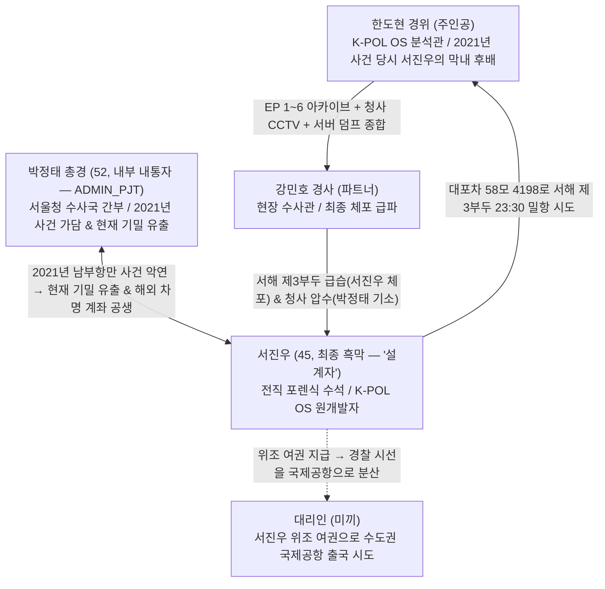

# 에피소드 7 (최종장) 완전 상세 설계서: 코드네임 '설계자' 검거 작전

> **문서 목적**: EP 1~6에서 수집한 **6개의 휘발성 연결 단서와 전체 사건 아카이브**를 총동원하여, 전직 사수 **서진우('설계자')의 위장 도주 트릭을 간파**하고 **경찰 내부 내통자 박정태 총경(`ADMIN_PJT`)을 동시 기소**하는 최종장 EP 7의 완전 상세 명세서입니다. *(날짜·시간선·초기 문서 원문·액션 트리·오답 피드백·플롯 홀 검증 완료 / 실존 상표명 0%)*

---

## 1. 사건 기본 설정 및 핵심 테마

* **사건 번호**: `CASE-2026-FINAL` (연쇄 증거 조작 교사, 공무상 비밀 누설, 범죄단체 조직)
* **개막 일시**: **2026년 12월 29일 `00:00`** (EP 6 종결 3일 뒤, 박정태 총경의 전담팀 해체 통보 직후 비밀 긴급 수사 돌입)
* **사건의 깊이 (5년 전 진실과 최종 클라이맥스)**: **"기록을 조작하는 자를, 그가 직접 만든 시스템(`K-POL OS`)의 기록으로 심판하다"**
  * 5년 전 **`2021년 남부항만 비자금 수사 증거 조작 사건`** 당시, 디지털포렌식센터 수석 서진우는 유력 세력의 비자금 서버를 복원했다가 박정태 총경과 민간 감정사 나기철(EP 3 공범)의 조작에 휘말려 누명을 쓰고 파면됨. 당시 막내 분석관이었던 주인공 한도현은 서진우를 지키지 못한 죄책감을 안고 내근 전담팀에 남았음.
  * 2026.12.29 `00:00` 성수동 은신처를 급습했으나 박정태 총경의 사전 경고를 받은 서진우는 1시간 전 이미 도주. 다만 서진우가 탈 **정기 야간 밀항 화물선의 출항 시각이 당일 밤 `23:30`**(정확히 23시간 30분 뒤)이므로, 서진우 역시 부두 인근에 숨어 출항을 기다리는 상황.
* **시간 규칙 (연장 수사 허용)**:
  * **밀항선 출항 전 긴급 체포 시한**: **24시간 (1,440분 — 당일 `23:30` 출항 기준)** — 시한 내 해결 및 `완전 휘발성 단서` 5~6개 확보 시 **진엔딩** 달성.

---

## 2. 등장인물 상세 프로필 및 최종 인물 관계도

### 2.1. 최종 인물 관계도

### 2.2. 핵심 대치 인물 요약
| 인물 | 역할 | 최종장 행동 및 심리 |
| :--- | :--- | :--- |
| **서진우 (45)** | 최종 흑막 ('설계자') | 은신처(성수 구 데이터센터)에 `LOG_WIPE_FINAL` 소각 스크립트를 걸고 도주. 국제공항에 대리인을 보내 시간을 벌면서, 대포차 `58모 4198`을 타고 **서해 제3부두 4번 선석**에서 당일 밤 `23:30` 밀항 예정. |
| **박정태 총경 (52)** | 내부 내통자 (`ADMIN_PJT`) | EP 5 순찰표 유출과 EP 6 신변보호 직권 해제가 발각될 위기에 처하자, 전담팀 해체 명령을 내리며 *"내 `K-POL OS` 계정이 외부 해킹당했다"*고 발뺌할 알리바이를 준비 중. |

---

## 3. EP 1~6 아카이브 단서(#1~#6)의 최종장 회수 매트릭스

EP 7 시작 시 `K-POL OS` 파일 탐색기에 **`[EP 1~6 통합 아카이브]`**가 열리며, 이전 에피소드의 6개 단서가 아래처럼 최종 퍼즐에 맞물립니다.

| 이전 에피소드 | 확보 단서 | EP 7에서의 결정적 역할 |
| :--- | :--- | :--- |
| **EP 1** | `LOG_WIPE_v4` 원본 IP (`211.XX.104.88`) & 계좌 끝자리(`-9912`) | 성수 구 데이터센터 서버 IP와 100% 일치 확인 + 송금 계좌 연결 |
| **EP 2** | 대포통장 전문(`302-XXXX-9912`) & 성수동 구 공단 기지국 | 서버 덤프의 마지막 송금처(**`서해 제3부두 선박 수리소` 8,000만 원 이체**) 추적 열쇠 |
| **EP 3** | 회색 승합차(`58모 4192`) & 나기철 2021년 감식 조작 기록 | 대포차 시리즈 추적 + `2021년 남부항만 사건` 박정태 총경 연루 배경 입증 |
| **EP 4** | 익명 메일 원본 헤더 개발자 서명(`SJW_KDFC_09`) | 서진우가 모든 사건의 직접 설계자임을 법적으로 입증하는 디지털 지문 |
| **EP 5** | 대포차(`58모 4195`) & `K-POL OS` 수사국 간부실 출력 로그 | 대포차 마지막 번호 **`58모 4198`** 예측 단서 + 박정태 총경 내부 유출 1차 물증 |
| **EP 6** | 신변보호 직권 해제 계정(`ADMIN_PJT`) 원본 결재 로그 | 청사 복도 CCTV와 결합해 박정태 총경의 '계정 도용' 변명 완전 분쇄 |

---

## 4. 초기 지급 문서 원문 (실제 게임 UI 텍스트)

### ① `EV_EP7_DOC_DISBAND` (서울청 수사국 긴급 인사 통보서 — 박정태 총경 결재)
> **[발신]** 서울청 수사국장 직무대리 박정태 총경  
> **[내용]** 미제·재수사 전담팀은 `2026.12.30 00:00`부로 해체하며, 한도현 경위 및 강민호 경사는 모든 사건 파일과 `K-POL OS` 접근 권한을 즉시 반납할 것. 최근 발생한 `ADMIN_PJT` 계정 불법 접속 건은 외부 해커의 도용으로 확인되어 본청 감찰실에 이관 완료함.

### ② `EV_EP7_DOC_AIRPORT_TIP` (출입국 긴급 조회 기록 — **서진우가 흘린 미끼!**)
> **[조회 결과]** 서진우(45)의 위조 여권(가명: 김진수)으로 **2026.12.29 `22:00` 수도권 국제공항발 동남아행 편도 항공권** 예약 확인됨. `20:30` 출국 수속 예정.

### ③ `EV_EP7_DOC_RAID_INIT` (성수 구 데이터센터 1차 급습 보고서 — 강민호 경사)
> *"경위님, `00:00`에 성수동 은신처 들이닥쳤는데 한 발 늦었습니다. 1시간 전에 이미 떴고, 서버에 `LOG_WIPE_FINAL` 자동 삭제가 돌고 있어서 전원부터 뽑았습니다. 정밀 덤프 뜨려면 제가 다시 들어가서 장비 떼와야 합니다. 공항으로 바로 뛸까요, 아니면 데이터센터랑 청사부터 털까요?"*

### ④ `EV_EP7_PHOTO_INIT_SERVER` (성수 구 데이터센터 1차 급습 사진 — 초동 확보분)
* 전원이 급히 뽑힌 메인 서버 랙, 바닥에 흩어진 케이블, 그리고 책상 위에 주인공 한도현을 향해 보란 듯이 놓여 있던 **`2021년 남부항만 비자금 사건` 서류 폴더** 사진.

---

## 5. 2D 지도 노드 6곳의 상세 의미 및 이동 시간 매트릭스

초기에는 5개 노드만 표시되며, **서해안 톨게이트 CCTV에서 대포차 `58모 4198`을 해독하고 서버 덤프 송금처를 교차 검증하면 최종 결전지 6번째 노드(`NODE_WEST_PORT`)가 해금**됩니다.

| 노드 ID | 장소명 | 사건 내 의미 및 역할 | 조사를 통해 밝혀낼 수 있는 것 |
| :--- | :--- | :--- | :--- |
| `NODE_STATION` | **경찰서 (시작 지점)** | 비밀 수사 본부 및 **박정태 총경 해외 차명 계좌·체포 영장** 발부 거점. | 박정태 총경의 해외 차명 계좌 수뢰 내역 확보 및 최종 체포 영장 준비. |
| `NODE_SERVER_BASE` | **성수 구 데이터센터 (은신처)** | 서진우의 아지트. | **서버 덤프 로그**(`302-XXXX-9912` → `서해 제3부두 선박 수리소` 8,000만 원 송금!) + **서진우 마지막 통화 녹음**(오디오 파형용) + **`2021년 남부항만 사건` 원본 장부**. |
| `NODE_HQ_CCTV` | **서울청 보안관제실** | 박정태 총경의 '계정 도용' 변명을 깰 핵심 장소. | **서울청 4층 복도 CCTV 4컷** — `12.17 21:00`과 `12.26 19:30`에 박정태 본인이 간부실에 출입해 USB를 챙겨 나오는 장면 확보! |
| `NODE_TOLL_GATE` | **서해안 톨게이트 관제소** | 대포차 도주 경로 추적 거점. | 새벽 하이패스 CCTV 4컷 — 명암 보정으로 **`58모 4198` 회색 대형 승합차** 및 서진우 실루엣 포착 → **`서해 제3부두` 노드 해금!** |
| `NODE_AIRPORT` | **수도권 국제공항** *(강력한 미끼!)* | 서진우가 일부러 흘린 위조 여권 출국지. | 급파 시 **`[미끼 적발 보고서]`**: *"체포했는데 서진우가 아니라 돈 받고 위조 여권으로 수속 밟던 대리인입니다! 완전히 속았습니다!"* → 시간 소모 후 공항 단서 기각. |
| `NODE_WEST_PORT` | **서해 제3부두 (4번 선석)** *(해금 노드)* | 서진우의 실제 밀항 출항지(최종 체포 거점). | 밀항선 출항 명부(`23:30` 출항) 및 대포차 `58모 4198` 주차 위치 최종 확인! |

### 노드 간 확정 이동 시간표 (단위: 분, 대칭)
| 출발 \ 도착 | 경찰서 | 성수 데이터센터 | 서울청 관제실 | 서해안 톨게이트 | 국제공항 | 서해 제3부두 |
| :--- | :---: | :---: | :---: | :---: | :---: | :---: |
| **경찰서** | 0 | 25 | 15 | 40 | 55 | 60 |
| **성수 데이터센터** | 25 | 0 | 25 | 45 | 65 | 65 |
| **서울청 관제실** | 15 | 25 | 0 | 40 | 50 | 60 |
| **서해안 톨게이트** | 40 | 45 | 40 | 0 | 45 | 25 |
| **국제공항** | 55 | 65 | 50 | 45 | 0 | 50 |
| **서해 제3부두** | 60 | 65 | 60 | 25 | 50 | 0 |

---

## 6. 포렌식 툴킷 & 현장 지시 액션 트리 및 시간 밸런스 검증

### 6.1. 포렌식 핵심 분석 3종
1. **서울청 4층 복도 CCTV 4컷 (`ACT_EP7_HQ_CCTV`)**: `12.17 20:58` & `12.26 19:28` 박정태 총경 본인이 간부실에 단독 출입해 출력물/USB를 안주머니에 넣는 모습 `2.0x` 확대 캡처 (`EV_EP7_CAP_PJT_CCTV`).
2. **서해안 톨게이트 CCTV 4컷 (`ACT_EP7_TOLL`)**: 명암 보정 + `2.5x` 확대 캡처 → 대포차 **`58모 4198`** 및 서진우 실루엣 확인 (`EV_EP7_CAP_VAN_4198`).
3. **은신처 통화 녹음 오디오 파형 (`ACT_EP7_SERVER`)**: 저주파 해풍·뱃고동 노이즈 컷 조절 시 → *"공항 쪽 미끼는 던져놨어. **23시 30분, 4번 선석**으로 `4198` 몰고 바로 들어갈 테니 시동 걸어둬."* (`EV_EP7_AUDIO_PORT`).

### 6.2. 현장 지시 액션 트리
| 액션 ID | 위치 노드 | 지시 내용 | 작업 시간 | 획득 증거 및 결과 |
| :--- | :--- | :--- | :---: | :--- |
| `ACT_EP7_SERVER` | 성수 데이터센터 | 메인 서버 덤프 추출, 통화 백업 오디오 및 2021년 장부 압수 | 90분 | **`EV_EP7_DOC_SERVER_DUMP`** (`302-XXXX-9912` → `서해 제3부두 선박 수리소` 8,000만 원 송금), **`EV_EP7_AUDIO_PORT`** (밀항 통화 12초), **`EV_EP7_DOC_2021_TRUTH`** (`2021년 남부항만 비자금 사건` 원본 조작 증거 및 한도현에게 남긴 서진우의 메모). |
| `ACT_EP7_HQ_CCTV` | 서울청 관제실 | 4층 수사국 간부실 복도 CCTV(`12.17` / `12.26`) 백업 확보 | 60분 | **`EV_EP7_CCTV_HQ`** (박정태 총경 직접 출입 및 USB 반출 4컷 — '계정 도용' 변명 완전 붕괴!). |
| `ACT_EP7_TOLL` | 서해안 톨게이트 | 새벽 하이패스 CCTV 확보 및 대포차 이동 경로 추적 | 60분 | **`EV_EP7_CCTV_TOLL`** (`58모 4198` 포착 → **`서해 제3부두` 노드 해금!**). |
| `ACT_EP7_AIRPORT` | 국제공항 *(미끼)* | 위조 여권 출국자 긴급 체포 급파 | 90분 | **`[미끼 적발 보고서]`** (가짜 대리인만 검거 — 시간 160분 손실 후 공항 단서 기각). |
| `ACT_EP7_PORT` | 서해 제3부두 *(해금)* | 4번 선석 출항 명부 확인 및 대포차 `58모 4198` 위치 파악 | 90분 | **`EV_EP7_DOC_SHIP_LOG`** (`23:30` 출항 화물선 확인 및 선석 인근 대포차 주차 확인). |
| `ACT_EP7_WARRANT` | 경찰서 | 박정태 총경 해외 차명 계좌 조회 및 최종 동시 체포 영장 발부 | 90분 | **`EV_EP7_DOC_PJT_ACCOUNT`** (서진우 측으로부터 송금된 해외 차명 계좌 수뢰 내역 확인). |

### 6.3. 수학적 시간 밸런스 검증 (체포 시한: 24시간 = 1,440분)
* **최적 동선 (필수 5개 액션 — 국제공항 미끼 생략)**: `서울청(90) → 성수(130) → 톨게이트(120) → 제3부두(130) → 경찰서(165)` = **635분 (10시간 35분)**.
* **국제공항 미끼에 속은 동선**: 공항 출동 및 왕복 포함 약 **900~1,050분 (15~17시간 30분)** → 여전히 24시간 내 반전 검거 가능.

---

## 7. 최종 작전서 정답 로직, 오답 피드백 및 3종 엔딩 분기

| 최종 작전서 항목 | 정답 값 / 숨겨진 증거 ID | 오답 시 파트너 피드백 |
| :--- | :--- | :--- |
| **1. 최종 체포 급파지 & 시각** | **`서해 제3부두 4번 선석` / `23:30`** (`EV_EP7_CAP_VAN_4198` + `EV_EP7_AUDIO_PORT`) | (국제공항 선택 시) *"공항은 위조 여권 미끼입니다! 서버 덤프 송금처와 대포차 `58모 4198` 이동 경로를 다시 확인해 보시죠!"* |
| **2. '설계자' 서진우 연쇄 조작 입증** | **`EV_META_EP04_SIGNATURE` (`SJW_KDFC_09`)** + **`EV_EP7_DOC_SERVER_DUMP`** | *"서진우가 지금까지의 사건들을 직접 설계했다는 디지털 서명과 서버 자금 기록을 연결해야 합니다."* |
| **3. 경찰 내부 내통자 지목** | **박정태 총경 (`ADMIN_PJT`)** | *"EP 5 순찰표 출력 부서와 EP 6 신변보호 해제 계정이 누구인지 아카이브를 다시 확인해 보십시오."* |
| **4. 내통자 '계정 도용' 변명 반박** | **`EV_EP7_CAP_PJT_CCTV`** + **`EV_EP7_DOC_PJT_ACCOUNT`** (또는 `EV_META_EP06_PJT`) | *"박 총경이 해킹당했다고 발뺌할 겁니다. 본인이 직접 간부실에 들어간 청사 CCTV와 수뢰 증거가 필요합니다."* |

### 최종 엔딩 3종 상세 분기 및 최종 체포 보고 메시지
1. **진엔딩 — 완벽 기소 (`EP 1~6 완전 휘발성 단서` 5~6개 확보 + 24시간 내 해결)**
   > `[최종 현장 체포 보고]` `2026.12.29 {클리어 시각}경, 서해 제3부두 4번 선석 밀항선 승선 직전의 피의자 서진우(45)와 서울청 수사국장실의 박정태 총경(52)을 연쇄 증거 조작 교사 및 공무상 비밀 누설 혐의로 동시 긴급 체포함.`  
   * **결말**: 2021년 남부항만 사건의 진실이 밝혀지며 서진우·박정태 총경·지하 증거 세탁망까지 완전히 일망타진. 전담팀은 정식 독립 수사국으로 승격.
2. **일반 엔딩 — 부분 검거 (`완전 휘발성 단서` 2~4개 확보)**
   > `[최종 현장 체포 보고]` `2026.12.29 {클리어 시각}경, 서해 제3부두 4번 선석에서 밀항을 시도하던 피의자 서진우(45)를 긴급 체포함. (단, 내부 감사 로그 일부 손상으로 박정태 총경은 계정 도용 피해자로 분류되어 불기소·사표 수리 처리)`  
   * **결말**: 서진우 본인은 검거했으나 내부 내통자 꼬리 자르기 성공. *(이전 에피소드 재플레이로 휘발성 단서 보완 후 EP 7 재도전 가능)*
3. **미완 엔딩 — 도주 허용 (`완전 휘발성 단서` 0~1개 확보)**
   > `[최종 현장 보고]` `2026.12.29 {클리어 시각}경, 수도권 국제공항에서 위조 여권 대리인을 검거했으나 주범 서진우(45)는 서해 제3부두를 통해 해외로 도주함.`  
   * **결말**: 엔딩 직전 `K-POL OS` 메신저에 서진우의 마지막 메시지(*"조금 늦었군, 한 경위. 다음 판에서 보자."*)가 도착하며 재도전 안내.

### 플롯 홀 최종 점검표 (자체 검수 완료)
* [x] **이미 1시간 전 도주한 서진우가 왜 23:30까지 밀항하지 않았는가?** → `2026.12.29 00:00` 급습 직후 도주했으나, 정기 야간 밀항 화물선 출항 시각이 당일 `23:30`(23시간 30분 뒤)이라 부두 인근에 숨어 대기해야 하는 현실적 시간선.
* [x] **EP 1~6에서 휘발성 단서를 일부 놓쳐도 EP 7 클리어가 가능한가?** → EP 7 은신처 서버 덤프와 청사 CCTV만으로 서진우 체포 자체는 가능하며, EP 1~6 완전 단서 개수가 진엔딩(박정태 동시 기소) 분기를 결정하는 공정한 구조.
