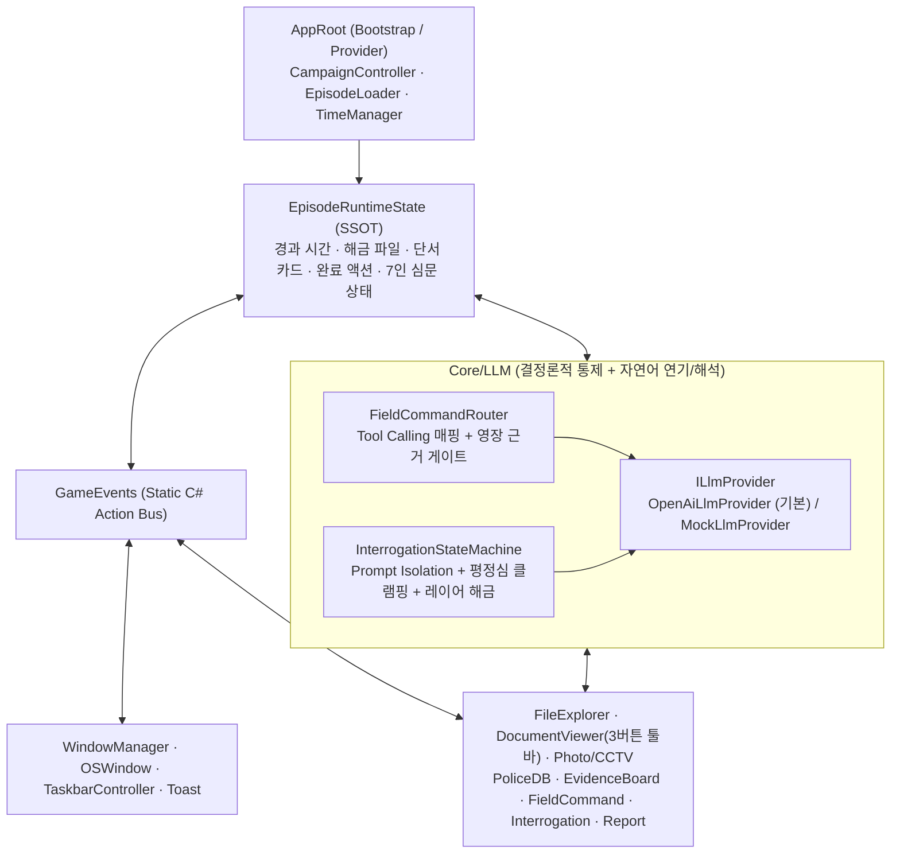

# Unity (C#) 기술 아키텍처 및 전체 클래스 설계서 (12_UNITY_ARCHITECTURE_SPEC)

> **문서 목적**: `ColdCaseOS`의 실제 Unity 프로젝트 구조(`Assets/Scripts/`, `Assets/Data/`)를 기준으로, **기존 구현 완료 모듈**과 **신규 추가할 LLM 현장 지휘·사건 관련자 전원 심문 모듈**의 아키텍처, 데이터 스키마, 핵심 알고리즘(Prompt Isolation·Tool Calling), 그리고 구현 로드맵을 정의합니다.

---

## 1. 개발 환경 및 실제 Unity 프로젝트 구조

* **엔진**: Unity 6 LTS / 2022.3 LTS — **2D (URP)**
* **핵심 패키지**: `TextMeshPro (TMP)`, `Newtonsoft Json`, `UniTask (Cysharp.Threading.Tasks)`, `DOTween`, `UnityEngine.Video (VideoPlayer)`, `UnityEngine.Networking (UnityWebRequest)`
* **기준 해상도**: `1920 × 1080` (`CanvasScaler`: Scale With Screen Size, Match = `0.5`)

### 실제 폴더 및 스크립트 트리 (`Assets/`)
*(기존 `[구현됨]`과 이번 개편으로 추가할 `[신규]`/`[확장]`을 명시합니다.)*

```text
Assets/
├── Data/Episodes/EP01~EP07/           # epXX.json, 현장 사진, CCTV 클립
├── Scripts/
│   ├── Core/
│   │   ├── Provider/                  # [구현됨] AppRoot, GameEvents [확장]
│   │   ├── Campaign/                  # [구현됨] CampaignController, SaveManager
│   │   ├── Episode/                   # [구현됨] EpisodeLoader, EpisodeRuntimeState [확장], TimeManager [확장]
│   │   ├── Audio/                     # [구현됨] AudioController
│   │   ├── Tutorial/                  # [구현됨] TutorialController [확장]
│   │   └── LLM/                       # [신규] ILlmProvider, LlmProviderConfig, OpenAiLlmProvider,
│   │                                  #        MockLlmProvider, FieldCommandRouter, InterrogationStateMachine
│   ├── Data/
│   │   ├── Episode/                   # [구현됨] EpisodeData [확장], MapAndActionData [확장], MediaData
│   │   │                              # [신규] InterrogationData (InterrogationProfileData, SecretLayerRule)
│   │   └── Runtime/                   # [구현됨] CampaignSaveData, UserClueCard [확장]
│   │                                  # [신규] InterrogationRuntimeState, FieldCommandMessageData
│   ├── OS/
│   │   ├── Window/                    # [구현됨] WindowManager, OSWindow, WindowHeader
│   │   ├── Taskbar/                   # [구현됨] TaskbarController [확장: 6개 앱 + 남은 시한 HUD]
│   │   └── Notification/              # [구현됨] NotificationToastManager
│   ├── Apps/
│   │   ├── FileExplorer/              # [구현됨] FileExplorerController
│   │   ├── FileViewer/
│   │   │   ├── Document/              # [구현됨] DocumentViewer, TextDragSelector, FloatingClueToolbar [확장: 3버튼]
│   │   │   └── Photo/                 # [구현됨] PhotoInspectorController
│   │   ├── Forensic/
│   │   │   ├── Capture/               # [구현됨] CaptureRectValidator
│   │   │   └── Cctv/                  # [구현됨] CctvVideoController
│   │   ├── PoliceDB/                  # [구현됨] PoliceDatabaseController [확장: 외부 텍스트 검색 API]
│   │   ├── EvidenceBoard/             # [구현됨] EvidenceBoardController, ClueCardView, PinWireRenderer,
│   │   │                              #          StickyNoteView, TrashBinPanel
│   │   ├── FieldCommand/              # [신규] FieldCommandController, ActionConfirmCardView, HintService
│   │   ├── Interrogation/             # [신규] InterrogationController, SuspectRosterItemView,
│   │   │                              #        InterrogationBubbleView, EvidenceAttachSlotView
│   │   └── Report/                    # [구현됨] ReportValidator, ResultSettlementView
│   ├── UI/                            # [구현됨] TitleScreenController, CaseCabinetController, SettingsModal
│   └── Editor/                        # [구현됨] MainSceneSetupTool [확장], SceneCleanupTool
```

---

## 2. 전체 시스템 아키텍처 (SSOT + Event Bus + LLM Layer)



---

## 3. 클래스 책임 카탈로그 (기존 구현 + 신규 추가)

### 3.1. 코어 및 LLM 제어 레이어 (`Scripts/Core/`)
| 영역 | 클래스명 | 상태 | 단일 책임 (SRP) |
| :--- | :--- | :---: | :--- |
| **부트/상태** | `AppRoot` | 구현됨 | 씬 전역 코어 인스턴스(`Campaign`, `RuntimeState`, `Time`, `Windows`, `Llm`) 제공 |
| | `EpisodeLoader` | 구현됨 | `epXX.json` 역직렬화, 텍스트 태그 인덱스 계산, 미디어 비동기 로드 |
| | `EpisodeRuntimeState` | **확장** | SSOT. 기존 필드 + `Dictionary<string, InterrogationRuntimeState>`, `List<FieldCommandMessageData>` 추가 및 스냅샷 저장/복원 |
| | `TimeManager` | **확장** | 행동 기반 시간 차감(`AdvanceMinutes`), 신뢰도 보정, 휘발성(`720분`)·송치(`960분`) 초과 이벤트 발행 (강민호 알림 호칭 `"팀장님"` 통일) |
| | `GameEvents` | **확장** | 앱 간 이벤트 버스. `OnFieldCommandRequest(string quote)`, `OnDbQuickSearchRequested(string query)`, `OnInterrogationLayerUnlocked(string suspectId, string layerId)` 추가 |
| | `CampaignController` / `SaveManager` | 구현됨 | 신뢰도 `Lv 0~5`, 휘발성 단서 누적, `save_data.json` 자동 저장(4대 시점) |
| | `AudioController` / `TutorialController` | **확장** | BGM 4트랙(`BGM_INTERROGATION` 추가)·SFX 15종 / 4단계 현장반·심문 튜토리얼 |
| **LLM 코어** | `ILlmProvider` | **신규** | `UniTask<string> CompleteJsonAsync(LlmChatRequest req, CancellationToken ct)` 추상 인터페이스 |
| | `LlmProviderConfig` | **신규** | 제공자 선택(`Gemini`/`OpenAI`/`Claude`/`Mock`), 모델명, 타임아웃, 로컬 설정/환경변수에서 API 키 로드(Git 제외) |
| | `OpenAiLlmProvider` | **신규** | OpenAI Chat Completions API (`UnityWebRequest` + Structured Outputs `json_schema`) 호출 및 오류 핸들링 |
| | `MockLlmProvider` | **신규** | API 키 미설정/오프라인 테스트용 결정론적 키워드 매칭·레이어 응답 시뮬레이터 |
| | `FieldCommandRouter` | **신규** | 미완료 `FieldActionData`만 LLM 프롬프트에 노출 → 반환된 `matchedActionIds`에 대해 `requiredEvidenceIds` 선행 검증 → 확정 시 시간 차감 및 보상 해금 |
| | `InterrogationStateMachine` | **신규** | 첨부 카드의 `hiddenEvidenceId` 대조 → 조건 충족 레이어 해금 → `immutableTimeline` + `unlockedLayers`만으로 시스템 프롬프트 조립(Prompt Isolation) → `composureDelta` 클램핑 |

### 3.2. OS 앱 6종 + 뷰어 (`Scripts/Apps/`)
| 앱 영역 | 클래스명 | 상태 | 단일 책임 (SRP) |
| :--- | :--- | :---: | :--- |
| **파일 탐색기** | `FileExplorerController` | 구현됨 | 해금된 문서·사진·CCTV 목록, 카테고리 필터, `NEW` 뱃지 표시 |
| **문서/포렌식** | `DocumentViewer`, `TextDragSelector` | 구현됨 | 문서 열람 및 `TMP_TextUtilities` 기반 120자 제한 드래그·60% 겹침 판별 |
| | `FloatingClueToolbar` | **확장** | 3버튼 팝업: `[+ 증거판 등록]`, `[K-POL DB 조회]`, `[현장반에 확인 지시]` |
| | `PhotoInspectorController`, `CctvVideoController`, `CaptureRectValidator` | 구현됨 | `2.0x~4.0x` 확대·명암 보정·2중 검증(85% 포함 + 15% 면적) 영역 캡처 |
| **경찰 DB** | `PoliceDatabaseController` | **확장** | 정규화 키워드 검색 + 외부 툴바에서 넘어온 텍스트 즉시 검색(`SearchImmediate(string query)`) |
| **증거판** | `EvidenceBoardController`, `ClueCardView`, `PinWireRenderer`, `StickyNoteView`, `TrashBinPanel` | 구현됨 | 카드 배치·핀-실 연결·메모·포스트잇·기각/복구. `InterrogationStatement` 타입 카드 표시 지원 |
| **현장수사반** | `FieldCommandController` | **신규** | `OSWindow` 상속. 채팅 로그, 자연어 입력, 증거 카드 첨부, 동적 추천 칩(3개), `[지시 확정: OO분]` 카드, 대기 연출 |
| | `ActionConfirmCardView` | **신규** | 매핑된 액션명·예상 소요 시간 표시 및 `[확정]`/`[취소]` 버튼 |
| | `HintService` | **신규** | `[강민호 경사에게 의견 묻기]` — 미확보 필수 단서 감지 후 0분 1단계/2단계 힌트 반환 |
| **전원 심문** | `InterrogationController` | **신규** | `OSWindow` 상속. 관련자 전원 목록, 소환(`-45분/8턴`), 표정 연동 초상화, 평정심 게이지, 증거 첨부(최대 2장), 발췌 등록 |
| | `SuspectRosterItemView` | **신규** | 관련자 이름·역할·소환 횟수·잠금 사유(의식불명 등) 표시 |
| | `InterrogationBubbleView` | **신규** | 대화 말풍선 + 레이어 해금 시 `[+ 증거판 등록]` 버튼 노출 |
| | `EvidenceAttachSlotView` | **신규** | 증거판 활성 카드 목록에서 현장반/심문 창에 첨부할 카드 선택 UI(공용) |
| **최종 보고서** | `ReportValidator`, `ResultSettlementView` | 구현됨 | 4슬롯 `hiddenEvidenceId` 검증, 3단계 동적 체포 보고서, 신뢰도·휘발성 정산 |

---

## 4. 공용 데이터 스키마 확장 (`Assets/Scripts/Data/`)

### 4.1. `EpisodeData.cs` 및 `MapAndActionData.cs` 확장 필드
```csharp
// EpisodeData.cs 추가 필드
[JsonProperty("interrogationSessionMinutes")] public int interrogationSessionMinutes = 45;
[JsonProperty("interrogationTurnsPerSession")] public int interrogationTurnsPerSession = 8;
[JsonProperty("interrogationProfiles")] public List<InterrogationProfileData> interrogationProfiles = new List<InterrogationProfileData>();

// FieldActionData (MapAndActionData.cs) 추가 필드
[JsonProperty("matchDescription")] public string matchDescription;           // LLM Tool Calling 매칭용 의도 설명
[JsonProperty("requiredEvidenceIds")] public List<string> requiredEvidenceIds; // 영장 등 필수 선행 증거 ID
[JsonProperty("rejectFeedback")] public string rejectFeedback;               // 근거 미충족 시 강민호 거절 대사
[JsonProperty("isRecommendedChip")] public bool isRecommendedChip;           // 추천 칩 노출 후보 여부
```

### 4.2. 신규 `InterrogationData.cs` (전원 심문 및 Prompt Isolation DTO)
```csharp
[Serializable]
public class InterrogationProfileData
{
    [JsonProperty("suspectId")] public string suspectId;
    [JsonProperty("displayName")] public string displayName;
    [JsonProperty("age")] public int age;
    [JsonProperty("roleLabel")] public string roleLabel;
    [JsonProperty("isInterrogatable")] public bool isInterrogatable = true;
    [JsonProperty("unavailableReason")] public string unavailableReason;
    [JsonProperty("portraitBaseKey")] public string portraitBaseKey;
    [JsonProperty("initialComposure")] public int initialComposure = 75;
    [JsonProperty("victimCallName")] public string victimCallName;
    [JsonProperty("personaPrompt")] public string personaPrompt;
    [JsonProperty("immutableTimeline")] public List<string> immutableTimeline = new List<string>();
    [JsonProperty("layers")] public List<SecretLayerRule> layers = new List<SecretLayerRule>();
}

[Serializable]
public class SecretLayerRule
{
    [JsonProperty("layerId")] public string layerId;
    [JsonProperty("isInitial")] public bool isInitial;
    [JsonProperty("requiredEvidenceIds")] public List<string> requiredEvidenceIds = new List<string>();
    [JsonProperty("requireAllEvidence")] public bool requireAllEvidence; // false=OR, true=AND
    [JsonProperty("requiredPriorLayers")] public List<string> requiredPriorLayers = new List<string>();
    [JsonProperty("minUnlockedPriorCount")] public int minUnlockedPriorCount;
    [JsonProperty("maxComposureRequired")] public int maxComposureRequired = 100;
    [JsonProperty("composurePenaltyOnUnlock")] public int composurePenaltyOnUnlock;
    [JsonProperty("promptDirective")] public string promptDirective;
    [JsonProperty("rewardEvidenceId")] public string rewardEvidenceId;
    [JsonProperty("rewardDocId")] public string rewardDocId;
}
```

### 4.3. `UserClueCard.cs` 확장
* `ClueSourceType` 열거형에 **`InterrogationStatement`** 추가.

---

## 5. 핵심 알고리즘 정밀 규격

1. **Prompt Isolation & 심문 턴 판정 (`InterrogationStateMachine`)**:
   * **Step A (C# 선행 레이어 판정)**: 첨부된 카드의 `hiddenEvidenceId` + 플레이어 보유 카드 목록을 각 미해금 `SecretLayerRule`과 대조. 조건(`requiredEvidenceIds`, `requiredPriorLayers`, `minUnlockedPriorCount`, `composure <= maxComposureRequired`) 충족 시 즉시 레이어 해금 + `composure -= composurePenaltyOnUnlock` + `rewardDocId` 자동 해금.
   * **Step B (프롬프트 조립)**: 시스템 프롬프트에는 오직 `personaPrompt`, `victimCallName`, `immutableTimeline`, 그리고 **`unlockedLayers`에 속한 `promptDirective`만** 포함. 잠긴 레이어 문자열은 메모리에서 읽지도 않음.
   * **Step C (평정심 클램핑)**:
     * 이번 턴에 레이어가 해금됨 → 고정 차감 적용.
     * 무관한 증거 카드 첨부 → `composure = Clamp(composure + 10, 0, 100)`.
     * 증거 미첨부 일반 추궁 → LLM 반환 `composureDelta`를 `Clamp(delta, -10, 0)`으로 강제 제한.
2. **현장수사반 Tool Calling 게이트 (`FieldCommandRouter`)**:
   * LLM에 전달하는 액션 목록은 `!state.IsActionCompleted(act.actionId)`인 미완료 액션으로 제한.
   * LLM이 반환한 `matchedActionIds` 중 존재하지 않는 ID는 폐기(환각 차단).
   * `requiredEvidenceIds` 미충족 시 `rejectFeedback`을 반환하고 시간 소모 `0분` 처리.
   * 통과된 액션만 `ActionConfirmCardView`로 전달해 플레이어가 확정 클릭 시 `TimeManager.AdvanceMinutes()` 실행.
3. **기존 유지 알고리즘**:
   * `TextDragSelector`: 최대 120자 제한, 60% 겹침 판별.
   * `CaptureRectValidator`: `>= 2.0x` 줌, Hitbox 85% 포함 + 15% 면적 판별.
   * `TimeManager`: `work = Max(15, baseWorkMinutes + TrustWorkMod)`, 휘발성(`720분`)·송치(`960분`) 이벤트 발행.

---

## 6. 구현 마일스톤 (EP 1 LLM 개편 기준)

| 단계 | 목표 | 핵심 산출물 |
| :---: | :--- | :--- |
| **Step 1** | 데이터·DTO 개편 | `InterrogationData.cs`, `EpisodeData`/`MapAndActionData`/`UserClueCard` 확장, `ep01.json` Rev. 2 완성(초기 8종 분리, 로그 5+3종 분할, 7인 알리바이·레이어, 사진/CCTV 히트박스, 시한 `960/720분` 복원) |
| **Step 2** | LLM 코어 & 상태 머신 | `ILlmProvider`, `LlmProviderConfig`, `OpenAiLlmProvider`, `MockLlmProvider`, `FieldCommandRouter`, `InterrogationStateMachine`, `EpisodeRuntimeState` 스냅샷 확장 |
| **Step 3** | OS 앱 2종 & 3버튼 툴바 | `FieldCommandController`, `InterrogationController`, `EvidenceAttachSlotView`, `FloatingClueToolbar` 3버튼 연계, `TaskbarController` 6앱 + 남은 시한 HUD 갱신 |
| **Step 4** | 씬 세팅·튜토리얼·QA | `MainSceneSetupTool` 창 프리팹 자동 배치 갱신, `TutorialController` 4단계 개편, Mock/실제 API 기반 7인 심문 탈옥 내성 및 960분 밸런스 테스트 |
