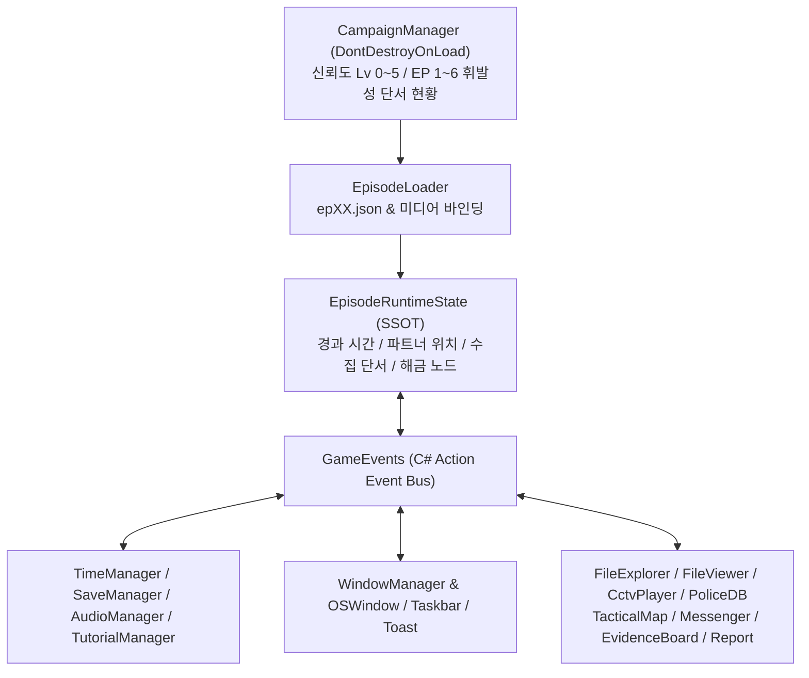

# Unity (C#) 기술 아키텍처 및 전체 클래스 설계서 (12_UNITY_ARCHITECTURE_SPEC)

> **문서 목적**: `ColdCaseOS`의 Unity 구현을 위한 프로젝트 구조, 이벤트 기반 아키텍처, EP 1~7 공용 JSON/C# 데이터 스키마, **3개 씬 및 7개 OS 앱의 누락 없는 전체 클래스 카탈로그(총 39개 클래스)**, 핵심 알고리즘 명세 및 단계별 개발 마일스톤을 정의합니다.

---

## 1. 개발 환경 및 Unity 프로젝트 구조

* **권장 엔진**: Unity 6 LTS (또는 Unity 2022.3 LTS) — **2D (URP)** 템플릿
* **필수 패키지**: `TextMeshPro (TMP)`, `Newtonsoft Json (com.unity.nuget.newtonsoft-json)`, `UnityEngine.Video (VideoPlayer)`
* **기준 해상도**: `1920 × 1080` (`CanvasScaler`: Scale With Screen Size, Match = `0.5`)

### 전체 폴더 및 스크립트 트리 (`Assets/_Project/`)
```text
Assets/_Project/
├── Data/Episodes/EP01~EP07/   # epXX.json, CCTV mp4 클립, 현장 사진 png
├── Scripts/
│   ├── Core/                  # CampaignManager, GameManager, EpisodeLoader, EpisodeRuntimeState,
│   │                          # GameEvents, TimeManager, SaveManager, AudioManager, TutorialManager
│   ├── Data/                  # EpisodeData, DocumentData, CctvClipData, MapData,
│   │                          # UserClueCard, CampaignSaveData (순수 C# DTO)
│   ├── Scenes/                # TitleScreenController, CaseCabinetController
│   ├── OS/                    # WindowManager, OSWindow, WindowDragHandle, TaskbarController,
│   │                          # NotificationToastManager, CaseBriefingModal, SettingsModal
│   └── Apps/
│       ├── FileExplorer/      # FileExplorerController
│       ├── FileViewer/        # DocumentViewer, TextDragSelector, FloatingClueToolbar,
│       │                      # PhotoInspectorController, MetadataViewerController
│       ├── CctvPlayer/        # CctvVideoController, CaptureRectValidator, AudioWaveAnalyzer
│       ├── PoliceDB/          # PoliceDatabaseController
│       ├── TacticalMap/       # CityMapManager, MapNodeView, PartnerAgentView,
│       │                      # ActionOrderPanel, TargetSelectModal, TimeSkipOverlay
│       ├── Messenger/         # MessengerController, HintSystem
│       ├── EvidenceBoard/     # EvidenceBoardController, ClueCardView, PinWireRenderer,
│       │                      # StickyNoteView, TrashBinPanel
│       └── Report/            # ReportValidator, ReportSlotView, ResultSettlementView
├── Shaders/                   # BrightnessContrast.shadergraph, Scanline.shadergraph
├── Prefabs/                   # OS 창, 단서 카드, 포스트잇, 지도 노드, 핀 선 프리팹
├── Art/ & Audio/              # 공통 OS 배경/아이콘, 리소그래프 에셋, BGM 3트랙, SFX 12종
└── Scenes/                    # 00_Title.unity, 01_CaseCabinet.unity, 02_InvestigationOS.unity
```

---

## 2. 전체 시스템 아키텍처 (SSOT + Event Bus)



---

## 3. 전체 클래스 책임 카탈로그 (2차 전수 검증 완료)

### 3.1. 코어 & 씬 (`Scripts/Core/`, `Scripts/Scenes/`)
| 클래스명 | 단일 책임 (SRP) |
| :--- | :--- |
| `CampaignManager` | `DontDestroyOnLoad` 싱글톤. 씬 전환 간 `CampaignSaveData`(신뢰도, EP 1~6 휘발성 단서, 클리어 기록) 유지 및 씬 로드 관리 |
| `GameManager` | `02_InvestigationOS` 씬 진입/초기화 오케스트레이터(`EpisodeLoader` 호출 → 브리핑 표시 → 인게임 루프 시작) |
| `EpisodeLoader` | `StreamingAssets/Episodes/EPxx/epXX.json` 역직렬화 및 현장 사진 `Texture2D`·`VideoPlayer.url` 경로 바인딩 |
| `EpisodeRuntimeState` | 현재 진행 중인 에피소드의 단일 진실 공급원(경과 시간, 파트너 현재 노드, 수집된 `UserClueCard`, 열람 여부, 해금 노드/문서) |
| `GameEvents` | 앱 간 직접 참조를 제거하는 정적 C# `Action` 이벤트 버스 (`OnTimeAdvanced`, `OnClueAdded`, `OnNodeUnlocked`, `OnOvertimeEntered` 등) |
| `TimeManager` | 결정론적 시간 계산(`이동 + 신뢰도 보정 작업 + 보고`), 휘발성 골든 타임/송치 마감 초과 감지 및 이벤트 발행 |
| `SaveManager` | `Application.persistentDataPath/save_data.json` 직렬화. 단서 추출·시간 보내기·에피소드 클리어 시 자동 저장 |
| `AudioManager` | BGM 3트랙(평상시/긴장/정산) 크로스페이드 및 SFX 12종 재생 (`OnOvertimeEntered` 연동) |
| `TutorialManager` | EP 1 초반 4단계 인게임 튜토리얼(대상 UI 외곽선 강조 + 단계 완료 이벤트 감지 + 메신저 안내) |
| `TitleScreenController` | `00_Title` 씬 제어 (`새 수사`, `이어하기`, `설정`, `종료`) |
| `CaseCabinetController` | `01_CaseCabinet` 씬 제어 (EP 1~7 폴더 목록, 신뢰도 표시, 휘발성 단서 뱃지, 재플레이 진입) |

### 3.2. OS 윈도우 인프라 (`Scripts/OS/`)
| 클래스명 | 단일 책임 (SRP) |
| :--- | :--- |
| `WindowManager` | 모든 `OSWindow` 인스턴스 레지스트리, Z-Order 최상단 포커스(`BringToFront`), 활성 창 전환 및 ESC 닫기 처리 |
| `OSWindow` | **모든 앱 창의 기반 클래스**. 상태(`Normal`, `Minimized`, `SnappedLeft`, `SnappedRight`, `Maximized`), 복원용 `savedRect` 기억, 화면 경계 클램핑, 활성/비활성 타이틀바 강조, 생명주기 콜백(`OnFocused`, `OnMinimized`, `OnClosed`) 제공 |
| `WindowDragHandle` | 타이틀바에 부착되어 `IBeginDragHandler`/`IDragHandler` 입력을 부모 `OSWindow` 이동으로 전달 |
| `TaskbarController` | 상단/하단 고정 HUD(남은 시한, 휘발성 타이머, 파트너 위치, 7개 앱 최소화/복원 아이콘, `NEW` 뱃지) |
| `NotificationToastManager` | 새 증거 수신, 신규 지도 노드 해금, 단서 추가 완료, 골든 타임 경고 등 우측 하단 알림 토스트 큐 관리 |
| `CaseBriefingModal` | 사건 시작 시 초동 수사 개요 및 시한 안내 모달 |
| `SettingsModal` | BGM/SFX 볼륨, 화면 모드, 단축키 안내 설정 팝업 |

### 3.3. OS 앱 7종 (`Scripts/Apps/`)
| 영역 | 클래스명 | 단일 책임 (SRP) |
| :--- | :--- | :--- |
| **파일 탐색기** | `FileExplorerController` | 폴더 트리(`[보고서/진술]`, `[현장 사진]`, `[보안/포렌식 로그]`, EP 7 `[EP 1~6 아카이브]`), `NEW` 뱃지 및 해당 뷰어 창 오픈 |
| **문서/사진** | `DocumentViewer` | 스캔 종이/로그 텍스트(`TMP_Text`) 표시 및 메타데이터 뷰어 호출 버튼 |
| | `TextDragSelector` | `TMP_TextUtilities` 기반 마우스 드래그 선택(최대 120자 제한) → 60% 겹침 `HiddenTextTag` 판별 |
| | `FloatingClueToolbar` | 텍스트 드래그 완료 시 커서 옆 팝업(`[+ 증거판에 추가]`) |
| | `PhotoInspectorController` | 정지 현장 사진(`EV_PHOTO_INIT_STORAGE` 등)의 `1.0x~4.0x` 팬/줌 및 영역 캡처(`CaptureRectValidator` 공용 호출) |
| | `MetadataViewerController` | EP 3~6 핵심 포렌식용 파일 속성(`Created_At`, `Modified_At`, `Original_Author`, 메일 헤더) 표시 및 드래그 채택 지원 |
| **CCTV/오디오** | `CctvVideoController` | `UnityEngine.Video.VideoPlayer` + `RenderTexture` 제어, 슬라이더 스크러빙, 버튼·키보드(`Space`, `←/→`), `2.0x~4.0x` 팬/줌, 명암 보정 셰이더 연동 (`OSWindow.OnMinimized` 시 자동 일시정지) |
| | `CaptureRectValidator` | **CCTV·사진 공용 정밀 캡처 검증기**: 전체 캡처 금지(`≥ 2.0x` / 40% 이하) + Hitbox 85% 포함 + 캡처 프레임 내 최소 15% 면적 판별 |
| | `AudioWaveAnalyzer` | EP 2·5·7 오디오 파형 표시, 저주파/고주파 노이즈 컷 슬라이더, 구간 드래그 오디오 단서 채택 |
| **경찰 DB** | `PoliceDatabaseController` | 키워드 정규화 검색(이름/차량번호/계좌/법인) → 결과 표시 + `unlocksNodeId` 존재 시 `CityMapManager.UnlockNode` 호출 |
| **2D 지도** | `CityMapManager` | 파트너 위치 유지, 노드 간 이동 시간 조회, 신규 노드 동적 해금, 지시 실행 오케스트레이션 |
| | `MapNodeView` | 지도 위 개별 장소 핀 UI, 선택 강조, 미완료 액션 뱃지 |
| | `PartnerAgentView` | 2D 지도 위 강민호 경사 현재 위치 아이콘 및 예상 이동 경로 선 표시 |
| | `ActionOrderPanel` | 선택 노드의 지시 목록, 확정 소요 시간(`이동 + 작업 + 보고`) 미리보기 및 실행 버튼 |
| | `TargetSelectModal` | EP 2~5 대상 선택 영장(금융/메일) 시 플레이어가 용의자 중 1명을 직접 지정하는 팝업 |
| | `TimeSkipOverlay` | `조사 완료까지 시간 보내기` 클릭 시 1~2초 시계·지도 이동 연출 오버레이 |
| **메신저** | `MessengerController` | 강민호 경사의 현장 보고(`특이사항 없음` 포함), 골든 타임/연장 수사 경고, 오답 피드백 대화 로그 |
| | `HintSystem` | `[강민호 경사에게 의견 묻기]` — 미확보 필수 단서 자동 감지 후 1단계(방향) → 2단계(구체 지목) 무료 힌트 제공 |
| **증거판** | `EvidenceBoardController` | 단서 카드 배치 캔버스, 핀-실 연결 관리, 폐기함 토글 |
| | `ClueCardView` | 개별 `UserClueCard` UI — 하단 `TMP_InputField` 자유 메모, `[기각(취소선 후 접기)]`, `[폐기함 이동]`, 드래그 이동 |
| | `PinWireRenderer` | 두 `ClueCardView` 상단 핀 사이를 잇는 UI 연결선 렌더링 및 카드 이동 시 실시간 갱신 |
| | `StickyNoteView` | 증거판 빈 공간에 생성·편집·삭제하는 독립 포스트잇 메모 |
| | `TrashBinPanel` | 폐기함으로 이동된 단서 카드 목록 및 원클릭 복구 UI |
| **최종 보고서** | `ReportValidator` | 슬롯별 `hiddenEvidenceId` 대조, `isTooSmallCapture` 우선 안내, 맞춤형 오답 피드백, 정답 시 3단계 체포 보고 선택 |
| | `ReportSlotView` | 증거판에서 `ClueCardView`를 드래그 앤 드롭으로 수용하는 보고서 슬롯 |
| | `ResultSettlementView` | 정산 화면 — 경과 시간 구간별 3단계 동적 체포 보고 메시지, 휘발성 단서 상태, 신뢰도 변동, 다음 사건 버튼 |

---

## 4. 공용 데이터 스키마 (EP 1~7 100% 데이터 드리븐)

### 4.1. 에피소드 정적 데이터 (`EpisodeData.cs`)
```csharp
[Serializable]
public class EpisodeData {
    public string episodeId;                  // "EP01"
    public string caseNumber;                 // "CASE-2026-014"
    public string title;
    public string startDateTimeIso;           // "2026-11-18T09:00:00"
    public int volatileDeadlineMinutes;       // 720 (12h)
    public int submissionDeadlineMinutes;     // 960 (16h)
    public string startNodeId;                // "NODE_STATION"

    public List<DocumentData> documents;
    public List<PhotoData> photos;            // 정지 현장 사진 (Hitbox 포함)
    public List<CctvClipData> cctvClips;      // VideoPlayer mp4 클립 (시간 구간 Hitbox 포함)
    public List<MapNodeData> mapNodes;
    public List<TravelEdgeData> travelEdges;
    public List<FieldActionData> actions;     // targetOptions 포함(대상 선택 영장 지원)
    public List<PoliceDbEntry> dbEntries;
    public ReportAnswerRule answerRule;
    public List<ArrestReportTier> arrestReports; // maxElapsedMinutes별 3단계 체포 메시지
}
```

### 4.2. 텍스트 숨겨진 태그 & CCTV/사진 Hitbox & 단서 카드
```csharp
[Serializable]
public class HiddenTextTag {
    public int startCharIndex;
    public int endCharIndex;
    public string evidenceId;
}

[Serializable]
public class VisualClueHitbox {
    public float startSec;       // 정지 사진은 0 ~ 0 (무시), 영상은 노출 구간(초)
    public float endSec;
    public Rect normalizedRect;  // 0~1 정규화 좌표 (x, y, width, height)
    public string evidenceId;
}

[Serializable]
public class UserClueCard {
    public string cardId;
    public string sourceId;
    public ClueSourceType sourceType; // TextExcerpt, CctvCapture, PhotoCapture, AudioClip, DbRecord
    public string displayTitle;
    public string extractedText;
    public string capturedImagePath;
    public string hiddenEvidenceId;   // "NONE" 또는 정답 ID
    public bool isTooSmallCapture;    // 식별 불가 소형 캡처 여부
    public string userMemo;
    public Vector2 boardPosition;
    public bool isDismissed;          // [기각(취소선 후 접기)]
    public bool isInTrash;            // [폐기함]
    public List<string> connectedCardIds;
}
```

---

## 5. 핵심 알고리즘 정밀 규격

1. **시간 및 신뢰도 보정 (`TimeManager`)**:
   * `totalMinutes = travelMinutes + Max(15, baseWorkMinutes + TrustWorkMod) + Max(5, 15 + TrustReportMod)`
   * `elapsedMinutes > volatileDeadlineMinutes` → `OnVolatileDeadlinePassed` 발행.
   * `elapsedMinutes > submissionDeadlineMinutes` → `isOvertime = true`, `OnOvertimeEntered` 발행 (게임오버 없음).
2. **텍스트 드래그 판별 (`TextDragSelector`)**:
   * 최대 선택 길이 `120자` 제한(통드래그 방지).
   * `overlap / tagLength >= 0.6f` → 해당 `evidenceId` 숨겨진 태그 부여, 미충족 시 `"NONE"`.
3. **CCTV/사진 캡처 2중 검증 (`CaptureRectValidator`)**:
   * 줌 배율 `>= 2.0x` (캡처 영역 원본 40% 이하) 필수.
   * `containedRatio = Area(inter) / Area(hitbox) >= 0.85f` AND `sizeInCapture = Area(inter) / Area(captureRect) >= 0.15f` → 정답 ID 부여.
   * 포함은 되었으나 `sizeInCapture < 0.15f` → `isTooSmallCapture = true` 플래그 저장(보고서 제출 시 *"더 확대해 주세요"* 피드백).

---

## 6. 단계별 개발 마일스톤 (EP 1 MVP 기준)

| 단계 | 목표 | 핵심 산출물 |
| :---: | :--- | :--- |
| **Phase 1** | 데이터·코어·OS 창 기반 | `Scripts/Data/` DTO 전체, `ep01.json` 완성본, `CampaignManager`, `EpisodeRuntimeState`, `GameEvents`, `TimeManager`, `SaveManager`, `WindowManager`, `OSWindow`, `WindowDragHandle` |
| **Phase 2** | 분석·추리 인터랙션 | `FileExplorerController`, `DocumentViewer`, `TextDragSelector`, `FloatingClueToolbar`, `PhotoInspectorController`, `CctvVideoController`, `CaptureRectValidator`, `EvidenceBoardController` + `ClueCardView` + `PinWireRenderer` + `StickyNoteView` + `TrashBinPanel` |
| **Phase 3** | 지도·DB·통신·검증 루프 | `CityMapManager` + `TargetSelectModal`, `PoliceDatabaseController`, `MessengerController` + `HintSystem`, `ReportValidator` + `ResultSettlementView`(3단계 체포) |
| **Phase 4** | 아트·오디오·튜토리얼·QA | `AudioManager`, `TutorialManager`, EP 1 리소그래프 에셋·CCTV mp4 연결, 전체 플레이 테스트 |
